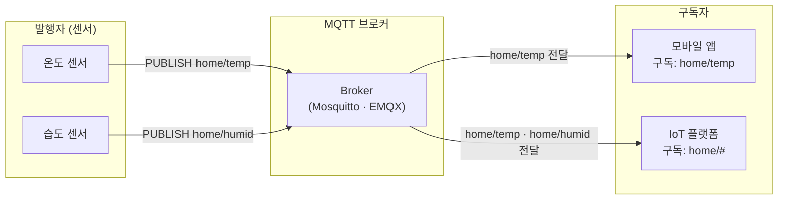

# MQTT (Message Queuing Telemetry Transport)

---

## I. 브로커를 통한 가벼운 발행·구독, MQTT의 개요

### 가. 정의

- 대역이 좁고 불안정한 IoT 환경을 위해 **브로커를 중심으로 토픽 기반 발행·구독(Publish/Subscribe) 메시지를 교환하는 TCP 기반 경량 메시징 [[프로토콜]]** (OASIS 표준, 3.1.1은 ISO/IEC 20922)

### 나. 특징

| 구분 | 내용 |
| --- | --- |
| 경량 | 고정 헤더 최소 2바이트, 단순한 패킷 구조 |
| 느슨한 결합 | 발행자와 구독자가 서로를 모르고 브로커만 알면 됨 ([[결합도]] 감소) |
| 1:N 비동기 | 하나의 발행을 여러 구독자에게 전달 |
| 전달 보장 | [[QoS\|QoS]] 0·1·2 단계 선택 |
| 불안정 망 대응 | Keep Alive, 지속 세션, LWT로 연결 끊김 처리 |

---

## II. 구조 및 구성요소

### 가. 발행·구독 구조

- 발행자가 토픽으로 메시지를 보내면 브로커가 해당 토픽을 구독한 모든 클라이언트에 전달, 클라이언트끼리 직접 연결하지 않음

### 나. 구성요소

| 구분 | 요소 | 설명 |
| --- | --- | --- |
| 구조 | Broker · Client | 브로커가 메시지 라우팅, 클라이언트는 발행자·구독자 겸용 가능 |
| 주소 | Topic | `/`로 구분한 계층 이름, 와일드카드 `+`(한 단계), `#`(하위 전체) |
| 전달 보장 | QoS 0 | 최대 1회 (At most once), 확인 없음 |
| | QoS 1 | 최소 1회 (At least once), PUBACK, 중복 가능 |
| | QoS 2 | 정확히 1회 (Exactly once), PUBREC·PUBREL·PUBCOMP 4단계 교환 |
| 상태 | Retained Message | 토픽의 마지막 메시지를 보관해 신규 구독자에게 즉시 전달 |
| | Persistent Session | 끊긴 동안의 구독·QoS 1·2 메시지 보존 |
| [[HA(High Availability)\|가용성]] | LWT (Last Will and Testament) | 비정상 종료 시 브로커가 미리 등록된 메시지 발행 |
| 연결 유지 | Keep Alive | PINGREQ/PINGRESP로 [[TCP]] 연결 상태 확인 |

---

## III. 비교 및 동향

### 가. MQTT vs CoAP

| 비교 항목 | MQTT | [[CoAP\|CoAP]] |
| --- | --- | --- |
| 통신 모델 | 발행·구독 (브로커 필수) | 요청·응답 (REST), Observe로 구독 |
| 전송 계층 | TCP (MQTT-SN은 UDP) | UDP |
| 신뢰성 | QoS 0·1·2 | CON / NON |
| 보안 | TLS | DTLS, OSCORE |
| 최소 헤더 | 2바이트 | 4바이트 |
| 주요 활용 | 텔레메트리 수집, 스마트홈, 차량 관제 | 기기 관리(LwM2M), 원격 검침 |

### 나. 동향

- **MQTT 5.0**: 사유 코드, 사용자 속성, 공유 구독(구독자 부하 분산), 메시지 만료로 대규모 운영 지원
- **보안 기본화**: TLS·mTLS와 X.509 기기 인증서, 토픽 단위 접근 제어
- **엣지·클라우드 연계**: 엣지 브로커와 클라우드 IoT 플랫폼 간 브리징, Sparkplug B로 산업용 데이터 모델 표준화

---

### 🔗 연관 토픽

- **소속 도메인**: [[00_네트워크_MOC|🌐 네트워크]]
- **세부 분류**: `1. OSI 7계층 & 데이터링크 계층 (L1/L2)`
- **핵심 연관 토픽**:
  - [[CoAP|CoAP (Constrained Application Protocol)]]
  - [[XMPP]]
  - [[TCP]]
  - [[게이트웨이]]
  - [[네트워크 프로토콜|네트워크 프로토콜 (Network Protocol)]]
