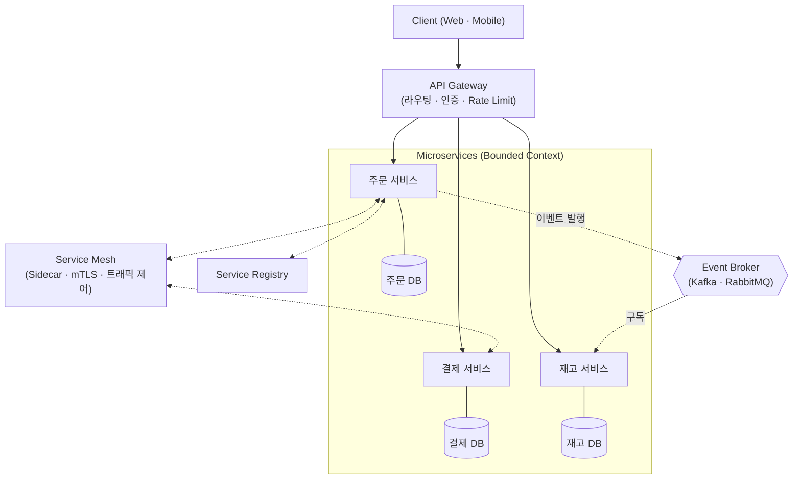

# MSA (Micro Service Architecture, 마이크로서비스 아키텍처)

---

## I. 비즈니스 민첩성을 위한 독립 서비스 구조, MSA의 개요

### 가. MSA의 정의

- 하나의 애플리케이션을 **비즈니스 도메인 단위의 작고 독립적으로 배포 가능한 서비스**들로 나누고, 서비스 간 경량 통신(API·이벤트)으로 결합하는 [[클라우드 네이티브]] 아키텍처

### 나. 등장 배경 및 특징

| 구분 | 내용 |
| --- | --- |
| 등장 배경 | [[모노리식 아키텍처]]의 높은 [[결합도]]로 인한 배포 지연, 부분 장애의 전체 전파 |
| 독립 배포 | 다른 서비스에 영향 없이 개별 CI/CD |
| 폴리글랏 | 서비스별로 최적의 언어·[[데이터베이스]] 선택 |
| 장애 격리 | 한 서비스 장애가 전체로 번지지 않음 |
| 독립 확장 | 부하가 큰 서비스만 Scale-out |

---

## II. MSA 아키텍처 및 핵심 기술

### 가. 아키텍처 개념도

- [[API Gateway]]가 단일 진입점이 되고, 각 서비스는 자체 DB를 소유하며, 동기 호출은 Service Mesh, 비동기 처리는 이벤트 브로커로 수행

### 나. 핵심 기술 및 패턴

| 구분 | 기술 | 설명 |
| --- | --- | --- |
| 서비스 분할 | [[DDD (Domain Driven Design)\|DDD]] | Bounded Context로 서비스 경계 도출 |
| 진입점 | API Gateway | 라우팅, 인증·인가, 응답 조합 |
| 데이터 | Database per Service | 서비스별 독립 DB로 데이터 결합 최소화 |
| | [[SAGA패턴\|Saga]] | 로컬 트랜잭션 연쇄 + 실패 시 보상 트랜잭션으로 분산 [[트랜잭션]] 처리 |
| | CQRS / Event Sourcing | 읽기·쓰기 모델 분리, 상태 변경을 이벤트로 저장 |
| 통신 | [[서비스 매쉬\|Service Mesh]] | 사이드카 프록시로 mTLS·트래픽 제어를 로직과 분리 |
| | Service Discovery | 동적으로 바뀌는 IP·Port 자동 등록·탐색 |
| 회복성 | [[서킷브레이커\|Circuit Breaker]] | 장애 서비스 호출 차단으로 연쇄 장애 방지 |
| 운영 | Container / [[쿠버네티스\|Kubernetes]] | 독립 패키징, [[무중단 배포]], 자동 확장 |
| 관측성 | 분산 추적 | Trace ID로 서비스 간 요청 흐름·병목 추적 (OpenTelemetry, Jaeger) |

---

## III. 모놀리식과의 비교 및 동향

### 가. 모놀리식 vs MSA

| 비교 항목 | 모놀리식 | MSA |
| --- | --- | --- |
| 배포 단위 | 전체 애플리케이션 통합 배포 | 서비스 단위 독립 배포 |
| 확장성 | 전체 [[인스턴스]] 복제 (Scale-up 위주) | 필요한 서비스만 Scale-out |
| 데이터 | 단일 DB, ACID 용이 | 서비스별 DB, 최종 일관성 |
| 장애 영향 | 부분 장애가 전체로 전파 | 장애 격리 |
| 기술 스택 | 단일 언어·프레임워크 | 서비스별 자율 선택 |
| 조직 | 기능별 조직 | 서비스별 Cross-functional 팀 ([[DevOps]]) |
| 단점 | 규모가 커질수록 복잡도 폭증 | 분산 트랜잭션·네트워크·운영 복잡성 |

### 나. 동향

- **플랫폼 엔지니어링**: 서비스 난립(Sprawl)과 인지 부하를 줄이기 위해 내부 개발자 포털(IDP) 구축
- **Sidecarless 메시**: eBPF 기반(Cilium 등)으로 사이드카의 자원 오버헤드·지연 감소
- **통신 최적화**: 잦은 동기 REST 호출 대신 gRPC와 이벤트 기반 비동기 통신으로 전환
- **모듈러 모놀리스 재조명**: 과도한 분할의 비용 때문에 경계를 명확히 한 모놀리스부터 시작하는 접근도 확산

---

### 🔗 연관 토픽

- **소속 도메인**: [[00_소프트웨어공학_MOC|🏗️ 소프트웨어공학]]
- **세부 분류**: `4. 아키텍처 스타일 & 객체지향 설계 원리`
- **핵심 연관 토픽**:
  - [[DDD (Domain Driven Design)]]
  - [[API Gateway]]
  - [[SAGA패턴]]
  - [[서비스 매쉬]]
  - [[클라우드 네이티브]]
