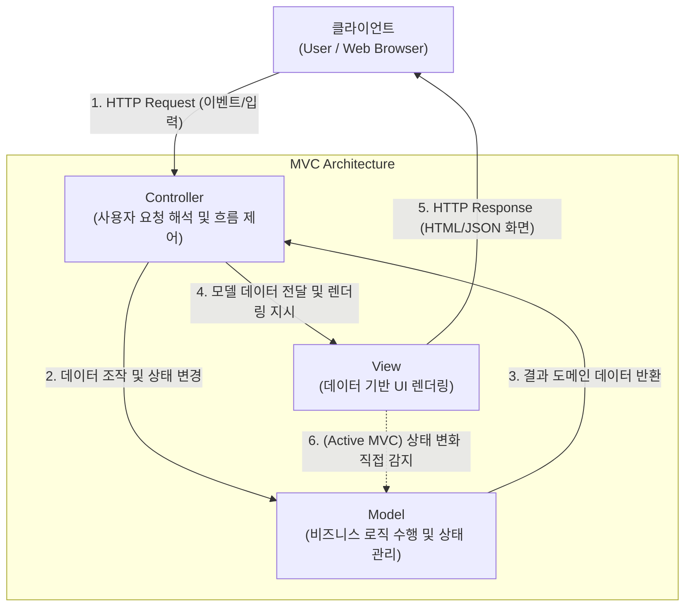

# MVC 패턴 (Model-View-Controller Pattern)

---

## I. 사용자 인터페이스 분리 설계의 표준, MVC 패턴의 개요

애플리케이션을 데이터 및 비즈니스 로직을 담당하는 모델(Model), 사용자 인터페이스를 담당하는 뷰(View), 그리고 사용자 입력을 받아 흐름을 제어하는 컨트롤러(Controller)의 3가지 역할로 분리하여 설계하는 소프트웨어 아키텍처 디자인 패턴이다.

| 구분 | 주요 내용 |
| --- | --- |
| **개념** | 사용자 인터페이스와 비즈니스 도메인 로직을 독립적인 컴포넌트로 분리하여 상호 변경 영향도를 최소화하는 UI 아키텍처 패턴 |
| **등장 배경** | 단일 코드베이스 내 화면 출력 코드와 데이터베이스 접근 코드가 뒤섞여 발생하는 스파게티 코드 방지 및 UI-비즈니스 로직 간 관심사 분리 필요 |
| **핵심 특징** | 관심사의 분리(SoC), 디자이너와 개발자 간 병렬 협업 지원, 낮은 결합도와 높은 [[응집도]] 달성, 웹 프레임워크의 근간 아키텍처 |

---

## II. MVC 패턴의 아키텍처 및 핵심 구성 요소

### 가. MVC 패턴의 아키텍처 및 요청 처리 흐름

사용자의 입력은 Controller로 진입하며, Controller는 Model을 호출하여 비즈니스 로직을 수행하고, 갱신된 데이터를 View에 전달하여 최종 렌더링된 화면이나 데이터를 사용자에게 회신한다.

### 나. MVC 패턴의 핵심 기술 및 구성 요소

| 분류 | 요소기술 (키워드) | 세부 설명 |
| --- | --- | --- |
| **핵심 계층** | Model (모델) | 애플리케이션의 핵심 비즈니스 도메인 상태, 데이터 엔티티 및 비즈니스 규칙을 캡슐화하는 계층 |
| **핵심 계층** | View (뷰) | Model이 보유한 데이터를 사용자에게 시각적으로 표현(HTML, CSS, JSON 등)하는 프레젠테이션 계층 |
| **핵심 계층** | Controller (컨트롤러) | 사용자의 액션이나 요청을 받아 해석하고, 적절한 Model을 호출하며 어떤 View를 보여줄지 결정하는 제어 계층 |
| **설계 원칙** | 관심사의 분리 (SoC) | 프레젠테이션 로직과 비즈니스 로직의 책임을 명확히 격리하여 코드의 재사용성과 모듈성 극대화 |
| **연동 패턴** | [[Observer (상태 변화 통지)\|Observer 패턴]] | Model의 상태가 변경되었을 때 Model이 자신을 구독하고 있는 View에 변경을 통지하는 능동형(Active) MVC 기법 |
| **웹 아키텍처** | Front Controller | Spring의 DispatcherServlet처럼 모든 클라이언트 요청을 단일 입구에서 받아 공통 처리를 수행하는 패턴 |
| **웹 아키텍처** | View Resolver | Controller가 반환한 논리적 뷰 명칭을 실제 물리적인 템플릿 파일(Thymeleaf, JSP)로 매핑하는 컴포넌트 |
| **데이터 전송** | DTO (Data Transfer Object) | 계층 간 데이터 교환 시 Model 엔티티의 직접 노출을 방지하고 필요한 속성만 안전하게 전달하는 객체 |

---

## III. UI 아키텍처 패턴 비교 및 최신 동향

### 가. UI 아키텍처 진화 비교 (MVC vs MVP vs MVVM)

| 비교 항목 | MVC (Model-View-Controller) | [[MVP]] (Model-View-Presenter) | [[MVVM (Model, View, View Model)\|MVVM]] (Model-View-ViewModel) |
| --- | --- | --- | --- |
| **중재자 역할** | **Controller** (사용자 입력 진입점) | **Presenter** (View와 1:1 결합 중재) | **ViewModel** (View 상태를 추상화한 모델) |
| **View-Model 결합** | 간접 의존성 존재 가능 (Active MVC) | 완전 분리 (Presenter 인터페이스 중재) | 완전 분리 (데이터 바인딩 기반 중재) |
| **데이터 바인딩** | 단방향 수동 데이터 전달 위주 | 인터페이스 메서드 수동 호출 | **양방향 또는 단방향 자동 데이터 바인딩** |
| **주요 적용처** | 전통적 웹 백엔드 (Spring MVC, Django) | 안드로이드 레거시 앱 개발 | 모던 프론트엔드 (Vue, Angular), WPF, 모바일 |

### 나. 최신 기술 동향 및 발전 방향

* **프론트엔드와 백엔드의 완전한 분리(Headless/SPA)**: 현대 웹 환경에서는 백엔드 MVC의 View 렌더링 역할이 사라지고, REST/GraphQL 기반의 JSON API만 제공하는 **Model-Controller(API 서버)**와 React/Vue 중심의 클라이언트 컴포넌트 아키텍처로 분리됨.
* **단방향 데이터 흐름(Flux/Redux/MVI)의 보편화**: 화면이 복잡해질수록 상태 추적이 어려운 양방향 바인딩의 한계를 극복하기 위해, 예측 가능한 단방향 아키텍처(Flux, Redux, MVI)가 프론트엔드 UI의 표준으로 안착됨.

---

### 🔗 연관 토픽

- **소속 도메인**: [[00_소프트웨어공학_MOC|🏗️ 소프트웨어공학]]
- **세부 분류**: `4. 아키텍처 스타일 & 객체지향 설계 원리`
- **핵심 연관 토픽**:
  - [[MVVM (Model, View, View Model)]]
  - [[MVP]]
  - [[디자인 패턴]]
  - [[Observer (상태 변화 통지)]]
  - [[모듈화]]
