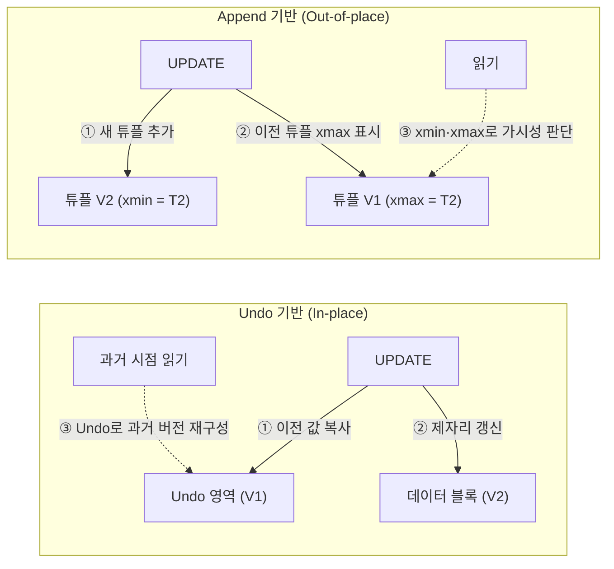

# MVCC (다중 버전 동시성 제어) 2가지 유형

---

## I. 읽기와 쓰기가 서로 막지 않도록, MVCC의 개요

### 가. 정의

- 데이터 변경 시 **이전 버전을 보존해 여러 버전을 유지하고, 각 트랜잭션이 자신의 스냅샷 시점에 맞는 버전을 읽게 하는 동시성 제어 기법**

### 나. 특징 및 2가지 유형

| 구분 | 내용 |
| --- | --- |
| 비차단 읽기 | 읽기는 잠금 없이 스냅샷 버전 조회, 쓰기 간 충돌만 잠금으로 제어 |
| 읽기 일관성 | 문장 또는 트랜잭션 시작 시점 기준의 일관된 결과 |
| Undo 기반 | 원본을 제자리 갱신하고 이전 버전을 Undo 영역에 보관 (Oracle, MySQL InnoDB) |
| Append 기반 | 새 버전을 테이블에 추가하고 이전 버전은 무효 표시 (PostgreSQL) |

---

## II. 유형별 동작 및 구성요소

### 가. 두 유형의 동작

- Undo 기반은 최신 값이 제자리에 있어 최신 읽기가 빠르고, Append 기반은 여러 버전이 테이블에 공존해 정리(VACUUM)가 필요

### 나. 구성요소

| 구분 | 요소 | 설명 |
| --- | --- | --- |
| 공통 | 트랜잭션 ID·SCN | 버전 생성 시점 식별, 가시성 판단 기준 |
| | 스냅샷 | 읽기 시점에 보이는 커밋 트랜잭션 집합 |
| Undo 기반 | In-place Update | 데이터 블록을 최신 값으로 갱신 |
| | Undo 세그먼트 | 이전 이미지 보관, 롤백과 읽기 일관성에 사용 |
| | Consistent Read | 쿼리 시작 SCN 기준으로 Undo를 적용해 과거 블록 재구성 (Oracle) |
| | Purge | 더 이상 필요 없는 Undo 정리 (InnoDB purge 스레드) |
| Append 기반 | Out-of-place Update | UPDATE = 새 튜플 INSERT + 이전 튜플 무효화 |
| | xmin·xmax | 튜플 헤더의 생성·삭제 트랜잭션 ID |
| | VACUUM | 데드 튜플 공간 회수, 트랜잭션 ID 랩어라운드 방지 |

---

## III. 비교 및 동향

### 가. Undo 기반 vs Append 기반

| 비교 항목 | Undo 기반 | Append 기반 |
| --- | --- | --- |
| 갱신 방식 | 제자리 갱신 | 새 버전 추가 |
| 이전 버전 위치 | 별도 Undo 영역 | 같은 테이블 |
| 과거 버전 읽기 | Undo 적용 재구성 비용 | 버전 선택만 하면 됨 |
| 롤백 | Undo 적용 필요 | 버전 무효 처리로 빠름 |
| 정리 작업 | Undo 재사용·Purge | VACUUM 필수 (테이블 팽창 위험) |
| 대표 DBMS | Oracle, MySQL InnoDB | PostgreSQL |
| 주의 | 긴 쿼리 시 ORA-01555(Snapshot too old) | 장기 트랜잭션 시 VACUUM 지연·팽창 |

### 나. 동향

- **분산 MVCC**: Spanner·[[CockroachDB]]가 TrueTime·HLC 타임스탬프로 노드 간 일관된 스냅샷 제공 ([[New SQL|NewSQL]])
- **PostgreSQL 개선 논의**: 테이블 팽창을 줄이기 위한 Undo 기반 저장 엔진(zheap) 등 대안 연구
- **격리 수준과 결합**: MVCC 위에서 Snapshot Isolation, SSI로 직렬 가능성 확보 ([[Isolation Level (격리 레벨고립성 수준)|격리 수준]])

---

### 🔗 연관 토픽

- **소속 도메인**: [[00_데이터베이스_MOC|🗄️ 데이터베이스]]
- **세부 분류**: `2. 트랜잭션 & 동시성 제어 (Concurrency)`
- **핵심 연관 토픽**:
  - [[병행 제어]]
  - [[Isolation Level (격리 레벨고립성 수준)]]
  - [[Locking]]
  - [[타임스탬프 순서 기법]]
  - [[CockroachDB|CockroachDB(코크로치DB)]]
