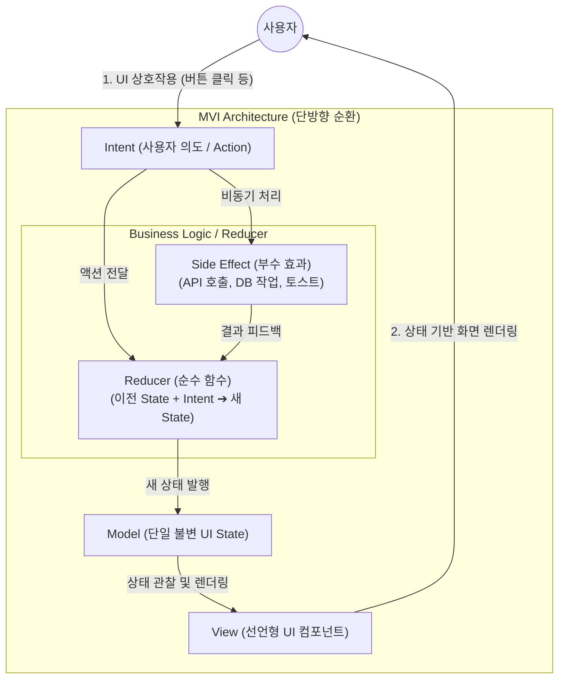

# MVI (Model-View-Intent) 패턴

---

## I. 상태 예측 가능성 극대화를 위한 선언형 아키텍처, MVI 패턴의 개요

상태(State) 불변성과 단방향 데이터 흐름(Unidirectional Data Flow, UDF)을 기반으로, 사용자의 모든 액션을 의도(Intent)로 캡슐화하여 단일 상태 모델(Model)을 갱신하고 뷰(View)를 렌더링하는 모던 UI 아키텍처 디자인 패턴이다.

| 구분 | 주요 내용 |
| --- | --- |
| **개념** | 사용자 인터랙션을 `Intent`로 정의하고, 순수 함수인 `Reducer`를 통해 새로운 불변 `Model(State)`을 생성하여 `View`에 단방향으로 주입하는 순환 아키텍처 |
| **등장 배경** | 기존 MVVM 패턴에서 다수의 관찰 가능한 상태(LiveData/StateFlow)가 비동기로 얽히면서 발생하는 상태 불일치, 경쟁 상태(Race Condition) 및 부수 효과(Side Effect) 제어 한계 극복 |
| **핵심 특징** | 엄격한 단방향 데이터 순환(UDF), 단일 진실 공급원(SSOT: Single Source of Truth), 상태 불변성(Immutability), 선언형 UI(Compose, SwiftUI) 최적화 |

---

## II. MVI 패턴의 아키텍처 및 핵심 기술 요소

### 가. MVI 패턴의 단방향 데이터 흐름(UDF) 아키텍처

사용자 입력은 오직 Intent로만 전달되며, 비즈니스 로직(Reducer)은 이전 상태와 Intent를 결합하여 완전히 새로운 불변 Model(State)을 생성하고, View는 이 단일 상태를 구독하여 화면을 재구성(Recomposition)한다.

### 나. MVI 패턴의 핵심 기술 및 구성 요소

| 분류 | 요소기술 (키워드) | 세부 설명 |
| --- | --- | --- |
| **핵심 계층** | Intent (의도) | 사용자 클릭, 제스처, 화면 진입 등 시스템 상태 변경을 유발하는 모든 액션을 캡슐화한 불변 객체 |
| **핵심 계층** | Model (UI 상태) | 로딩, 데이터, 에러 등 화면 전체가 가질 수 있는 모든 상태를 하나의 불변 객체(Data Class)로 통합 관리 |
| **핵심 계층** | View (뷰) | 전달받은 단일 Model 상태를 관찰하여 UI를 선언형으로 렌더링하고, 사용자 입력을 Intent로 방출 |
| **상태 변환** | Reducer (리듀서) | 이전 상태(Old State)와 유입된 Intent를 입력받아 새로운 상태(New State)를 반환하는 부작용 없는 순수 함수 |
| **비동기 격리** | Side Effect (부수 효과) | REST API 네트워크 호출, DB 쿼리, 화면 이동 등 순수 함수 영역 밖의 비동기 작업을 독립 처리하는 채널 |
| **흐름 제어** | 단방향 흐름 (UDF) | 데이터가 반드시 `View ➔ Intent ➔ Reducer ➔ State ➔ View`의 단일 순환 루프로만 흐르도록 강제 |
| **상태 무결성** | 불변 객체 (Immutable) | 기존 상태를 직접 수정(Mutation)하지 않고 `copy()` 등을 통해 새 객체를 생성하여 동시성 버그 원천 차단 |
| **반응형 스트림** | Reactive Streams | Kotlin Coroutines(StateFlow, SharedFlow) 또는 RxJava를 사용하여 상태와 부수 효과를 반응형 스트림으로 전파 |

---

## III. MVI와 MVVM 비교 및 최신 동향

### 가. MVVM vs MVI 비교

| 비교 항목 | MVVM (Model-View-ViewModel) | MVI (Model-View-Intent) |
| --- | --- | --- |
| **데이터 흐름** | 양방향(Data Binding) 또는 개별 스트림 혼재 | **엄격한 단방향 순환 데이터 흐름 (UDF)** |
| **상태 관리 방식** | 다수의 개별 LiveData / StateFlow 파편화 | **단일 불변 객체(Single Immutable State) 통합** |
| **이벤트 처리** | ViewModel의 공개 메서드를 View가 직접 호출 | Intent(액션 객체)를 단일 진입 파이프라인으로 전달 |
| **상태 예측성** | 여러 상태가 독립적으로 변하여 경쟁 상태 가능 | **순수 함수(Reducer) 기반으로 완벽한 상태 예측 가능** |
| **구현 복잡도** | 구조가 비교적 직관적이고 보일러플레이트 적음 | 러닝 커브가 높고 액션·상태 정의 코드가 많음 |

### 나. 최신 기술 동향 및 발전 방향

* **모던 선언형 UI(Declarative UI) 표준 채택**: Android Jetpack Compose, iOS SwiftUI, Web React 환경처럼 'UI = f(State)' 공식을 따르는 최신 프론트엔드 환경에서 가장 궁합이 맞는 아키텍처로 표준화됨.
* **상태 복제 메모리 오버헤드 최적화**: 상태 변경 시마다 새로운 객체를 생성함에 따른 가비지 컬렉션(GC) 부하를 줄이기 위해, Kotlin Value Class(Inline Class) 및 Orbit MVI, Mavericks 등 경량 MVI 프레임워크 도입이 활성화됨.

---

### 🔗 연관 토픽

- **소속 도메인**: [[00_소프트웨어공학_MOC|🏗️ 소프트웨어공학]]
- **세부 분류**: `4. 아키텍처 스타일 & 객체지향 설계 원리`
- **핵심 연관 토픽**:
  - [[MVVM (Model, View, View Model)]]
  - [[MVC 패턴 (Model-View-Controller Pattern)]]
  - [[프레임워크]]
  - [[무결성]]
  - [[디자인 패턴]]
