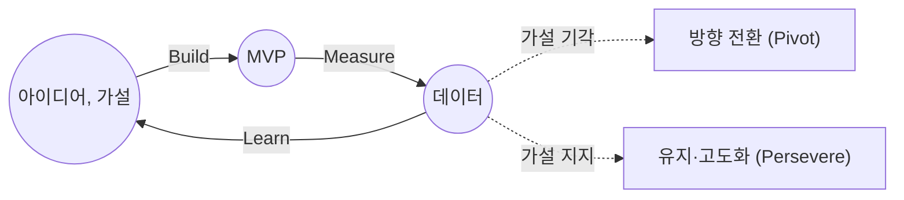

# MVP (Minimum Viable Product, 최소 기능 제품)

---

## I. 최소 노력으로 최대 학습, MVP의 개요

### 가. 정의

- 비즈니스 가설을 **최소 노력으로 검증**하기 위해 핵심 가치만 담아 출시하는 제품으로, 검증된 학습(Validated Learning)을 얻는 수단 (Eric Ries, 『린 스타트업』 2011)

### 나. 필요성 및 특징

| 구분 | 내용 |
| --- | --- |
| 낭비 최소화 | 아무도 원하지 않는 제품을 완벽하게 만드는 위험 감소 |
| 피드백 루프 | 만들기-측정-학습(Build-Measure-Learn) 반복 |
| 초기 수용자 | 불완전함을 감수하고 피드백을 주는 얼리어답터 대상 |
| 학습 목적 | 기능 수가 아니라 가설 검증이 목표, 제품이 아닌 실험일 수도 있음 |

---

## II. 동작 원리와 구성요소

### 가. 개념도

- 가설을 MVP로 구현해 실제 사용자 행동을 측정하고, 학습 결과로 방향 전환 또는 유지를 결정

### 나. 구성요소

| 구분 | 요소 | 설명 |
| --- | --- | --- |
| 원리 | 검증된 학습 | 실제 고객 행동 데이터로 가설 검증 |
| 의사결정 | 피벗 (Pivot) | 고객·문제·해결책·수익 모델 중 일부를 바꿔 새 가설 수립 |
| | 유지 (Persevere) | 현 방향을 유지하며 기능·품질 고도화 |
| 지표 | 실행 가능 지표 | 허영 지표(누적 가입자 등)를 배제하고 코호트·전환율·리텐션 등 판단에 쓰이는 지표 (AARRR) |
| 구현 유형 | 컨시어지 MVP | 자동화 없이 사람이 직접 서비스 제공, 고객도 수동임을 앎 |
| | 오즈의 마법사 MVP | 겉은 자동화처럼 보이나 뒤에서 사람이 처리 |
| | 랜딩 페이지 MVP | 가치 제안 페이지로 사전 등록·클릭률 측정 |
| | 조각 MVP (Piecemeal) | 기존 SaaS·도구를 조합해 서비스 흐름 구현 |
| | 동영상 MVP | 제품 시연 영상으로 수요 확인 (예: Dropbox) |

---

## III. 비교 및 동향

### 가. 프로토타입 vs MVP vs MLP

| 비교 항목 | 프로토타입 | MVP | MLP (Minimum Lovable Product) |
| --- | --- | --- | --- |
| 목적 | 기술 실현성·UI 설계 검증 | 시장 수요·비즈니스 가설 검증 | 초기 고객의 애착 확보 |
| 대상 | 내부 팀, 이해관계자 | 얼리어답터 | 핵심 타깃 고객 |
| 완성도 | 낮음, 부분 동작 | 핵심 가치 중심 최소 동작 | 핵심 기능 + 높은 UX 완성도 |
| 피드백 | 사용성 결함, 흐름 | 지불 의사, 리텐션 | 추천 의향(NPS), 입소문 |

### 나. 동향

- **MLP·MMP 확장**: 경쟁이 치열한 시장에서 최소 사랑받는 제품(MLP), 최소 시장성 제품(MMP)으로 출시 기준 상향
- **검증 주기 단축**: 노코드·로코드와 생성형 AI로 MVP 제작 기간이 크게 단축
- **애자일 연계**: 제품 백로그에서 MVP 범위를 정하고 반복 릴리스로 확장 ([[범위관리]])

---

### 🔗 연관 토픽

- **소속 도메인**: [[00_프로젝트관리_MOC|📋 프로젝트관리]]
- **세부 분류**: `3. 소프트웨어 원가 산정 & 성과 관리 (Cost & EVM)`
- **핵심 연관 토픽**:
  - [[린 방법론|린 (Lean) 방법론]]
  - [[디자인 씽킹]]
  - [[그로스 해킹]]
  - [[범위관리]]
  - [[Agile]]
