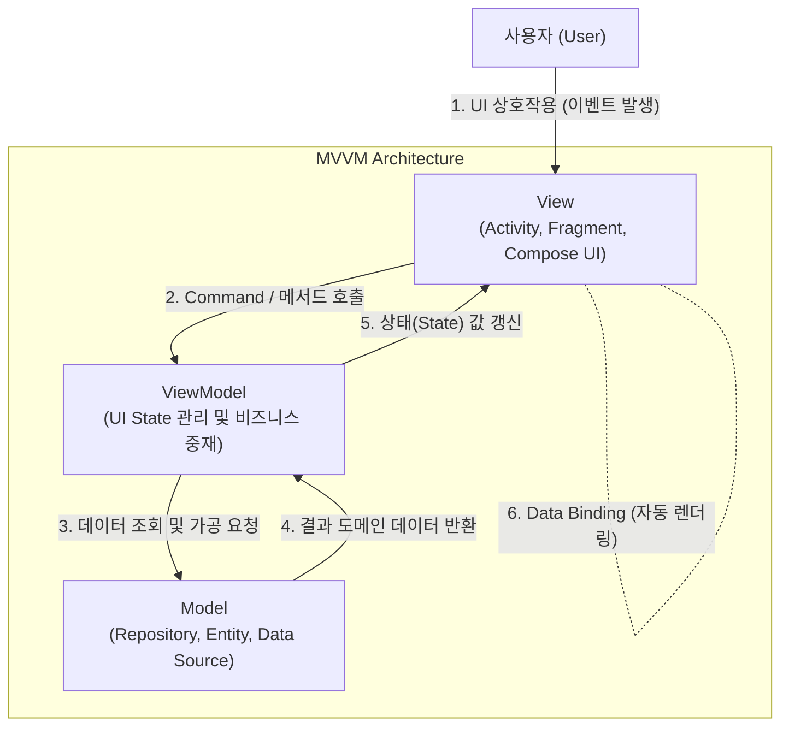

# MVVM (Model-View-ViewModel) 패턴

---

## I. 모던 UI 개발을 위한 데이터 바인딩 아키텍처, MVVM의 개요

사용자 인터페이스(View)와 비즈니스 도메인 로직(Model) 간의 의존성을 분리하고, 이 둘을 중재하는 뷰모델(ViewModel)을 두어 양방향 또는 단방향 데이터 바인딩을 통해 상태 동기화를 자동화하는 UI 아키텍처 디자인 패턴이다.

| 구분 | 주요 내용 |
| --- | --- |
| **개념** | View가 ViewModel의 데이터 상태를 관찰(Observe)하고, 데이터 바인딩(Data Binding) 메커니즘을 통해 화면 갱신 보일러플레이트를 제거하는 패턴 |
| **등장 배경** | MVC 및 MVP 패턴에서 View와 Presenter/Controller 간의 강한 결합도로 인한 유지보수 어려움 및 UI 종속적 코드의 테스트 한계 극복 |
| **핵심 특징** | 선언적 데이터 바인딩, View에 독립적인 ViewModel 단위 테스트 용이성, 생명주기(Lifecycle) 인식 기반 상태 보존 |

---

## II. MVVM의 아키텍처 및 핵심 기술 요소

### 가. MVVM 패턴의 아키텍처 및 데이터 동기화 흐름

사용자 입력 이벤트가 발생하면 View는 ViewModel의 메서드를 호출하고, ViewModel은 Model을 통해 데이터를 가공한 후 관찰 가능한 상태(State)를 갱신하며, View는 데이터 바인딩을 통해 변경된 상태를 자동으로 화면에 반영한다.

### 나. MVVM의 핵심 기술 및 구성 요소

| 분류 | 요소기술 (키워드) | 세부 설명 |
| --- | --- | --- |
| **핵심 계층** | Model (모델) | 로컬 DB(Room, SQLite), 원격 네트워크 API, 비즈니스 엔티티 등 순수 도메인 데이터를 캡슐화 |
| **핵심 계층** | View (뷰) | 화면 레이아웃과 UI 컴포넌트를 구성하며, ViewModel의 상태 변화를 구독하여 화면을 자동 렌더링 |
| **핵심 계층** | ViewModel (뷰모델) | View에 표현될 UI 상태 데이터를 보존하고 비즈니스 흐름을 제어하되, View에 대한 직접적 참조는 배제 |
| **데이터 연동** | 데이터 바인딩 (Data Binding) | XML 또는 선언적 코드에서 UI 위젯과 ViewModel 변수를 직접 바인딩하여 수동 화면 갱신 코드 제거 |
| **상태 관리** | 반응형 스트림 (StateFlow/LiveData) | 생명주기를 인식하여 활성 상태일 때만 안전하게 데이터 변경 사항을 View로 흘려보내는 관찰자 스트림 |
| **이벤트 제어** | Command / Binding Adapter | UI 클릭 이벤트를 ViewModel의 비즈니스 커맨드와 연결하고 커스텀 속성을 선언적으로 처리 |
| **계층 분리** | 레포지토리 패턴 (Repository) | ViewModel이 원격 API와 로컬 캐시의 세부 구현을 알 필요 없도록 데이터 소스를 단일 추상 인터페이스로 제공 |
| **생명주기** | ViewModel Lifecycle | 화면 회전 등 기기 구성 변경(Configuration Change)이 발생해도 소멸되지 않고 UI 상태를 안전하게 유지 |

---

## III. UI 아키텍처 패턴 비교 및 최신 동향

### 가. MVP vs MVVM 비교

| 비교 항목 | [[MVP]] (Model-View-Presenter) | MVVM (Model-View-ViewModel) |
| --- | --- | --- |
| **중재자 역할** | **Presenter** (View의 1:1 대리자) | **ViewModel** (View 상태 모델) |
| **View와의 결합** | 1:1 강결합 (View 인터페이스 직접 참조/제어) | **느슨한 결합** (View를 직접 참조하지 않고 상태만 노출) |
| **데이터 동기화** | Presenter가 View의 메서드를 일일이 수동 호출 | **Data Binding** 및 관찰자 스트림을 통한 자동 동기화 |
| **테스트 용이성** | View 인터페이스 Mocking 필요 | UI 종속성 없는 **순수 로직 단위 테스트(Unit Test) 용이** |
| **대표 기술 스택** | 안드로이드 레거시 Java 구조, Windows Forms | 안드로이드 Jetpack, Vue.js, WPF, SwiftUI |

### 나. 최신 기술 동향 및 발전 방향

* **모던 선언형 UI(Compose/SwiftUI)와의 완전 통합**: 복잡한 양방향 XML 바인딩 대신, ViewModel의 불변 상태(State)를 선언형 컴포저블 함수가 관찰하여 재구성(Recomposition)하는 단방향 MVVM 모델이 표준으로 정착됨.
* **MVI 패턴과의 결합**: 다수의 비동기 데이터 스트림이 복잡해질 때 발생하는 상태 경쟁(Race Condition)을 방지하기 위해, 단일 상태 불변 객체(Single State)와 Intent를 도입한 MVI 하이브리드 아키텍처로 진화함.

---

### 🔗 연관 토픽

- **소속 도메인**: [[00_소프트웨어공학_MOC|🏗️ 소프트웨어공학]]
- **세부 분류**: `4. 아키텍처 스타일 & 객체지향 설계 원리`
- **핵심 연관 토픽**:
  - [[MVC 패턴 (Model-View-Controller Pattern)]]
  - [[MVI (Model-View-Intent) 패턴]]
  - [[MVP]]
  - [[디자인 패턴]]
  - [[프레임워크]]
