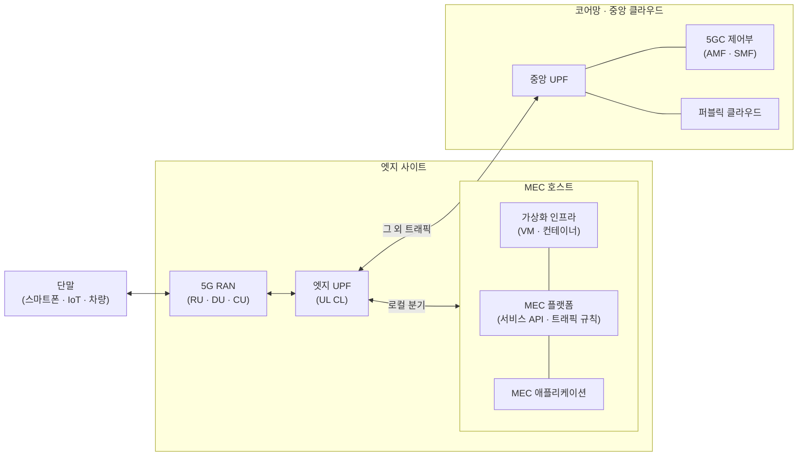

# MEC (Multi-access Edge Computing)

---

## I. 기지국 옆의 클라우드, MEC의 개요

### 가. 정의

- 이동통신 접속망(RAN) 가까이 **컴퓨팅·스토리지와 애플리케이션 실행 환경을 두고, 트래픽을 로컬에서 분기해 처리**하는 ETSI 표준 [[EDGE|엣지]] 컴퓨팅 구조 (2017년 Mobile → Multi-access로 명칭 변경)

### 나. 필요성 및 특징

| 구분 | 내용 |
| --- | --- |
| 저지연 | 중앙 클라우드까지 왕복을 줄여 응용 지연을 수 ms 수준으로 단축 |
| 백홀 절감 | 대용량 트래픽(영상 분석 등)을 엣지에서 처리해 [[백홀 트래픽]] 감소 |
| 망 정보 활용 | 무선 상태·위치 정보를 API로 애플리케이션에 제공 |
| 데이터 국지화 | 민감 데이터를 현장·국내에서 처리 |
| 다중 접속 | 셀룰러뿐 아니라 Wi-Fi·유선 접속도 수용 |

---

## II. 구조 및 구성요소

### 가. 5G 연동 MEC 구조

- SMF가 엣지 UPF에 상향링크 분류기(UL CL)를 설정해 특정 목적지 트래픽만 MEC 호스트로 분기하고 나머지는 중앙으로 보냄

### 나. 구성요소

| 구분 | 요소 | 설명 |
| --- | --- | --- |
| 호스트 | MEC Host | MEC 플랫폼 + 애플리케이션 + [[가상화]] 인프라 |
| | MEC Platform (MEP) | 트래픽 규칙 적용, 서비스 등록·탐색, MEC API 제공 |
| 관리 | MEC Orchestrator (MEO) | 전체 호스트 자원 파악, 앱 온보딩·배치·종료 |
| | MEC Platform Manager | 호스트 단위 플랫폼·앱 수명주기 관리 |
| 트래픽 | UL CL · Local Breakout | 5G UPF에서 목적지별 로컬 분기 |
| API | RNIS · Location API | 무선망 정보(채널·혼잡), 단말 위치 제공 |
| 인프라 | [[NFV]] · 컨테이너 | 범용 서버 위 VNF·[[쿠버네티스]] 기반 배포 |
| 연동 | 3GPP EDGEAPP (TS 23.558) | 단말이 엣지 서버를 찾는 EAS 탐색 구조 |

---

## III. 비교 및 동향

### 가. 중앙 클라우드 vs MEC

| 비교 항목 | 중앙 클라우드 | MEC |
| --- | --- | --- |
| 위치 | 원격 데이터센터 | 기지국·지역 국사·기업 구내 |
| 지연 | 수십 ms 이상 | 수 ms ~ 수십 ms |
| 망 부하 | 백홀·코어로 집중 | 엣지에서 분기·처리 |
| 자원 규모 | 대규모, 탄력적 | 사이트당 소규모 |
| 적합 분야 | 대규모 학습, 저장 | 실시간 영상 분석, AR·VR, [[Smart Car(자율주행)\|V2X]], 공장 제어 |

### 나. 동향

- **엣지 AI 추론**: 영상 분석·이상 탐지 모델을 MEC에서 실행해 지연·전송량 감소
- **하이퍼스케일러 협력**: 통신사 엣지에 클라우드 사업자 인프라 배치 (예: AWS Wavelength, Azure Operator Nexus)
- **API 개방**: GSMA Open Gateway·CAMARA로 망 기능 API를 표준화해 개발자에 제공

---

### 🔗 연관 토픽

- **소속 도메인**: [[00_네트워크_MOC|🌐 네트워크]]
- **세부 분류**: `1. OSI 7계층 & 데이터링크 계층 (L1/L2)`
- **핵심 연관 토픽**:
  - [[EDGE|edge]]
  - [[5G|5G 주요 기술]]
  - [[네트워크 슬라이싱]]
  - [[NFV]]
  - [[백홀 트래픽]]
