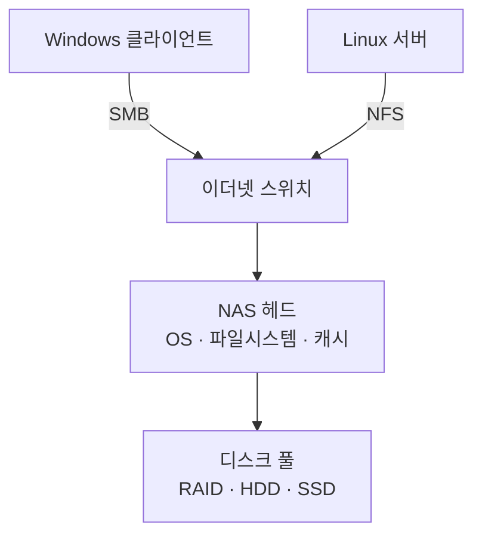

# NAS (Network Attached Storage)

---

## I. 네트워크로 파일을 공유하는 스토리지, NAS의 개요

### 가. 정의

- [[TCP]]/IP 네트워크(LAN)에 연결되어 **NFS·SMB 등 파일 공유 [[프로토콜]]로 여러 클라이언트에 파일 단위 저장 공간을 제공**하는 전용 스토리지 장치

### 나. 특징

| 구분 | 내용 |
| --- | --- |
| 파일 단위 접근 | NAS가 파일시스템을 관리, 클라이언트는 경로로 파일 접근 |
| 이기종 공유 | Windows(SMB)·Linux(NFS) 클라이언트가 같은 데이터 공유 |
| 구축 용이 | 기존 이더넷 인프라 사용, 전용 SAN 대비 저렴 |
| 중앙 관리 | 백업·스냅샷·권한을 한곳에서 관리 |

---

## II. 구조 및 구성요소

### 가. 구조

- 클라이언트 요청을 NAS 헤드가 받아 파일시스템과 캐시를 거쳐 [[RAID]]로 구성된 디스크에서 처리

### 나. 구성요소

| 구분 | 요소 | 설명 |
| --- | --- | --- |
| 프로토콜 | SMB (CIFS) | Windows 중심 파일 공유 프로토콜 (SMB 3.x) |
| | NFS | Unix·Linux 원격 파일시스템 마운트 (NFSv3·v4) |
| 파일시스템 | ZFS, XFS, Btrfs 등 | 대용량 관리, 저널링·체크섬 기반 [[무결성]] 검증 |
| 하드웨어 | NAS 헤드 | 프로토콜 처리와 파일시스템을 담당하는 컨트롤러 |
| | 디스크 풀 | RAID로 묶은 HDD·SSD |
| 확장 구조 | 스케일업 / 스케일아웃 | 헤드 1대에 디스크 추가 / 노드를 추가해 용량·성능 동시 확장 |
| 데이터 보호 | RAID, 스냅샷, 복제 | 디스크 장애 대비, 시점 복구, 원격지 복제 |
| 보안 | ACL, WORM | 파일 접근 권한 제어, 변경 불가 저장으로 [[랜섬웨어]] 대비 |
| 가속 | NFS over RDMA, nconnect | 네트워크 지연·CPU 부하 감소 |

---

## III. 비교 및 동향

### 가. DAS vs NAS vs SAN

| 비교 항목 | DAS | NAS | SAN |
| --- | --- | --- | --- |
| 연결 | 서버에 직접 연결 | 이더넷 LAN | 전용 FC망 또는 iSCSI |
| 접근 단위 | 블록 | 파일 | 블록 |
| 프로토콜 | SATA, SAS, NVMe | NFS, SMB | FCP, iSCSI, NVMe-oF |
| 공유 | 어려움 | 쉬움 | 클러스터 파일시스템 필요 |
| 비용 | 낮음 | 중간 | 높음 |
| 적합 | 단일 서버 | 파일 공유·협업·백업 | 고성능 [[데이터베이스]]·가상화 |

### 나. 동향

- **클라우드 계층화**: 자주 쓰지 않는 파일을 퍼블릭 클라우드 오브젝트 스토리지로 자동 이동, 클라우드 관리형 파일 서비스(AWS EFS·FSx 등) 확산
- **랜섬웨어 대응**: 변경 불가(Immutable) 스냅샷과 이상 암호화 패턴 탐지 기능 내장
- **AI 데이터 파이프라인**: 올플래시 스케일아웃 NAS가 GPU 학습 데이터 공급용으로 확대

---

### 🔗 연관 토픽

- **소속 도메인**: [[00_컴퓨터구조_MOC|💻 컴퓨터구조]]
- **세부 분류**: `2. 캐시 & 메모리 계층 구조 · 스토리지`
- **핵심 연관 토픽**:
  - [[스토리지 유형|스토리지 유형 (블록, 파일, 오브젝트 스토리지)]]
  - [[RAID]]
  - [[이레이저 코딩|이레이저 코딩(erasure coding)]]
  - [[HA(High Availability)]]
  - [[데이터베이스]]
