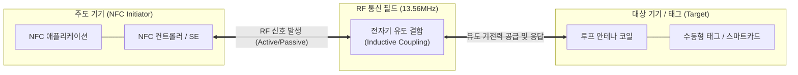

# NFC (Near Field Communication)

---

## I. 초근접 비접촉 무선 통신, NFC의 개요

### 가. 정의

- 13.56MHz 주파수 대역을 사용하여 10cm 이내의 초단거리에서 기기 간 데이터를 양방향으로 전송하는 **비접촉식 근거리 무선 통신 기술 표준 (ISO/IEC 18092)**

### 나. 특징 및 필요성

| 구분 | 내용 |
| --- | --- |
| 초단거리 보안성 | 통신 반경이 10cm 이내(통상 4cm 이하)로 제한되어 전파 도청 및 중간자 공격(MITM) 위험 원천 차단 |
| 복합 동작 모드 | 단일 칩에서 카드 에뮬레이션, 리더/라이터, P2P 모드를 동적 전환 지원 |
| 즉시성 (Zero Setup) | 블루투스와 달리 별도의 페어링 절차 없이 단말 태깅 즉시(0.1초 미만) 세션 연결 |
| 인프라 호환성 | 기존 비접촉식 교통카드 및 스마트카드 표준(ISO/IEC 14443, FeliCa)과 하위 호환성 유지 |

---

## II. 개념도 및 핵심 구성요소

### 가. 개념도 (동작 원리 및 상호작용)

- 주도 기기(Initiator)가 13.56MHz의 교류 자기장을 발생시키면 대상 기기(Target)의 코일에 유도 기전력이 발생하여 에너지를 공급받고 데이터를 변복조하여 전송

### 나. 핵심 기술 요소 및 동작 모드

| 구분 | 요소 | 설명 |
| --- | --- | --- |
| 3대 동작 모드 | 카드 에뮬레이션 | 스마트폰이 교통카드나 신용카드(스마트카드)처럼 동작하여 POS 리더기에 결제 수행 |
| | 리더 / 라이터 | 스마트폰이 RFID 태그에 기록된 정보(스마트 포스터, URL, 제품 정보)를 읽거나 수정 |
| | Peer-to-Peer (P2P) | 두 NFC 단말 간에 명함, 사진, Wi-Fi 접속 정보 등을 직접 양방향 교환 |
| 보안 아키텍처 | Secure Element (SE) | 암호화 키와 금융 결제 정보를 물리적으로 격리 보관하는 하드웨어 보안 칩 (eSE, USIM) |
| | Host Card Emulation (HCE) | 물리적 SE 칩 없이 OS 커널 및 클라우드 가상 환경에서 카드 결제를 안전하게 처리 |
| 인터페이스 | Single Wire Protocol (SWP) | NFC 비접촉 컨트롤러와 통신사 USIM 카드 간 단일 배선으로 통신하는 표준 규격 |
| 무선 규격 | 13.56 MHz 대역 | ISM 대역을 사용하며 전송 속도는 106, 212, 424 kbps 지원 |

---

## III. 무선 기술 비교 및 동향

### 가. NFC vs BLE vs RFID

| 비교 항목 | NFC (Near Field Communication) | BLE (Bluetooth Low Energy) | RFID (Radio Frequency Identification) |
| --- | --- | --- | --- |
| 통신 거리 | **초단거리 (10cm 이내)** | 중단거리 (10m ~ 100m) | 주파수에 따라 단거리 ~ 장거리 (수 cm ~ 수십 m) |
| 통신 방향 | **양방향 (Bi-directional)** | **양방향 (Bi-directional)** | 단방향 (태그 $\rightarrow$ 리더 일방 통신) |
| 주파수 대역 | 13.56 MHz | 2.4 GHz ISM 대역 | LF, HF, UHF(900MHz), 마이크로웨이브 |
| 페어링 절차 | 불필요 (단말 태깅 즉시 통신) | 페어링 탐색 및 수락 과정 필요 | 불필요 |
| 주요 활용처 | 모바일 결제, 모바일 신분증, 출입통제 | 비콘 위치추적, 스마트워치, 무선 이어폰 | 물류 유통, 재고 관리, 도서관 대출, 하이패스 |

### 나. 동향

- **모바일 신분증 및 디지털 지갑 표준화**: 모바일 운전면허증, 주민등록증, 사원증 등 국가 공공 신분증 및 디지털 키(차량 도어록)의 핵심 인증 매체로 안착
- **IoT 기기 초간편 설정(Zero-Touch Pairing)**: 복잡한 Wi-Fi 비밀번호 입력 없이 스마트홈 가전이나 블루투스 스피커에 스마트폰을 태깅하여 원터치 연동 지원
- **NFC 무선 충전(WLC) 규격 확대**: 초소형 저전력 웨어러블(스타일러스 펜, 스마트 링, 무선 이어버드)에 통신과 최대 1W 무선 충전을 동시 공급하는 기술 확산

---

### 🔗 연관 토픽

- **소속 도메인**: [[00_네트워크_MOC|🌐 네트워크]]
- **세부 분류**: `4. 무선 및 차세대 이동통신 (5G/6G/Wi-Fi)`
- **핵심 연관 토픽**:
  - [[RFID]]
  - [[Wi-Fi 7]]
  - [[암호화]]
  - [[프로토콜]]
  - [[매터]]
