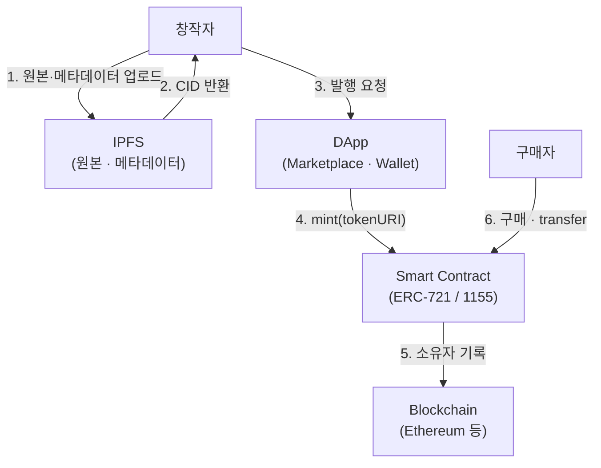

# NFT (Non Fungible Token)

---

## I. 디지털 자산의 고유성 증명, NFT의 개요

### 가. 정의

- [[01_IT Tech/블록체인|블록체인]]에 발행되어 **토큰마다 고유 식별자(Token ID)를 가지며 서로 대체할 수 없는 토큰**으로, 디지털 자산의 소유·거래 이력을 증명

### 나. 특징

| 구분 | 내용 |
| --- | --- |
| 고유성 | 컨트랙트 주소 + Token ID 조합으로 개별 토큰 식별, 고유 메타데이터 보유 |
| 추적성 | 발행(Minting)부터 현재 소유자까지 거래 이력 공개 |
| 상호운용성 | ERC-721 등 표준 인터페이스로 지갑·마켓플레이스 간 호환 |
| 프로그래머블 | 스마트 컨트랙트로 2차 거래 로열티 등 규칙 정의 (로열티는 마켓 정책에 따라 강제되지 않을 수 있음) |
| 한계 | 토큰 소유가 원본 저작권 이전을 뜻하지 않음, 원본 파일이 오프체인이면 링크 소실 위험 |

---

## II. 구조 및 구성요소

### 가. 발행·거래 구조

- 대용량 원본은 오프체인(IPFS 등)에 두고, 온체인에는 Token ID·소유자·tokenURI만 기록하여 수수료(Gas) 절감

### 나. 구성요소

| 구분 | 요소 | 설명 |
| --- | --- | --- |
| 표준 | ERC-721 | 개별 NFT 표준 |
| | ERC-1155 | 하나의 컨트랙트에서 FT·NFT 다중 토큰 관리, 일괄 전송 |
| 데이터 | Metadata ([[JSON]]) | 이름·설명·이미지 URI·속성(Traits) [[스키마]] |
| | Token ID / CID | 토큰 식별 번호 / 콘텐츠 해시 기반 IPFS 주소(내용이 바뀌면 주소도 바뀜) |
| 저장 | IPFS · Arweave | 분산 파일 저장, 원본 위변조 방지 |
| 로직 | 스마트 컨트랙트 | 발행·전송·승인·로열티 정보(ERC-2981) |
| 인증 | Web3 Wallet | 개인키로 소유 증명·거래 서명 (MetaMask 등) |
| 응용 | Dynamic NFT | 오라클 연동으로 외부 데이터에 따라 메타데이터 변경 |

---

## III. 비교 및 동향

### 가. NFT vs FT

| 비교 항목 | NFT | FT (Fungible Token) |
| --- | --- | --- |
| 대체 가능성 | 대체 불가 (토큰별 고유 가치) | 대체 가능 (동일 토큰끼리 1:1 교환) |
| 분할 | 원칙적으로 불가 | 소수 단위 분할 가능 |
| 표준 | ERC-721, ERC-1155 | ERC-20 |
| 사례 | 디지털 아트, 게임 아이템, 티켓, 회원권 | 스테이블코인(USDC), 거버넌스 토큰 |

### 나. 동향

- **ERC-6551 (Token Bound Account)**: NFT마다 스마트 계정을 연결해 NFT가 다른 토큰·NFT를 소유
- **SBT (Soulbound Token)**: 양도 불가 토큰(ERC-5192 등)으로 자격·이력 증명에 활용 시도
- **활용 전환**: 투기형 PFP 시장 위축 후 티켓·멤버십·게임 아이템·실물자산(RWA) 증명 등 유틸리티 중심으로 이동

---

### 🔗 연관 토픽

- **소속 도메인**: [[00_디지털서비스_MOC|🚀 디지털서비스]]
- **세부 분류**: `2. 블록체인 & 분산원장 · Web3`
- **핵심 연관 토픽**:
  - [[01_IT Tech/블록체인|블록체인 (Block Chain)]]
  - [[Web 3.0]]
  - [[메타버스|메타버스 (Metaverse)]]
  - [[해시함수]]
  - [[전자 서명|전자 서명 (Digital Signature)]]
