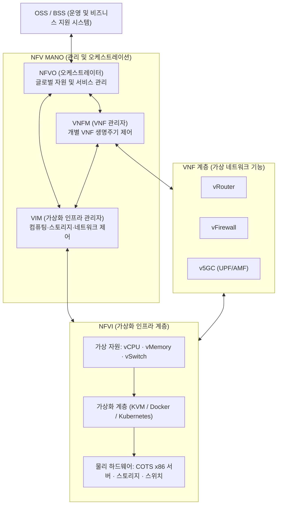

# NFV (Network Functions Virtualization)

---

## I. 통신 장비의 소프트웨어 가상화, NFV의 개요

### 가. 정의

- 라우터, 방화벽, 로드밸런서 등 고가의 전용 어플라이언스에 종속되었던 통신 네트워크 기능들을 **범용 서버(x86) 상에서 구동되는 소프트웨어(가상머신 또는 컨테이너) 형태로 분리·가상화하는 ETSI 표준 네트워크 아키텍처**

### 나. 특징 및 필요성

| 구분 | 내용 |
| --- | --- |
| 벤더 락인 해제 | 전용 하드웨어 어플라이언스 대신 표준 COTS(상용 기성) x86 서버를 활용하여 CAPEX 대폭 절감 |
| 서비스 민첩성 | 수개월 소요되던 신규 네트워크 서비스 프로비저닝을 수 분 내 소프트웨어 배포로 단축 |
| 동적 확장성 | 실시간 트래픽 증감에 따라 가상 네트워크 기능(VNF)을 소프트웨어적으로 오토스케일링(Scale-out/in) |
| 클라우드 전환 | 5G 코어(5GC) 및 엣지 컴퓨팅(MEC) 인프라를 클라우드 네이티브 컨테이너 기반으로 전환하는 토대 |

---

## II. 개념도 및 핵심 구성요소

### 가. 개념도 (ETSI NFV 표준 아키텍처)

- 하드웨어 인프라(NFVI) 위에 가상 네트워크 기능(VNF)을 소프트웨어로 구동하고, 전체 자원 할당과 VNF 생명주기를 MANO 계층에서 중앙 집중 오케스트레이션

### 나. 핵심 기술 요소

| 구분 | 요소 | 설명 |
| --- | --- | --- |
| MANO (관리 계층) | NFVO (Orchestrator) | 전체 네트워크 서비스(NS)의 토폴로지 구성 및 글로벌 인프라 자원 오케스트레이션 |
| | VNFM (VNF Manager) | 개별 VNF 인스턴스의 생성, 설정, 확장(Scaling), 장애 복구, 종료 생명주기 관리 |
| | VIM (Virtual Infrastructure Mgr) | NFVI의 물리·가상 자원(컴퓨팅, 스토리지, 가상 네트워크)을 직접 할당 및 제어 (예: OpenStack) |
| 네트워크 기능 | VNF | 가상 머신(VM) 또는 컨테이너 형태로 실행되는 개별 네트워크 애플리케이션 소프트웨어 |
| | EMS | 특정 VNF에 대한 기능적 장애, 구성, 과금, 성능, 보안(FCAPS) 관리 시스템 |
| 가상화 인프라 | NFVI | VNF가 배포되어 실행되는 물리적 상용 하드웨어 및 하이퍼바이저/컨테이너 런타임 환경 |
| 서비스 체이닝 | SFC (Service Function Chaining) | 패킷이 방화벽 $\rightarrow$ DPI $\rightarrow$ 캐시 순으로 가상 기능들을 순차 통과하도록 트래픽 경로를 동적 지정 |

---

## III. 기술 비교 및 동향

### 가. NFV vs SDN

| 비교 항목 | NFV (Network Functions Virtualization) | SDN (Software Defined Networking) |
| --- | --- | --- |
| 주 목적 | 네트워크 **장비 기능(L4~L7)의 소프트웨어 가상화** | 네트워크 **제어 평면과 데이터 평면의 분리 및 중앙 집중화** |
| 주요 계층 | L4 ~ L7 (방화벽, 라우터, 로드밸런서, 코어망) | L2 ~ L3 (스위칭, 라우팅 플로우 테이블 제어) |
| 핵심 가치 | 전용 하드웨어 비용 절감, 장비 통합 | 트래픽 경로의 프로그래밍 제어, 망 운영 자동화 |
| 표준 기구 | ETSI (유럽전기통신표준협회) | ONF (Open Networking Foundation) |
| 상호 관계 | 상호보완적 관계 (NFV 인프라의 가상 네트워크 연결을 SDN 컨트롤러로 구현) |

### 나. 동향

- **VNF에서 CNF(Cloud-native Network Function)로 진화**: 무거운 가상머신(VM) 기반 VNF에서 시작하여 경량 도커 컨테이너와 쿠버네티스(K8s) 기반 CNF로의 전면 전환 가속화
- **5G/6G 코어 및 슬라이싱 기반 기술**: 5G Service-Based Architecture(SBA)에서 AMF, SMF, UPF가 클라우드 네이티브 네트워크 기능(CNF)으로 배포되는 근간 인프라로 채택
- **Telco 클라우드 자동화(GitOps)**: 선언적 인프라 명세(IaC)와 CI/CD 파이프라인을 결합하여 통신망 VNF 배포 및 구성을 전자동으로 무중단 롤링 업데이트

---

### 🔗 연관 토픽

- **소속 도메인**: [[00_네트워크_MOC|🌐 네트워크]]
- **세부 분류**: `5. 통신 인프라 & 차세대 네트워크 기술`
- **핵심 연관 토픽**:
  - [[SDN(Software Defined Network)]]
  - [[가상화]]
  - [[클라우드 네이티브]]
  - [[컨테이너]]
  - [[O-RAN]]
