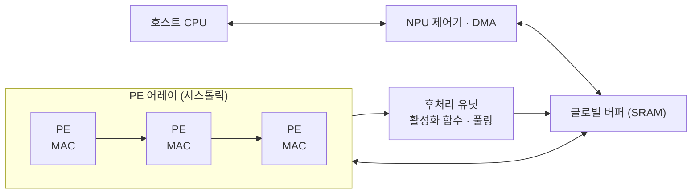

# NPU (Neural Processing Unit)

---

## I. 신경망 연산 전용 프로세서, NPU의 개요

### 가. 정의

- [[인공지능]] 신경망의 **행렬 곱·합성곱 연산을 대규모 [[MAC 배열|MAC]] 연산기로 저전력·고속 처리하는 AI 전용 프로세서**

### 나. 특징

| 구분 | 내용 |
| --- | --- |
| 연산 특화 | MAC 유닛을 대량 집적, 행렬 연산에 최적화 |
| 데이터 흐름 | [[시스톨릭 어레이]] 등으로 데이터 재사용, 메모리 접근 최소화 |
| 전력 효율 | [[GPU]] 대비 높은 TOPS/W, 배터리 기기에 적합 |
| 저정밀 연산 | INT8·INT4·FP16 등 양자화 모델 실행 |

---

## II. 구조 및 구성요소

### 가. 구조

- DMA로 가중치·입력을 SRAM에 적재 → PE 어레이에서 곱-누산 → 활성화 함수 적용 후 다음 레이어로 전달

### 나. 구성요소

| 구분 | 요소 | 설명 |
| --- | --- | --- |
| 연산 | MAC 유닛 | 곱셈 후 누산을 한 사이클에 수행 |
| | [[PE]] 어레이 | MAC·레지스터로 구성된 셀의 2차원 격자 |
| | 벡터·후처리 유닛 | 활성화 함수(ReLU 등), 정규화, 풀링 |
| 메모리 | 온칩 SRAM | 가중치·활성값을 담아 외부 DRAM 접근 감소 |
| 제어 | 데이터플로 | 가중치·입력·출력 고정(Stationary) 방식으로 데이터 이동 최소화 |
| 경량화 | 양자화·희소성 | 저비트 연산, 0 값 연산 생략 |
| 연결 | NoC | 다수 코어 간 온칩 네트워크 |
| | PCIe / [[CXL]] | 데이터센터 NPU의 호스트 연결 |
| SW | 컴파일러·런타임 | 모델 그래프를 NPU 명령으로 변환 |

---

## III. 비교 및 동향

### 가. NPU vs GPU

| 비교 항목 | NPU | [[GPU]] |
| --- | --- | --- |
| 목적 | 신경망 연산 전용 | 그래픽·범용 병렬 연산 |
| 구조 | 대규모 MAC, 시스톨릭 어레이 | 수천 개 SIMT 코어 + 텐서 코어 |
| 유연성 | 낮음 | 높음 |
| 전력 효율 | 높음 | 중간 |
| 주 용도 | [[온디바이스 AI]] 추론, 추론 서버 | AI 학습, 대규모 추론, 렌더링 |

### 나. 동향

- **AI PC·스마트폰 내장**: Microsoft Copilot+ PC 기준 40 TOPS 이상 NPU 탑재 등 SoC 내장 NPU 표준화
- **데이터센터 추론 NPU**: Google TPU, AWS Inferentia, 국내 리벨리온·퓨리오사AI 등 추론 전용 칩 확대
- **메모리 병목 대응**: [[PIM]]·[[HBM]] 결합으로 LLM 추론의 메모리 대역폭 한계 완화

---

### 🔗 연관 토픽

- **소속 도메인**: [[00_컴퓨터구조_MOC|💻 컴퓨터구조]]
- **세부 분류**: `1. CPU 프로세서 & 마이크로아키텍처`
- **핵심 연관 토픽**:
  - [[시스톨릭 어레이]]
  - [[PE|PE(Processing Element)]]
  - [[TPU (Tensor Processing Unit)]]
  - [[GPU]]
  - [[지능형 반도체]]
