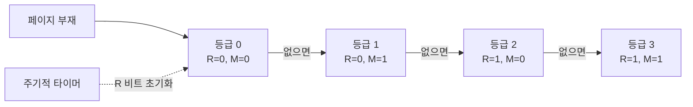

# NUR (Not Used Recently)

---

## I. 두 비트로 LRU를 흉내내는, NUR의 개요

### 가. 정의

- 페이지마다 **참조 비트(R)와 변경 비트(M)를 두고, 최근 참조되지 않은 페이지를 우선 교체**하는 LRU 근사 [[페이지 교체 알고리즘]] (NRU라고도 함)

### 나. 특징

| 구분 | 내용 |
| --- | --- |
| 저비용 | 페이지당 비트 2개만 유지, 하드웨어(MMU)가 참조·쓰기 시 자동 설정 |
| 최근성 근사 | OS가 주기적으로 R 비트를 0으로 지워 "최근"의 범위를 정함 |
| 쓰기 비용 고려 | 변경되지 않은 페이지를 먼저 교체해 디스크 기록(Write-back) 회피 |
| 정밀도 한계 | 같은 등급 안에서는 순서를 구분하지 못함 |

---

## II. 동작 구조 및 구성요소

### 가. 등급별 교체 순서

- 가장 낮은 등급에서 교체 대상을 고르고(같은 등급이면 임의), M=1인 페이지는 디스크에 기록 후 교체

### 나. 구성요소

| 구분 | 요소 | 설명 |
| --- | --- | --- |
| 상태 비트 | 참조 비트 (R) | 읽기·쓰기 참조 시 1, 주기적으로 0으로 초기화 |
| | 변경 비트 (M, Dirty) | 쓰기 시 1, 디스크에 기록되면 0 |
| 등급 | 0 (R=0, M=0) | 최근 미참조·미변경, 1순위 교체 |
| | 1 (R=0, M=1) | 최근 미참조·변경됨 (R만 초기화돼 생기는 상태), 2순위 |
| | 2 (R=1, M=0) | 최근 참조·미변경, 3순위 |
| | 3 (R=1, M=1) | 최근 참조·변경됨, 마지막 순위 |
| 운영 | 주기적 R 초기화 | 타이머 [[인터럽트]]마다 R 비트 일괄 클리어 |

---

## III. 비교 및 동향

### 가. NUR vs LRU vs FIFO

| 비교 항목 | NUR | [[LRU]] | [[FIFO]] |
| --- | --- | --- | --- |
| 기준 | R·M 비트 등급 | 마지막 참조 시점 | 적재 시점 |
| 오버헤드 | 낮음 (비트 2개) | 높음 | 매우 낮음 |
| 부재율 | LRU보다 다소 높은 수준 | [[OPT]]에 근접 | 높음 |
| Belady's Anomaly | 발생 가능 | 없음 | 발생 가능 |
| 구현 | 하드웨어 비트 + 타이머 | 카운터·스택·리스트 | 큐 |

### 나. 동향

- **Clock·Enhanced Clock**: 원형 큐를 도는 포인터로 R 비트를 검사하는 Second Chance, R·M을 함께 보는 Enhanced Second Chance로 발전
- **Linux 페이지 회수**: 참조 비트를 활용한 active·inactive LRU 리스트, 6.1부터 MGLRU로 최근성 근사 정밀화
- **하드웨어 지원 확대**: x86 페이지 테이블의 Accessed·Dirty 비트, ARMv8.1 하드웨어 Access Flag 관리로 OS 부담 감소

---

### 🔗 연관 토픽

- **소속 도메인**: [[00_운영체제_MOC|⚙️ 운영체제]]
- **세부 분류**: `5. 가상 메모리 관리 & 페이지 교체 알고리즘`
- **핵심 연관 토픽**:
  - [[LRU]]
  - [[OPT]]
  - [[FIFO]]
  - [[Belady's Anomaly]]
  - [[페이지 교체 알고리즘|페이지 교체 알고리즘 (Paging Replacement Algorithm)]]
