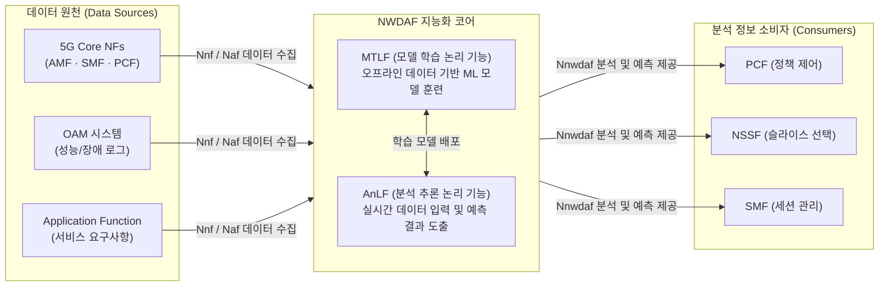

# NWDAF (Network Data Analytics Function)

---

## I. 5G/6G 코어망의 지능화 분석 엔진, NWDAF의 개요

### 가. 정의

- 5G 코어 네트워크(5GC)의 다양한 네트워크 기능(NF), OAM, 애플리케이션(AF)으로부터 운영 데이터를 수집하고 기계학습(ML) 기반의 분석 및 예측을 수행하여, **타 NF에 최적화 인사이트를 제공하는 3GPP 표준 네트워크 지능화 엔진**

### 나. 특징 및 필요성

| 구분 | 내용 |
| --- | --- |
| 자율형 네트워크 실현 | 복잡한 5G/6G 초연결 환경에서 사람의 수동 개입을 배제한 제로 터치(Zero-Touch) 네트워크 자동 운영 달성 |
| SBA 네이티브 연동 | 5G 서비스 기반 아키텍처(SBA) 내에서 표준화된 RESTful API(`Nnwdaf`)를 통해 분석 데이터를 서비스 형태로 제공 |
| 슬라이싱 동적 최적화 | 네트워크 슬라이스별 트래픽 부하 및 성능 저하를 사전 예측하여 선제적 자원 증설 및 재할당 지원 |
| 논리 기능 분리 (R17) | 모델 훈련 기능(MTLF)과 실시간 추론 기능(AnLF)을 분리하여 엣지와 중앙 클라우드 간 분산 배치 지원 |

---

## II. 개념도 및 핵심 구성요소

### 가. 개념도 (SBA 내 데이터 수집 및 분석 제공)

- 코어망 NFs와 OAM으로부터 트래픽 및 단말 이벤트를 수집하여 MTLF에서 모델을 훈련하고, AnLF가 실시간 추론을 수행하여 정책 결정 NF들에 최적화 정보를 통지

### 나. 핵심 기술 요소

| 구분 | 요소 | 설명 |
| --- | --- | --- |
| 논리 아키텍처 | AnLF (Analytics Logical Function) | 수집된 실시간 데이터를 ML 모델에 입력하여 통계 및 미래 예측 결과를 생성하고 소비자에게 전달 |
| | MTLF (Model Training Logical) | 대규모 이력(Historical) 데이터를 수집하여 분석 모델을 학습시키고 AnLF에 최신 모델 배포 |
| 표준 인터페이스 | Nnwdaf_EventsSubscription | 소비자 NF가 특정 분석 이벤트(혼잡 임계치 초과, QoS 저하 등)를 상시 모니터링하기 위한 구독/통지 API |
| | Nnwdaf_AnalyticsInfo | 소비자 NF가 특정 단말이나 슬라이스에 대한 분석 결과를 단발성으로 질의(Request/Response)하는 API |
| | Nnf_EventExposure | AMF, SMF, UDM 등 5G 코어망 NFs로부터 단말 이동성 및 세션 상태 데이터를 수집하기 위한 API |
| 주요 분석 유즈케이스 | Network Slice Load | 슬라이스별 부하 및 가용 자원을 예측하여 슬라이스 승인 제어 및 동적 오케스트레이션 연동 |
| | UE Mobility Analytics | 단말의 이동 궤적과 체류 시간을 학습하여 최적의 페이징(Paging) 영역 설정 및 사전 핸드오버 수행 |
| | QoS Sustainability | 특정 위치 및 시간대의 서비스 품질 유지 가능 여부를 예측하여 비디오 화질 등 사전 적응 |

---

## III. 표준 진화 비교 및 동향

### 가. 3GPP 릴리즈별 NWDAF 기술 진화

| 비교 항목 | Release 15 (도입기) | Release 16 (발전기) | Release 17 ~ 18 (고도화/현재) |
| --- | --- | --- | --- |
| 주요 기능 | 단일 NWDAF 구조, 기본 통계 수집 | SBA 완전 연동, 다중 유즈케이스(QoS/이동성) 정의 | **MTLF와 AnLF의 기능 분리**, 분산형 배치 |
| 학습 및 추론 | 중앙 집중형 단일 구조 | 중앙 분석 중심 | 계층형/분산형 분석, **연합학습(Federated Learning)** 지원 |
| 지능화 범위 | 기초적인 네트워크 부하 모니터링 | 슬라이스 및 단말 예측 기능 본격화 | AI/ML 생명주기 관리 및 자율 제어(Closed-loop) 연동 |
| 타 시스템 연동 | 코어망 내부 NFs 한정 | AF(애플리케이션) 연계 확장 | O-RAN의 RIC 및 엣지 MEC와 통합 지능화 연계 |

### 나. 동향

- **연합학습(Federated Learning) 기반 분산 프라이버시 보호**: 단말 및 기지국의 원시 데이터를 중앙 코어망으로 수집하지 않고, 로컬에서 모델을 학습한 후 가중치만 전송해 결합하는 프라이버시 보존형 지능망 구현
- **O-RAN 무선망 지능(RIC)과의 결합**: 코어망 분석을 담당하는 NWDAF와 무선 기지국 최적화를 담당하는 O-RAN RIC가 인터페이스를 연동하여 종단간(End-to-End) 전구간 네트워크 최적화 달성
- **6G AI-Native 통신의 핵심 코어로 발전**: 단순한 부가 분석 기능을 넘어 망 설계 단계부터 AI 모델이 내재화되는 6G 자율 운영 통신의 인지 제어 평면으로 확장

---

### 🔗 연관 토픽

- **소속 도메인**: [[00_네트워크_MOC|🌐 네트워크]]
- **세부 분류**: `4. 무선 및 차세대 이동통신 (5G/6G/Wi-Fi)`
- **핵심 연관 토픽**:
  - [[QoS]]
  - [[네트워크 슬라이싱]]
  - [[O-RAN]]
  - [[5G 특화망]]
  - [[Mobile Edge Computing|Mobile Edge Computing (MEC)]]
