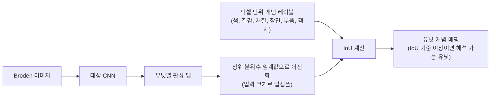

# Network Dissection (네트워크 해부)

---

## I. 뉴런이 무엇을 보는지 재는, Network Dissection의 개요

### 가. 정의

- CNN 은닉층의 **개별 유닛(채널) 활성 영역을 픽셀 단위 개념 레이블과 IoU로 비교해, 각 유닛이 어떤 시각 개념에 대응하는지 정량화**하는 해석 기법 (Bau et al., MIT, CVPR 2017)

### 나. 필요성 및 특징

| 구분 | 내용 |
| --- | --- |
| 필요성 | 성능이 높은 [[딥러닝]] 모델 내부 표현을 사람이 이해 가능한 개념으로 설명 ([[XAI]]) |
| 유닛 단위 해석 | 입력 영역이 아닌 내부 뉴런이 학습한 개념을 해석 |
| 정량화 | 활성 영역과 개념 영역의 겹침(IoU)으로 해석 가능성 점수화 |
| 개념 계층 | 앞쪽 층은 색·질감, 뒤쪽 층은 부품·객체 개념이 많이 나타남 |
| 한계 | 대응 관계는 상관이며 인과가 아님, 레이블된 개념 사전 범위에 제한 |

---

## II. 동작 원리 및 구성요소

### 가. 개념도

- 각 유닛의 활성 맵을 이진 마스크로 만들어 Broden 데이터셋의 개념 마스크와 겹침을 계산하고, IoU가 가장 높은 개념을 그 유닛의 레이블로 부여

### 나. 구성요소

| 구분 | 요소 | 설명 |
| --- | --- | --- |
| 데이터 | Broden (Broadly and Densely Labeled) | 여러 데이터셋을 합쳐 색·질감·재질·장면·부품·객체를 픽셀 단위로 레이블 |
| 활성 | 유닛 활성 맵 | 합성곱 층 각 채널의 공간 활성값 |
| 이진화 | 분위수 임계값 | 전체 데이터에서 상위 0.5% 수준 활성을 기준으로 마스크 생성 |
| 지표 | IoU | 활성 마스크와 개념 마스크의 교집합 / 합집합 |
| 결과 | 개념 레이블 | 유닛별 대응 개념과 해석 가능 유닛 수 |
| 분석 | 모델·학습 비교 | 구조, 학습 데이터, 정규화 기법에 따른 해석 가능성 비교 |
| 확장 | GAN Dissection | 생성 모델 유닛을 해부하고 유닛 제거·활성화로 생성물 편집 |

---

## III. 비교 및 동향

### 가. 주요 XAI 기법 비교

| 비교 항목 | Network Dissection | [[GradCAM\|Grad-CAM]] | [[LIME]] |
| --- | --- | --- | --- |
| 분석 대상 | 내부 유닛 | 특정 예측에 기여한 입력 영역 | 개별 예측의 입력 특징 기여 |
| 질문 | 이 뉴런은 무엇을 표현하는가 | 어디를 보고 판단했는가 | 이 예측은 왜 나왔는가 |
| 필요 자원 | 픽셀 단위 개념 레이블 데이터 | 모델 기울기 | 모델 질의(블랙박스 가능) |
| 범위 | 전역(모델 구조) | 국소(예측별) | 국소(예측별) |

### 나. 동향

- **기계적 해석 가능성**: LLM 내부 뉴런·회로를 분석하는 Mechanistic Interpretability, 희소 오토인코더(SAE)로 다의적 뉴런을 개념 특징으로 분해
- **자동 개념 레이블링**: CLIP-Dissect 등 비전-언어 모델로 레이블 데이터 없이 유닛 개념 부여
- **편향·안전 진단**: 특정 개념(성별·배경 등)에 반응하는 유닛을 찾아 [[편향]] 원인 분석

---

### 🔗 연관 토픽

- **소속 도메인**: [[00_인공지능_MOC|🤖 인공지능]]
- **세부 분류**: `1. 수학 · 통계학 & 데이터 전처리`
- **핵심 연관 토픽**:
  - [[XAI]]
  - [[GradCAM]]
  - [[LRP]]
  - [[CNN|CNN (Convolutional Neural Network)]]
  - [[LIME]]
