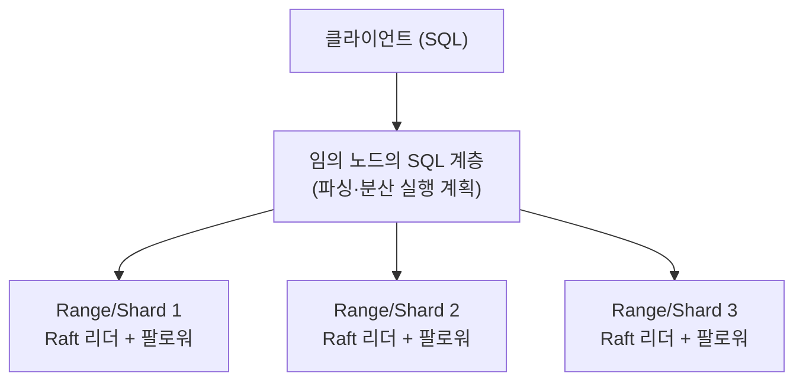

# NewSQL

---

## I. 확장성과 ACID의 공존, NewSQL의 개요

### 가. 정의

- NoSQL 수준의 **수평 확장성과 RDBMS의 SQL·ACID 트랜잭션을 함께 제공하는 분산 관계형 데이터베이스** 계열 (451 Group, 2011 명명, 분산 SQL이라고도 함)

### 나. 등장 배경 및 특징

| 구분 | 내용 |
| --- | --- |
| RDBMS 한계 | 단일 노드 중심 구조로 수평 확장 어려움 |
| NoSQL 한계 | 확장성은 높지만 조인·다중 행 트랜잭션·강한 일관성 지원 제약 |
| 구조 | 무공유(Shared-Nothing) 노드, 자동 샤딩·재분배 |
| 일관성 | 합의 알고리즘 기반 복제, 분산 트랜잭션 |

---

## II. 아키텍처 및 구성요소

### 가. 분산 구조

- 데이터를 키 범위로 나눠 샤드별 Raft·Paxos 그룹으로 복제하고, 여러 샤드에 걸친 트랜잭션은 분산 커밋 프로토콜로 원자성 확보

### 나. 구성요소

| 구분 | 요소 | 설명 |
| --- | --- | --- |
| 분할 | 자동 샤딩 | 키 범위·해시로 분할, 크기·부하에 따라 자동 분할·이동 ([[샤딩]]) |
| 복제 | Raft·Paxos | 과반 합의 후 커밋, 소수 파티션 쪽은 쓰기 불가 ([[합의 알고리즘]]) |
| 트랜잭션 | 분산 커밋 | 2PC 변형(병렬 커밋 등)으로 다중 샤드 원자성 |
| 시간 | TrueTime·HLC | 노드 간 타임스탬프 순서 결정, 스냅샷 읽기 |
| 동시성 | MVCC | 버전 기반 비차단 읽기 ([[MVCC(다중 버전 동시성 제어) 2가지 유형\|MVCC]]) |
| 저장 | LSM-Tree KV 엔진 | RocksDB·Pebble 등 쓰기 최적화 저장소 |
| 질의 | 분산 옵티마이저 | 데이터 위치를 고려한 조인·집계 푸시다운 |
| 가용성 | 자동 장애 조치 | 리더 장애 시 재선출로 수 초 내 복구 ([[HA(High Availability)\|고가용성]]) |

---

## III. 비교 및 동향

### 가. RDBMS vs NoSQL vs NewSQL

| 비교 항목 | RDBMS | [[NoSQL (CAP 이론 BASE 속성)\|NoSQL]] | NewSQL |
| --- | --- | --- | --- |
| 확장 | Scale-Up 중심 | Scale-Out | Scale-Out |
| 트랜잭션 | ACID | 제품별 제한적 (단일 문서·최종 일관성 중심) | 분산 ACID |
| 데이터 모델 | 관계형 | KV·문서·컬럼·그래프 | 관계형 (SQL) |
| 구조 | 단일 노드·공유 디스크 | 무공유 | 무공유 |
| 약점 | 확장 비용 | 복잡한 조인·트랜잭션 | 노드 간 지연, 운영 복잡성 |
| 예 | Oracle, PostgreSQL | MongoDB, Cassandra | Spanner, [[CockroachDB]], TiDB, YugabyteDB |

### 나. 동향

- **관리형·서버리스 제공**: Spanner, CockroachDB Cloud, TiDB Cloud 등 사용량 기반 서비스 확산
- **PostgreSQL 호환 경쟁**: YugabyteDB, CockroachDB, AlloyDB Omni 등 PostgreSQL 생태계 호환 강화
- **벡터 검색 내장**: TiDB·Spanner 등이 벡터 타입·인덱스를 추가해 관계형 데이터와 함께 처리

---

### 🔗 연관 토픽

- **소속 도메인**: [[00_데이터베이스_MOC|🗄️ 데이터베이스]]
- **세부 분류**: `2. 트랜잭션 & 동시성 제어 (Concurrency)`
- **핵심 연관 토픽**:
  - [[CockroachDB|CockroachDB(코크로치DB)]]
  - [[분산 데이터베이스|분산 데이터베이스 (Distributed Database)]]
  - [[NoSQL (CAP 이론 BASE 속성)]]
  - [[PACELC]]
  - [[합의 알고리즘]]
