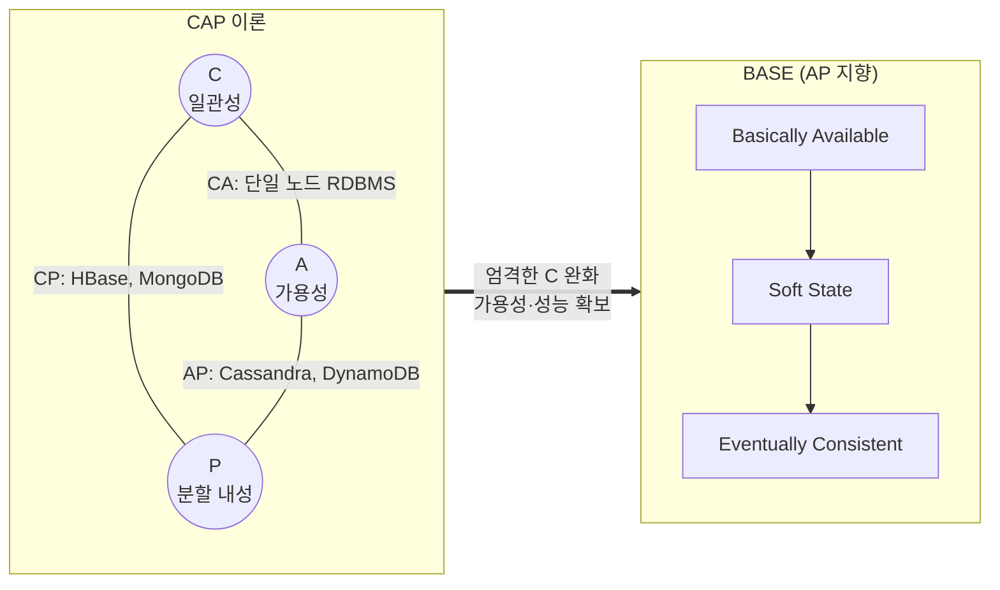

# NoSQL (CAP 이론, BASE 속성)

---

## I. 대규모 분산 데이터 처리, NoSQL과 CAP·BASE의 개요

### 가. 정의

- **NoSQL**: 비정형 데이터의 대규모 처리와 수평 확장(Scale-out)을 위해 유연한 [[스키마]]를 가지며, RDBMS의 엄격한 [[트랜잭션]](ACID) 제약을 완화한 비관계형 [[데이터베이스]]
- **CAP 이론**: [[분산 데이터베이스]]는 일관성(C)·가용성(A)·분할 내성(P) 중 **동시에 최대 두 가지만** 만족할 수 있다는 정리 (Brewer 추측 2000, Gilbert·Lynch 증명 2002)
- **BASE**: 강한 일관성 대신 가용성을 우선하는 NoSQL의 설계 철학 (Basically Available, Soft state, Eventually consistent)

### 나. 등장 배경

| 구분 | 내용 |
| --- | --- |
| 확장 한계 | 빅데이터·클라우드 환경에서 단일 RDBMS의 수직 확장(Scale-up) 한계 |
| 요구 변화 | 강한 일관성보다 [[HA(High Availability)\|고가용성]]·응답 성능을 중시하는 서비스 증가 |
| 설계 전제 | 분산 환경에서 네트워크 분할(P)은 피할 수 없으므로 C와 A 사이에서 선택 |

---

## II. CAP 이론과 BASE 속성

### 가. CAP–BASE 관계 개념도

- 분산 시스템에서 P는 포기할 수 없으므로 실제 선택은 **CP 또는 AP**이며, BASE는 AP 구조에서 일시적 불일치를 허용하고 결국 동기화를 완료하는 방식

### 나. 핵심 속성

| 분류 | 속성 | 설명 |
| --- | --- | --- |
| CAP | Consistency | 모든 노드가 같은 시점에 같은 데이터를 반환 |
| | Availability | 일부 노드 장애에도 모든 요청에 응답 |
| | Partition Tolerance | 노드 간 통신 단절에도 시스템 전체는 동작 |
| BASE | Basically Available | 부분 장애 시에도 기본 서비스 제공 |
| | Soft State | 외부 입력 없이도 상태가 바뀔 수 있는 과도기적 불일치 허용 |
| | Eventually Consistent | 일정 시간이 지나면 모든 노드가 최신 값으로 수렴 |
| 구현 기법 | Quorum | 복제본 N, 쓰기 W, 읽기 R에서 **W + R > N**이면 최신 값 읽기 보장 |
| | Gossip Protocol | 노드가 무작위로 상태를 교환하며 클러스터 상태 전파 |

### 다. NoSQL 데이터 모델

| 유형 | 특징 | 예시 |
| --- | --- | --- |
| Key-Value | 단순 키 조회, 초고속 캐시 | Redis, DynamoDB |
| Document | [[JSON]] 문서 단위 저장, 유연한 스키마 | MongoDB, Couchbase |
| Column Family | 대용량 쓰기, 컬럼 패밀리 단위 저장 | Cassandra, HBase |
| Graph | 노드·엣지 관계 탐색 | Neo4j |

---

## III. RDBMS와의 비교 및 발전 동향

### 가. ACID(RDBMS) vs BASE(NoSQL)

| 비교 항목 | RDBMS (ACID) | NoSQL (BASE) |
| --- | --- | --- |
| 일관성 | 강한 일관성 | 최종 일관성 |
| 가용성 | 상대적으로 낮음 (잠금·블로킹) | 높음 (부분 장애 허용) |
| 스키마 | 고정 (Schema-on-Write) | 유연 (Schema-on-Read) |
| 확장 | Scale-up 위주 | Scale-out 위주 |
| 설계 철학 | 비관적 (충돌 가정) | 낙관적 (충돌 드묾 가정) |
| 적용 분야 | 금융, 결제, ERP | SNS, IoT 로그, 실시간 추천 |

### 나. 발전 동향

- **[[PACELC]]**: CAP가 설명하지 못하는 정상 상태(Else)의 지연시간(L)–일관성(C) 트레이드오프까지 포함한 확장 모델
- **[[New SQL|NewSQL]]**: Spanner, [[CockroachDB]] 등 NoSQL의 확장성과 ACID 트랜잭션을 함께 제공
- **멀티 모델 DB**: 하나의 엔진에서 Key-Value·Document·Graph와 [[SQL(Structured Query Language)|SQL]]을 함께 지원

---

### 🔗 연관 토픽

- **소속 도메인**: [[00_데이터베이스_MOC|🗄️ 데이터베이스]]
- **세부 분류**: `1. 데이터 모델링 & 관계형 DB 설계`
- **핵심 연관 토픽**:
  - [[PACELC]]
  - [[분산 데이터베이스|분산 데이터베이스 (Distributed Database)]]
  - [[New SQL]]
  - [[NoSQL 데이터모델링 패턴]]
  - [[CockroachDB|CockroachDB(코크로치DB)]]
