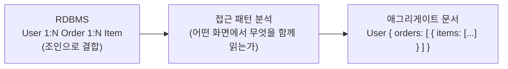

# NoSQL 데이터모델링 패턴

---

## I. 질의가 구조를 결정, NoSQL 데이터모델링의 개요

### 가. 정의

- 정규화 중심의 관계형 설계와 달리 **애플리케이션의 접근 패턴(Query Pattern)을 먼저 정하고 그에 맞게 데이터를 중복·내장해 구조화하는 설계 기법**

### 나. 특징

| 구분 | 내용 |
| --- | --- |
| Query-Driven | 저장 구조보다 질의 형태를 먼저 분석 |
| 반정규화 | 조인 대신 중복·내장(Embedding)으로 한 번에 읽기 |
| 애그리게이트 단위 | 함께 읽고 쓰는 데이터를 하나의 단위로 묶음 |
| 유연한 스키마 | 요구 변화에 따라 필드 추가가 쉬움 |

---

## II. 모델링 구조 및 패턴

### 가. RDBMS 모델 → NoSQL 모델 전환

- 함께 조회되는 엔티티를 하나의 문서·파티션으로 내장해 조인 없이 1회 조회로 처리

### 나. 주요 패턴

| 구분 | 요소 | 설명 |
| --- | --- | --- |
| 기본 | 반정규화 | 조회 효율을 위해 데이터 중복 저장 |
| | 애그리게이트 | 연관 개체를 [[JSON]] 문서·컬럼 패밀리 하나로 묶음 |
| 관계 표현 | 내장 (Embedding) | 1:1·1:소수 관계를 하위 문서로 포함 |
| | 참조 (Referencing) | 1:다수·N:M은 ID 참조 후 애플리케이션 조인 |
| 조회 최적화 | 구체화 뷰 | 집계·검색 결과를 미리 계산해 별도 저장 |
| | 인덱스 테이블 | 보조 인덱스가 없는 저장소에서 조회용 매핑 테이블 생성 |
| 계층 | 트리 집계 | Materialized Path, Nested Set으로 계층 표현 |
| 키 설계 | 복합 키 | 파티션 키 + 정렬 키로 분산과 범위 조회를 함께 충족 |
| | 싱글 테이블 설계 | 여러 엔티티를 한 테이블에 두고 키 접두어로 구분 (DynamoDB) |

---

## III. 비교 및 동향

### 가. RDBMS 모델링 vs NoSQL 모델링

| 비교 항목 | RDBMS 모델링 | [[NoSQL (CAP 이론 BASE 속성)\|NoSQL]] 모델링 |
| --- | --- | --- |
| 출발점 | 데이터·엔티티 | 질의·접근 패턴 |
| 논리 설계 | ERD, 정규화 | 접근 패턴 목록, 애그리게이트 정의 |
| 물리 설계 | 테이블·인덱스, 제한적 반정규화 | 내장·중복, 복합 키, 파티션·[[샤딩]] 키 |
| 핵심 기준 | [[무결성]], 중복 최소화 | 성능, 확장성 |
| 변경 대응 | 스키마 변경 필요 | 새 질의마다 모델 재설계 가능성 |

### 나. 동향

- **멀티 모델 DB**: Cosmos DB, ArangoDB 등이 Document·Graph·Key-Value를 함께 지원
- **벡터 검색 통합**: MongoDB Atlas Vector Search처럼 문서에 임베딩을 함께 저장해 RAG에 활용
- **조정 가능한 일관성**: Cassandra·Cosmos DB의 일관성 수준 선택을 모델 설계에 반영

---

### 🔗 연관 토픽

- **소속 도메인**: [[00_데이터베이스_MOC|🗄️ 데이터베이스]]
- **세부 분류**: `1. 데이터 모델링 & 관계형 DB 설계`
- **핵심 연관 토픽**:
  - [[NoSQL (CAP 이론 BASE 속성)]]
  - [[데이터베이스 반정규화]]
  - [[샤딩]]
  - [[데이터베이스 모델링]]
  - [[조인|조인(Join)]]
