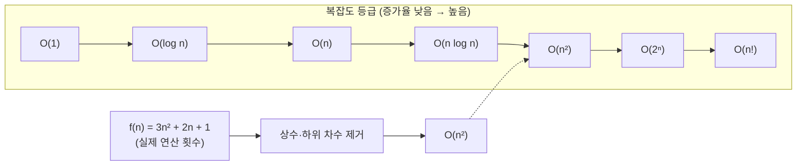

# O-Notation (빅오 표기법)

---

## I. 알고리즘 성능 평가의 핵심 기준, 빅오 표기법의 개요

### 가. 정의

- 입력 크기 $n$이 커질 때 알고리즘의 실행 시간·메모리 사용량 **증가율의 상한(Upper Bound)** 을 최고차항으로 표현하는 점근적 표기법
- $n \ge n_0$인 모든 $n$에 대해 $f(n) \le c \cdot g(n)$을 만족하는 양의 상수 $c, n_0$가 있으면 $f(n) = O(g(n))$

### 나. 필요성 및 특징

| 구분 | 내용 |
| --- | --- |
| 환경 독립성 | 하드웨어·언어와 무관하게 [[알고리즘]] 자체의 효율 비교 |
| 확장성 예측 | 데이터 증가에 따른 성능 저하 추세 파악 |
| 단순화 | 상수와 낮은 차수 항을 생략 (예: $3n^2 + 2n + 1 \rightarrow O(n^2)$) |
| 최악 보장 | 주로 최악의 경우 실행 시간이 넘지 않는 한계를 표현하는 데 사용 |

---

## II. 복잡도 등급 및 계산 규칙

### 가. 개념도

- 어떤 지점 $n_0$ 이후로 실제 실행 시간 $f(n)$은 항상 $c \cdot g(n)$ 아래에 있음

### 나. 주요 복잡도 등급

| 등급 | 의미 | 예시 |
| --- | --- | --- |
| $O(1)$ | 입력 크기와 무관 | 배열 인덱스 접근, [[해시 테이블]] 조회(평균) |
| $O(\log n)$ | 매 단계 탐색 범위 절반 | 이진 탐색, 균형 [[이진 탐색 트리]], B-Tree |
| $O(n)$ | 입력에 비례 | 선형 탐색, 연결 리스트 순회 |
| $O(n \log n)$ | 비교 기반 정렬의 하한 수준 | [[병합 정렬]], [[힙]] 정렬, [[퀵 정렬]](평균) |
| $O(n^2)$ | 이중 반복 | [[버블 정렬]], 선택·[[삽입 정렬]] |
| $O(2^n)$, $O(n!)$ | 조합 폭발 | 부분집합·순열 전수 탐색 |

### 다. 계산 규칙

| 규칙 | 내용 |
| --- | --- |
| 상수 제거 | $O(c \cdot f(n)) = O(f(n))$ |
| 합의 법칙 | $O(f(n) + g(n)) = O(\max(f(n), g(n)))$ → 순차 구문은 큰 쪽 |
| 곱의 법칙 | $O(f(n)) \times O(g(n)) = O(f(n) \cdot g(n))$ → 중첩 반복 |

---

## III. 점근적 표기법 비교 및 동향

### 가. O vs Ω vs Θ

| 구분 | Big-O ($O$) | Big-Omega ($\Omega$) | Big-Theta ($\Theta$) |
| --- | --- | --- | --- |
| 의미 | 점근적 상한 | 점근적 하한 | 상한과 하한을 동시에 만족 (Tight Bound) |
| 수식 | $f(n) \le c \cdot g(n)$ | $f(n) \ge c \cdot g(n)$ | $c_1 g(n) \le f(n) \le c_2 g(n)$ |
| 주 사용 | 최악의 경우 성능 보장 | 최선의 경우·문제의 하한 | 정확한 증가율 |
| 퀵 정렬 예 | 최악 $O(n^2)$ | 최선 $\Omega(n \log n)$ | 평균 $\Theta(n \log n)$ |

- 시험 답안에서는 관례적으로 O = 최악, Ω = 최선, Θ = 평균으로 대응시키지만, 엄밀히는 **경계(bound)의 종류**이며 어떤 경우(최악·평균)에도 적용 가능

### 나. 동향

- **Space-Time Trade-off**: 메모리를 더 써서 시간을 줄이는 캐싱·인메모리 DB(Redis $O(1)$ 조회) 설계 일반화
- **AI 연산 최적화**: [[트랜스포머]] Self-Attention의 $O(n^2)$ 문제를 Linear Attention, SSM(Mamba) 등으로 $O(n)$ 수준까지 낮추는 연구
- **양자 알고리즘**: 쇼어 알고리즘이 소인수분해를 다항 시간에 해결 → 암호 체계 전환 필요 ([[쇼어 & 그루버 알고리즘]])

---

### 🔗 연관 토픽

- **소속 도메인**: [[00_컴퓨터구조_MOC|💻 컴퓨터구조]]
- **세부 분류**: `2. 캐시 & 메모리 계층 구조 · 스토리지`
- **핵심 연관 토픽**:
  - [[알고리즘 성능평가]]
  - [[알고리즘]]
  - [[퀵 정렬|퀵 정렬 (Quick Sort)]]
  - [[해시 테이블]]
  - [[병합 정렬|병합 정렬 (Merge Sort)]]
