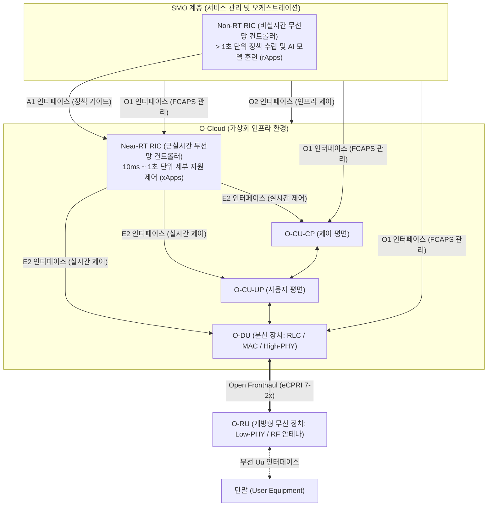

# O-RAN (Open Radio Access Network)

---

## I. 개방성과 가상화 기반의 차세대 기지국 혁신, O-RAN의 개요

### 가. 정의

- 특정 통신 장비 제조사의 종속성(Vendor Lock-in)을 탈피하기 위해 **기지국 하드웨어와 소프트웨어를 분리(Disaggregation)하고, 표준화된 개방형 인터페이스와 AI 지능형 컨트롤러(RIC)를 적용한 개방형 무선 접속망 아키텍처**

### 나. 특징 및 필요성

| 구분 | 내용 |
| --- | --- |
| 벤더 종속 탈피 | O-RU와 O-DU 간 인터페이스를 표준화하여 서로 다른 제조사의 하드웨어와 소프트웨어를 자유롭게 조합 가능 |
| 비용 절감 (CAPEX/OPEX) | 전용 통신 장비 대신 표준 COTS(상용 x86/ARM) 서버 및 화이트박스 하드웨어 활용으로 구축·운영비 절감 |
| 개방형 프론트홀 | eCPRI 및 IEEE 1914.3(RoE) 기반의 O-RAN Open Fronthaul 표준 인터페이스(Option 7-2x Split) 채택 |
| AI/ML 지능화 제어 | 무선망 지능형 컨트롤러(RIC)를 통해 트래픽 분산, 핸드오버, 에너지 절감 알고리즘을 실시간 자율 제어 |

---

## II. 개념도 및 핵심 구성요소

### 가. 개념도 (O-RAN 얼라이언스 표준 아키텍처)

- 기지국 기능을 O-CU, O-DU, O-RU로 분할하고 개방형 인터페이스로 상호 연결하며, SMO의 Non-RT RIC와 O-Cloud의 Near-RT RIC가 결합되어 AI 기반 무선망 자율 최적화 수행

### 나. 핵심 기술 요소

| 구분 | 요소 | 설명 |
| --- | --- | --- |
| 분할 기지국 개체 | O-RU (Open Radio Unit) | 기지국 RF 무선 신호 송수신 및 하위 물리 계층(Lower PHY)을 담당하는 안테나 결합 장치 |
| | O-DU (Open Distributed Unit) | RLC, MAC, 상위 물리 계층(High PHY)을 처리하며 O-RU와 패킷 데이터를 고속 교환 |
| | O-CU (Open Centralized Unit) | RRC, SDAP, PDCP 프로토콜을 집중 처리하며 제어부(CP)와 사용자부(UP)로 분리 운영 |
| 지능화 제어 (RIC) | Non-RT RIC | SMO 내에 위치하여 1초 이상의 장기 데이터 분석, AI/ML 모델 학습, 글로벌 정책 수립 (rApp 구동) |
| | Near-RT RIC | 10ms ~ 1초 단위로 무선 베어러 제어, 간섭 완화, 핸드오버 최적화 등 근실시간 자원 제어 (xApp 구동) |
| 표준 인터페이스 | Open Fronthaul | O-DU와 O-RU 사이를 연결하는 7-2x 기능 분할 기반 표준 eCPRI 인터페이스 규격 |
| | A1 / E2 / O1 | Non-RT RIC와 Near-RT RIC 간 정책 전달(A1), RIC와 E2 노드 간 제어(E2), SMO 관리(O1) |
| 가상화 인프라 | O-Cloud | O-CU, O-DU, RIC 가상 네트워크 기능이 배포되어 실행되는 클라우드 컴퓨팅 플랫폼 |

---

## III. 전통적 기지국 비교 및 동향

### 가. Traditional RAN vs O-RAN

| 비교 항목 | Traditional RAN (기존 기지국) | O-RAN (개방형 무선망) |
| --- | --- | --- |
| 장비 구조 | 하드웨어-소프트웨어 일체형 폐쇄 구조 | 기능 분할(CU-DU-RU) 및 소프트웨어 가상화(vRAN) |
| 벤더 종속성 | 단일 벤더 독점 (Vendor Lock-in 발생) | 개방형 인터페이스로 다중 벤더 장비 간 완벽 호환 |
| 프론트홀 규격 | 제조사별 독자 규격 (비표준 CPRI) | 글로벌 표준 Open Fronthaul (eCPRI 7-2x) |
| 하드웨어 환경 | 제조사 전용 고가 통신 보드/ASIC | 표준 상용 x86/ARM 서버(COTS) 및 가속기 카드 |
| 망 최적화 | 제조사 정적 룰 및 수동 엔지니어링 | RIC 기반 AI/ML 알고리즘(xApp/rApp) 실시간 자율 제어 |

### 나. 동향

- **글로벌 통신사의 대규모 상용망 O-RAN 도입**: 미국(AT&T, Verizon), 일본(라쿠텐 모바일, NTT 도코모) 등을 중심으로 수십억 달러 규모의 멀티 벤더 O-RAN 전국망 전환 계약 체결
- **O-RAN 얼라이언스와 통신 보안 강화**: 개방형 인터페이스 도입에 따른 보안 공격 표면 확대를 방지하기 위해 제로 트러스트(Zero Trust) 및 하드웨어 보안 모듈(RoT) 표준화 진행
- **6G 지능형 자율망의 기본 아키텍처 채택**: 6G 통신의 핵심 비전인 AI-Native 무선망과 서브테라헤르츠(THz) 커버리지 최적화의 기반 플랫폼으로 O-RAN 표준 확장

---

### 🔗 연관 토픽

- **소속 도메인**: [[00_네트워크_MOC|🌐 네트워크]]
- **세부 분류**: `4. 무선 및 차세대 이동통신 (5G/6G/Wi-Fi)`
- **핵심 연관 토픽**:
  - [[C-RAN(Centralized Cloud RAN)|C-RAN]]
  - [[NFV]]
  - [[가상화]]
  - [[NWDAF(Network Data Analytics Function)|NWDAF]]
  - [[5G 특화망]]
