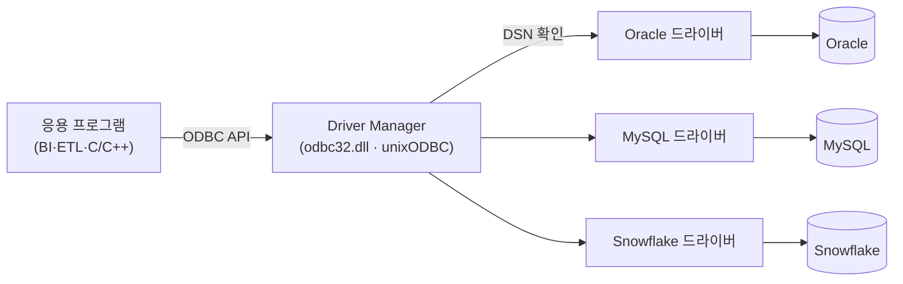

# ODBC (Open Database Connectivity)

---

## I. DBMS 독립적 접근 표준, ODBC의 개요

### 가. 정의

- 응용 프로그램이 **DBMS 종류와 무관하게 같은 함수 호출로 데이터베이스에 접근하도록 하는 C 기반 표준 API** (Microsoft, 1992, SQL Access Group CLI 기반)

### 나. 특징

| 구분 | 내용 |
| --- | --- |
| DBMS 독립성 | 드라이버만 바꾸면 Oracle·MySQL·SQL Server 등 접근 |
| 드라이버 구조 | Driver Manager가 DSN에 맞는 드라이버를 로드 |
| 표준 기반 | X/Open·ISO SQL/CLI(ISO/IEC 9075-3)와 호환 |
| 동적 SQL | 실행 시점에 SQL 문자열을 전달·실행 ([[Dynamic SQL (동적 SQL)\|Dynamic SQL]]) |

---

## II. 아키텍처 및 구성요소

### 가. ODBC 계층 구조

- 응용은 ODBC API만 호출하고, 드라이버가 이를 각 DBMS 고유 프로토콜로 변환

### 나. 구성요소

| 구분 | 요소 | 설명 |
| --- | --- | --- |
| 계층 | ODBC API | 연결·실행·결과 조회용 표준 C 함수 (SQLConnect, SQLExecDirect, SQLFetch) |
| | Driver Manager | DSN 해석, 드라이버 로드·호출 중계 |
| | Driver | ODBC 호출을 DBMS 네이티브 프로토콜로 변환 |
| | Data Source (DSN) | 서버 주소·포트·드라이버 등 연결 정보의 논리 이름 |
| 핸들 | Environment·Connection | 전역 환경, DB 연결 단위 관리 |
| | Statement | SQL 실행, 파라미터 바인딩 |
| 결과 | 커서 (Result Set) | 결과 행 집합을 순회하며 조회 |
| 플랫폼 | unixODBC·iODBC | Linux·macOS용 Driver Manager |

---

## III. 비교 및 동향

### 가. ODBC vs JDBC vs OLE DB

| 비교 항목 | ODBC | [[JDBC]] | OLE DB |
| --- | --- | --- | --- |
| 기반 | C API | Java API | COM 인터페이스 |
| 플랫폼 | 드라이버에 따라 다중 OS | JVM 위에서 OS 독립 | Windows |
| 대상 | 관계형 DB 중심 | 관계형 DB 중심 | 관계형 + 비관계형 소스 |
| 활용 | BI 도구, 네이티브 앱 | Java·Spring 애플리케이션 | 레거시 Windows 앱 (ADO) |

### 나. 동향

- **BI·클라우드 DW 연동**: Tableau·Power BI가 Snowflake·Databricks·BigQuery에 ODBC 드라이버로 접속
- **고속 컬럼 전송**: 대용량 추출에는 행 단위 ODBC 대신 Apache Arrow 기반 ADBC·Arrow Flight SQL 등장

---

### 🔗 연관 토픽

- **소속 도메인**: [[00_데이터베이스_MOC|🗄️ 데이터베이스]]
- **세부 분류**: `1. 데이터 모델링 & 관계형 DB 설계`
- **핵심 연관 토픽**:
  - [[JDBC]]
  - [[DBMS]]
  - [[Dynamic SQL (동적 SQL)]]
  - [[SQL(Structured Query Language)]]
  - [[데이터 가시화|데이터 가시화 (Data Visualization)]]
