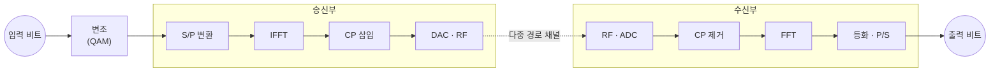

# OFDM (Orthogonal Frequency Division Multiplexing)

---

## I. 겹쳐도 간섭하지 않는 부반송파, OFDM의 개요

### 가. 정의

- 고속 데이터를 **서로 직교하는 다수의 저속 부반송파에 나누어 병렬 전송**하는 다중 반송파 변조·[[다중화]] 방식 (LTE·5G NR·Wi-Fi·디지털 방송의 물리 계층)

### 나. 특징

| 구분 | 내용 |
| --- | --- |
| 주파수 효율 | 부반송파 스펙트럼을 겹쳐 배치, 부반송파 사이 보호 대역 불필요 |
| 다중 경로 대응 | 심볼 길이가 길어지고 CP가 지연 확산을 흡수해 ISI 억제 |
| 단순 등화 | 주파수 선택적 채널이 부반송파별 평탄 채널이 되어 1탭 등화 |
| 디지털 구현 | 다수 발진기 대신 IFFT/FFT로 변복조 |
| 단점 | 높은 PAPR, 주파수 오프셋·위상 잡음에 민감 |

---

## II. 구조 및 구성요소

### 가. 송수신 구조

- 병렬 심볼을 IFFT로 시간 영역 신호로 바꾸고, 심볼 끝부분을 앞에 복사한 CP를 붙여 전송

### 나. 구성요소

| 구분 | 요소 | 설명 |
| --- | --- | --- |
| 원리 | 직교성 | 부반송파 간격을 심볼 길이의 역수(Δf = 1/T)로 두어 한 심볼 구간에서 서로 상관이 0 |
| 신호 처리 | IFFT / FFT | 부반송파 생성·분리를 디지털 연산으로 수행 |
| 간섭 대응 | CP (Cyclic Prefix) | 심볼 뒤 일부를 앞에 복사, CP보다 짧은 지연 확산의 ISI 제거 |
| 데이터 분할 | S/P · P/S | 고속 직렬 데이터를 저속 병렬로 나눠 심볼 길이 확대 |
| 채널 추정 | 파일럿 · 참조 신호 | 부반송파별 채널 추정 후 등화 |
| 한계 | PAPR | 부반송파 합성으로 순간 전력이 커져 전력 증폭기 효율 저하 |
| | 동기 민감성 | 주파수 오프셋·도플러로 부반송파 간 간섭(ICI) |
| 다중 접속 | OFDMA | 부반송파·시간 자원 블록을 사용자별로 나눠 할당 |

---

## III. 비교 및 동향

### 가. FDM vs OFDM

| 비교 항목 | FDM | OFDM |
| --- | --- | --- |
| 스펙트럼 | 채널 간 분리, 보호 대역 필요 | 부반송파 겹침, 직교성으로 분리 |
| 대역 효율 | 낮음 | 높음 (채널 가장자리 보호 대역은 필요) |
| 다중 경로 | 등화 복잡 | CP와 1탭 등화로 강인 |
| 구현 | 아날로그 필터·발진기 | IFFT/FFT 디지털 처리 |
| 약점 | 대역 낭비 | PAPR, 동기 민감 |

### 나. 동향

- **가변 Numerology (5G NR)**: 부반송파 간격 15·30·60·120kHz(동기 신호 240kHz)로 대역·지연 요구에 맞춤, LTE는 15kHz 고정
- **상향 PAPR 대책**: LTE 상향은 SC-FDMA, 5G NR 상향은 CP-OFDM과 DFT-s-OFDM을 선택 사용
- **6G 파형**: OFDM 계열 유지가 유력하며 고이동성용 OTFS, AI 기반 수신기 연구 병행

---

### 🔗 연관 토픽

- **소속 도메인**: [[00_네트워크_MOC|🌐 네트워크]]
- **세부 분류**: `2. 네트워크 계층 & 라우팅 프로토콜 (L3)`
- **핵심 연관 토픽**:
  - [[다중화|다중화(Multiplexing)]]
  - [[MIMO]]
  - [[QAM(Quadrature Amplitude Modulation)--|QAM]]
  - [[비직교 다중접속]]
  - [[5G|5G 주요 기술]]
