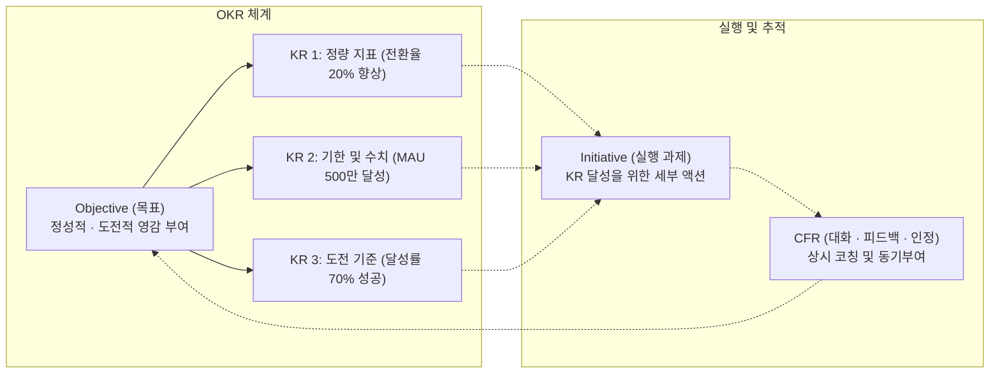

# OKR (Objectives and Key Results)

---

## I. 도전적 목표와 측정 가능한 결과, OKR의 개요

### 가. 정의

- 조직 전체를 한 방향으로 정렬하고 구성원의 자발적 몰입을 유도하기 위해 **도전적 정성 목표(Objective)와 측정 가능한 정량 결과(Key Results)를 수립·추적하는 애자일 성과관리 프레임워크**

### 나. 특징 및 필요성

| 구분 | 내용 |
| --- | --- |
| 등장 배경 | 연 단위 하향식 평가(MBO)의 경직성 극복, 급변하는 환경(VUCA) 대응을 위한 민첩한 궤도 수정 |
| 도전적 목표 | 60~70% 달성 시 성공으로 간주하는 스트레치 골(Stretch Goals)을 통한 한계 돌파 |
| 투명성 | 전 구성원의 목표와 진척도를 전사에 공개하여 부서 간 사일로(Silo) 제거 및 정렬 |
| 보상 분리 | 인사평가·금전적 보상과 엄격히 분리하여 실패 위험에 따른 소극적 목표 설정(Sandbagging) 방지 |
| 짧은 주기 | 분기(Quarterly) 단위 수립·회고와 주 단위 체크인을 통한 기민한 피드백 루프 |

---

## II. 개념도 및 핵심 구성요소

### 가. 개념도

- 목표(O) 하나에 3~5개의 정량적 핵심 결과(KR)를 연결하고, 구체적 실행 과제(Initiative)와 상시 소통 체계(CFR)로 목표를 추적

### 나. 핵심 구성요소

| 구분 | 요소 | 설명 |
| --- | --- | --- |
| 프레임워크 | Objective | 조직의 비전과 방향성을 제시하는 정성적·도전적 목표 (무엇을 이룰 것인가) |
| | Key Results | 목표 달성 여부를 검증하는 구체적·정량적 측정 지표 (어떻게 측정할 것인가, 목표당 3~5개) |
| | Initiative | KR 수치를 개선하기 위해 현장에서 실행하는 구체적인 프로젝트 및 액션 플랜 |
| 운영 원리 | Alignment | 전사-팀-개인 간 목표를 상향식(Bottom-up)과 하향식(Top-down)으로 양방향 연계 |
| | Moonshot | 달성 확률 50~70% 수준의 야심 찬 혁신 목표 설정 (Sweet Spot) |
| | CFR | 지속적 성과 관리를 위한 대화(Conversation), 피드백(Feedback), 인정(Recognition) |
| 관리 도구 | Tracker/Dashboard | 전 구성원의 진척도와 기여도를 실시간 가시화하는 협업 대시보드 |

---

## III. 성과관리 체계 비교 및 동향

### 가. OKR vs KPI vs MBO

| 비교 항목 | OKR | KPI | MBO |
| --- | --- | --- | --- |
| 도입 목적 | 도전적 목표 달성과 비약적 성장 | 비즈니스 프로세스 상태 측정 및 유지 | 연간 성과 평가 및 개인 보상 산정 |
| 지표 성격 | 혁신·도전 지표 (선행 중심) | 현상 유지 지표 (BAU, 후행 중심) | 실적 지표 (할당된 목표, 방어적) |
| 주기 | 분기 단위 수립 및 주 단위 점검 | 일·주·월 단위 상시 모니터링 | 연간 1회 평가 (정적) |
| 투명성 | 전사 완전 공개 (정렬 극대화) | 부서 및 실무 담당자 공유 | 개인별 비공개 원칙 |
| 보상 연계 | 보상과 엄격히 분리 (인사고과 미반영) | 보상 체계와 부분 연계 | 인사고과 및 금전 보상과 직접 연계 |

### 나. 동향

- **애자일 조직 문화 도구로 확장**: 단순 평가 도구를 넘어 자율성과 심리적 안전감을 기반으로 한 전사적 애자일 조직 전환의 매개체로 활용
- **변질 방지 및 하이브리드 운영**: KPI(유지·운영)와 OKR(도전·혁신)을 상호보완적으로 병행 배치하여 핵심 업무 안정성과 미래 성장 동시 확보
- **생성형 AI 기반 목표 정렬 자동화**: LLM을 활용해 상위 조직 목표와 하위 실행 과제 간의 논리적 정렬 상태를 분석하고 KR 측정 지표를 추천하는 솔루션 확산

---

### 🔗 연관 토픽

- **소속 도메인**: [[00_경영전략_MOC|📈 경영전략]]
- **세부 분류**: `5. IT 투자 성과 평가 & 비즈니스 연속성 계획 (BCP)`
- **핵심 연관 토픽**:
  - [[PDCA(Plan-Do-Check-Act, Deming Cycle)]]
  - [[Agile]]
  - [[SLA]]
  - [[린 방법론]]
  - [[DevOps|데브옵스 (DevOps)]]
