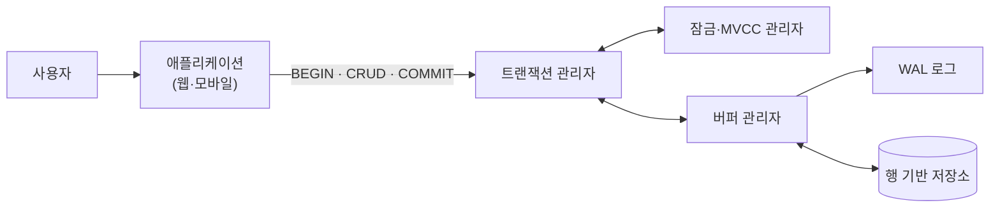

# OLTP (Online Transaction Processing)

---

## I. 실시간 업무 처리, OLTP의 개요

### 가. 정의

- 다수 사용자의 **짧은 [[트랜잭션]](조회·입력·수정·삭제)을 실시간으로 처리하며 ACID를 보장하는 온라인 업무 처리 방식** (주문, 결제, 예약, 계좌 이체)

### 나. 특징

| 구분 | 내용 |
| --- | --- |
| 짧은 트랜잭션 | 소량 행을 다루는 단순 질의가 대량·동시 발생 |
| 무결성 | ACID 준수, 갱신 손실·불일치 방지 |
| 높은 동시성 | [[Locking]]·MVCC로 경합 최소화 |
| 정규화 모델 | 중복 최소화로 [[Anomaly(이상현상)\|이상현상]] 방지 |

---

## II. 구조 및 구성요소

### 가. OLTP 처리 구조

- 짧은 트랜잭션을 동시성 제어와 WAL로 안전하게 처리하고, 인덱스로 단건·좁은 범위를 빠르게 접근

### 나. 핵심 기술

| 구분 | 요소 | 설명 |
| --- | --- | --- |
| 트랜잭션 | ACID | 원자성·일관성·고립성·지속성 보장 |
| 동시성 | MVCC·행 잠금 | 읽기–쓰기 비차단, 쓰기 충돌만 잠금 |
| 모델링 | 정규화 (3NF 이상) | 갱신 이상 방지, 쓰기 효율 ([[데이터베이스 정규화]]) |
| 저장 | 행 기반 저장 | 한 행을 연속 저장해 단건 CRUD 최적화 |
| 인덱스 | B+Tree | 점 질의·좁은 범위 검색 ([[RDBMS 인덱스(index)\|인덱스]]) |
| 회복 | WAL | 로그 선기록으로 장애 복구 ([[DB 회복기법]]) |
| 분산 | 2PC | 여러 DB에 걸친 트랜잭션 원자성 |
| 가용성 | 복제·장애 조치 | Active-Standby 복제로 SPOF 제거 ([[HA(High Availability)\|고가용성]]) |

---

## III. 비교 및 동향

### 가. OLTP vs OLAP

| 비교 항목 | OLTP | [[OLAP]] |
| --- | --- | --- |
| 목적 | 일상 업무 처리 | 의사결정 지원 분석 |
| 데이터 | 현재·상세 | 이력·요약 |
| 접근 | 짧은 CRUD | 대용량 스캔·집계 |
| 모델 | 정규화 | 스타·스노우플레이크 스키마 |
| 저장 | 행 기반 | 열 기반 |
| 성능 지표 | TPS, 응답 시간 | 질의 응답 시간 |

### 나. 동향

- **HTAP**: 행·열 저장을 함께 두어 ETL 없이 실시간 분석 (TiDB, SAP HANA, Oracle In-Memory)
- **분산 SQL**: Spanner, [[CockroachDB]] 등 [[New SQL|NewSQL]]로 수평 확장 OLTP
- **클라우드 관리형**: Aurora·AlloyDB 등 스토리지 분리형 OLTP DB 확산

---

### 🔗 연관 토픽

- **소속 도메인**: [[00_데이터베이스_MOC|🗄️ 데이터베이스]]
- **세부 분류**: `2. 트랜잭션 & 동시성 제어 (Concurrency)`
- **핵심 연관 토픽**:
  - [[OLAP]]
  - [[트랜잭션]]
  - [[병행 제어]]
  - [[New SQL]]
  - [[분산 데이터베이스|분산 데이터베이스 (Distributed Database)]]
