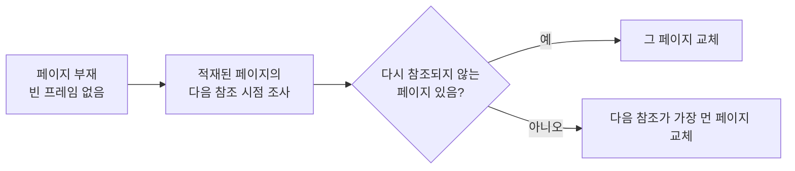

# OPT (Optimal Page Replacement)

---

## I. 미래를 아는 최적 교체, OPT의 개요

### 가. 정의

- 페이지 부재 시 **앞으로 가장 오랫동안 참조되지 않을 페이지를 교체**해 페이지 부재 횟수를 최소로 만드는 [[페이지 교체 알고리즘]] (Belady, 1966, MIN 알고리즘)

### 나. 특징

| 구분 | 내용 |
| --- | --- |
| 최소 부재 | 같은 프레임 수에서 어떤 알고리즘보다 부재 횟수가 적음 (증명됨) |
| 구현 불가 | 미래 참조열을 알아야 하므로 실제 OS에서는 사용 불가 |
| 비교 기준 | 다른 알고리즘 성능 평가의 하한 기준 (시뮬레이션에서 사용) |
| 스택 알고리즘 | [[Belady's Anomaly]] 없음 |

---

## II. 동작 구조 및 구성요소

### 가. 교체 대상 선정

- 예: 참조열 7 0 1 2 0 3 0 4 2 3 0 3 2 1 2 0 1 7 0 1, 프레임 3개에서 2 참조 시 0·1보다 7의 다음 참조가 가장 멀어 7 교체 (총 부재 9회)

### 나. 구성요소

| 구분 | 요소 | 설명 |
| --- | --- | --- |
| 입력 | 참조열 (Reference String) | 프로세스가 참조할 페이지 번호의 순서 |
| 전제 | 미래 지식 | 전체 참조열을 미리 안다는 가정 |
| 선정 | 최장 미참조 페이지 | 다음 참조까지 거리가 가장 먼 페이지 |
| 성질 | 스택 알고리즘 | 프레임 증가 시 부재가 늘지 않음 |
| | 최적성 | 부재 횟수의 하한 (어떤 알고리즘도 이보다 적을 수 없음) |
| 근사 | [[LRU]]·[[LFU]] | 과거 최근성·빈도로 미래를 추정 |
| 지표 | 페이지 부재율 | 전체 참조 중 부재 비율 |

---

## III. 비교 및 동향

### 가. OPT vs LRU vs FIFO

| 비교 항목 | OPT | [[LRU]] | [[FIFO]] |
| --- | --- | --- | --- |
| 기준 | 가장 먼 미래에 참조될 페이지 | 가장 오래전에 참조된 페이지 | 가장 먼저 적재된 페이지 |
| 구현 | 불가능 | 가능 (비용 큼) | 가능 (단순) |
| 부재율 | 최소 | OPT에 근접 | 높음 |
| Belady's Anomaly | 없음 | 없음 | 발생 가능 |
| 용도 | 성능 비교 기준 | 캐시·DB 버퍼, OS 근사 구현 | 단순 버퍼 |

### 나. 동향

- **근사 구현**: 실제 OS는 참조 비트 기반 Clock·[[NUR]]·active/inactive 리스트로 LRU를 근사해 OPT에 다가감
- **캐시 연구의 기준선**: CPU 캐시·CDN 캐시 정책 평가 시 Belady MIN을 상한 기준으로 사용
- **학습 기반 교체**: 과거 접근 패턴으로 재참조 거리를 예측해 OPT를 모방하는 정책 연구 (예: Hawkeye, LRB)

---

### 🔗 연관 토픽

- **소속 도메인**: [[00_운영체제_MOC|⚙️ 운영체제]]
- **세부 분류**: `5. 가상 메모리 관리 & 페이지 교체 알고리즘`
- **핵심 연관 토픽**:
  - [[LRU]]
  - [[LFU]]
  - [[NUR]]
  - [[Belady's Anomaly]]
  - [[페이지 교체 알고리즘|페이지 교체 알고리즘 (Paging Replacement Algorithm)]]
