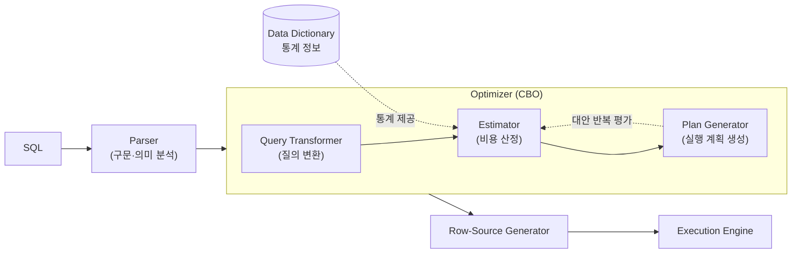

# OPTIMIZER (데이터베이스 옵티마이저)

---

## I. SQL의 최적 실행 경로 결정기, 옵티마이저의 개요

### 가. 정의

- 사용자가 작성한 [[SQL(Structured Query Language)\|SQL]]을 분석하여 I/O·[[CPU]] 비용이 가장 적은 **실행 계획(Execution Plan)** 을 결정하는 [[DBMS]]의 핵심 엔진

### 나. 필요성 및 특징

| 구분 | 내용 |
| --- | --- |
| 선언적 언어 보완 | SQL은 무엇(What)만 기술하므로 어떻게(How) 처리할지 결정하는 모듈 필요 |
| 성능 좌우 | [[조인]] 순서·접근 경로 선택에 따라 응답 시간이 수십~수천 배 차이 |
| 통계 의존 | CBO는 데이터 딕셔너리의 통계 정보에 따라 판단 |
| 진화 | 규칙 기반(RBO) → 비용 기반(CBO) → AI 기반 Learned Optimizer |

---

## II. 옵티마이저 구조 및 핵심 요소

### 가. 처리 흐름

### 나. 핵심 구성요소

| 구분 | 요소 | 설명 |
| --- | --- | --- |
| 세부 모듈 | Query Transformer | 결과가 같은 더 최적화하기 쉬운 형태로 변환 (서브쿼리 Unnesting, View Merging) |
| | Estimator | 선택도·카디널리티·비용 산정 |
| | Plan Generator | 대안 실행 계획 중 최저 비용 계획 선택 |
| 기반 데이터 | 통계 정보 | 테이블·인덱스 크기, Row 수, 히스토그램, 시스템(CPU·I/O) 통계 |
| 지표 | 선택도 (Selectivity) | 조건에 의해 선택될 행의 비율 (균등 분포 가정 시 1 / NDV) |
| | 카디널리티 (Cardinality) | 예상 결과 건수 = 전체 행 수 × 선택도 |
| 물리적 결정 | Access Path | Full Table Scan, [[RDBMS 인덱스(index)\|Index]] Range/Unique Scan |
| | Join Method | Nested Loop, Hash Join, Sort Merge Join |
| 튜닝 | Hint | 통계 부정확 등으로 오판할 때 실행 경로를 강제로 지시 |
| 결과 | Execution Plan | Explain Plan으로 조회하여 튜닝에 활용 ([[DB 성능 개선 방안]]) |

---

## III. 방식 비교 및 동향

### 가. RBO vs CBO

| 비교 항목 | RBO (Rule-Based) | CBO (Cost-Based) |
| --- | --- | --- |
| 기준 | 사전 정의된 우선순위 규칙 (15단계) | 통계 기반 비용 |
| 데이터 분포 | 무시 | 행 수·분포도·클러스터링 팩터 반영 |
| 장점 | 실행 계획 예측 용이 | 데이터 변화에 맞는 현실적 최적화 |
| 단점 | 대용량·복잡 질의에 비효율 | 통계가 오래되면 치명적 오판, 통계 수집 부하 |
| 현황 | 대부분 폐기 | 현대 DBMS 표준 |

### 나. 동향

- **Learned Optimizer (AI4DB)**: 머신러닝으로 다중 조인 카디널리티를 정밀 예측, [[강화학습]]으로 조인 순서 최적화 (예: Bao 연구)
- **자율운영 DB**: 워크로드 패턴을 학습해 인덱스 생성·삭제와 실행 계획 튜닝을 자동화
- **적응형 실행 계획**: 실행 중 실제 건수를 보고 조인 방식을 바꾸는 Adaptive Plan 확산

---

### 🔗 연관 토픽

- **소속 도메인**: [[00_데이터베이스_MOC|🗄️ 데이터베이스]]
- **세부 분류**: `6. SQL 표준 문법 & 쿼리 성능 튜닝`
- **핵심 연관 토픽**:
  - [[SQL(Structured Query Language)]]
  - [[DBMS]]
  - [[RDBMS 인덱스(index)]]
  - [[조인]]
  - [[DB 성능 개선 방안]]
