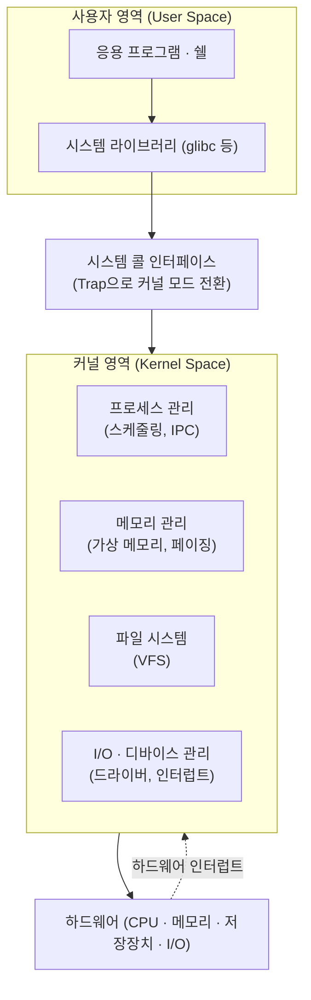

# OS (Operating System, 운영체제)

---

## I. 하드웨어와 사용자 간의 중재자, 운영체제의 개요

### 가. 운영체제의 정의

- 사용자·응용 프로그램과 하드웨어 사이에서 인터페이스를 제공하고, [[CPU]]·메모리·저장장치·I/O 같은 **한정된 자원을 효율적이고 안전하게 관리·분배**하는 시스템 소프트웨어

### 나. 핵심 특징

| 구분 | 내용 |
| --- | --- |
| 자원 [[추상화]] | 복잡한 하드웨어를 [[프로세스]], 가상 메모리, 파일 같은 논리 단위로 제공 |
| 다중 프로그래밍·시분할 | 여러 프로세스를 번갈아 실행해 CPU 활용률 극대화 |
| 보호와 격리 | 커널 모드와 사용자 모드(Dual Mode) 분리, 프로세스별 주소 공간 격리 |

---

## II. 운영체제 구조 및 핵심 기능

### 가. 계층 구조

- 응용 프로그램은 하드웨어에 직접 접근하지 못하고 **시스템 콜**로 커널에 자원을 요청

### 나. 핵심 기능 및 기술

| 기능 | 기술 | 설명 |
| --- | --- | --- |
| [[프로세스 관리]] | [[스케줄링\|CPU 스케줄링]] | FCFS, SJF, RR, MLFQ 등으로 CPU 할당 순서 결정 |
| | [[프로세스간 통신\|IPC]] / [[교착상태]] 관리 | 공유 메모리·메시지 전달, 교착상태 예방·회피·탐지·회복 |
| [[메모리 관리]] | [[가상 메모리]] | 디스크 일부를 메모리처럼 사용해 물리 한계 극복 |
| | 페이징 / [[세그멘테이션]] | 고정 크기 분할(외부 [[단편화]] 없음, 내부 단편화 발생) / 논리 단위 가변 분할(외부 단편화 발생) |
| 파일 시스템 | VFS | EXT4, NTFS 등을 공통 인터페이스로 접근 |
| I/O 관리 | [[인터럽트]] / [[DMA(Direct Memory Access)\|DMA]] | 장치 이벤트 비동기 처리, CPU 개입 없는 메모리 직접 전송 |
| 보호 | Dual Mode | 특권 명령은 커널 모드에서만 실행 ([[CPU Ring Level]]) |

---

## III. 커널 구조 비교 및 최신 동향

### 가. 모놀리식 커널 vs 마이크로커널

| 비교 항목 | 모놀리식 커널 | 마이크로커널 |
| --- | --- | --- |
| 구조 | 모든 OS 서비스가 하나의 커널 공간에 통합 | 최소 기능만 커널에, 나머지는 사용자 영역 서버 |
| 통신 | 커널 내부 함수 호출 | 메시지 전달(IPC) |
| 성능 | 오버헤드가 적어 빠름 | IPC·[[문맥 교환]] 오버헤드 |
| 안정성 | 한 모듈 오류가 전체 장애로 확산 | 오류가 격리되어 안정성 높음 |
| 예시 | Linux, UNIX, Windows(하이브리드) | QNX, L4, Minix, Fuchsia(Zircon) |

### 나. 최신 동향

- **메모리 안전성**: Linux 커널에 Rust 도입(6.1 이후)으로 메모리 취약점 감소
- **eBPF**: 커널 수정 없이 네트워크·보안·관측 기능을 안전하게 확장
- **컨테이너 전용 OS**: 읽기 전용·최소 패키지로 공격 표면을 줄인 Bottlerocket, Talos, Flatcar ([[컨테이너]], [[쿠버네티스]])
- **이기종 스케줄링**: CPU·[[GPU]]·[[NPU]]를 함께 관리하는 AI PC용 스케줄러 ([[온디바이스 AI]])
- **SDV·RTOS**: 자율주행차의 기능안전([[ISO 26262]])을 위한 마이크로커널 기반 차량용 RTOS 확산

---

### 🔗 연관 토픽

- **소속 도메인**: [[00_운영체제_MOC|⚙️ 운영체제]]
- **세부 분류**: `1. 프로세스 & 스레드 관리`
- **핵심 연관 토픽**:
  - [[커널|커널(Kernel)]]
  - [[프로세스]]
  - [[스케줄링]]
  - [[가상 메모리]]
  - [[인터럽트|인터럽트 (Interrupt)]]
