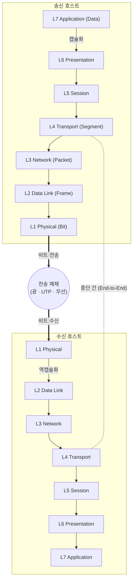

# OSI 7 Layer (ISO 7498)

---

## I. 통신을 일곱 단계로 나눈 공통 언어, OSI 7계층의 개요

### 가. 정의

- 이기종 시스템 간 통신 기능을 **7개 계층으로 나누고 계층별 역할과 인터페이스를 정의한 ISO 참조 모델** (ISO/IEC 7498-1, 1984)

### 나. 등장 배경 및 특징

| 구분 | 내용 |
| --- | --- |
| 등장 배경 | IBM SNA, DEC DECnet 등 벤더별 독자 구조로 상호 연결 불가 |
| 계층 독립성 | 한 계층의 변경이 다른 계층에 영향을 주지 않도록 [[모듈화]] |
| 서비스·프로토콜 분리 | 인접 계층 간 서비스([[서비스 프리미티브]]), 동등 계층 간 [[프로토콜]] |
| 캡슐화 | 계층마다 헤더를 붙여 PDU 구성 |
| 활용 | 설계·교육·장애 분석의 공통 기준 |

---

## II. 구조 및 계층별 역할

### 가. 캡슐화와 동등 계층 통신

- 송신측은 위에서 아래로 헤더를 붙이고, 수신측은 아래에서 위로 떼어 내며 같은 계층끼리 논리적으로 통신

### 나. 계층별 역할

| 구분 | 계층 (PDU) | 설명 |
| --- | --- | --- |
| 상위 | L7 Application (Data) | 사용자 응용 서비스 제공 (HTTP, FTP, SMTP, DNS) |
| | L6 Presentation (Data) | 데이터 표현 변환·부호화·압축·암호화 (ASN.1, JPEG, TLS로 분류하기도 함) |
| | L5 [[Session Layer\|Session]] (Data) | 대화 설정·유지·동기화·종료 (RPC, NetBIOS) |
| 중간 | L4 [[전송 계층\|Transport]] (Segment) | 종단 간 신뢰성, 흐름·오류 제어, 포트 ([[TCP]], UDP, L4 스위치) |
| 하위 | L3 [[네트워크 계층\|Network]] (Packet) | 논리 주소, 경로 설정 (IP, [[ICMP]], [[라우터]]) |
| | L2 [[데이터 링크 계층\|Data Link]] (Frame) | 인접 노드 간 프레임 전달, MAC 주소, 오류 검출, 매체 접근 제어(CSMA/CD) ([[스위치]]) |
| | L1 Physical (Bit) | 전기·광·기계적 특성으로 비트 전송 (100BASE-T, 허브, 리피터) |

---

## III. 비교 및 동향

### 가. OSI 7계층 vs TCP/IP 4계층

| 비교 항목 | OSI 7계층 | TCP/IP |
| --- | --- | --- |
| 제정 | ISO, 참조 모델 | ARPANET 실무에서 발전, IETF 표준 |
| 계층 수 | 7 | 4 (응용·전송·인터넷·네트워크 접근) |
| L5~L7 | 세션·표현·응용 분리 | 응용 계층 하나로 통합 |
| L3 | 네트워크 | 인터넷 |
| L1~L2 | 데이터링크·물리 분리 | 네트워크 접근 계층으로 통합 |
| 신뢰성 | 계층별 연결형·비연결형 서비스 정의 | 주로 L4 TCP가 종단 간 보장 |
| 현재 위상 | 개념 기준, 장애 분석 언어 | 인터넷의 사실상 표준 |

### 나. 동향

- **장애 분석 기준**: "ping은 되는데 웹이 안 됨"처럼 계층별로 원인을 좁히는 공통 언어로 활용
- **클라우드 서비스 분류**: 네트워크 ACL·보안 그룹(L3/L4), 애플리케이션 로드밸런서·WAF(L7)
- **L7 중심 보안**: [[제로 트러스트 보안모델|Zero Trust]]·마이크로세그멘테이션 확산으로 L7 정책(NGFW, [[WAAP]]) 비중 확대

---

### 🔗 연관 토픽

- **소속 도메인**: [[00_네트워크_MOC|🌐 네트워크]]
- **세부 분류**: `1. OSI 7계층 & 데이터링크 계층 (L1/L2)`
- **핵심 연관 토픽**:
  - [[프로토콜]]
  - [[서비스 프리미티브]]
  - [[데이터 링크 계층]]
  - [[네트워크 계층|네트워크 계층 (Network Layer)]]
  - [[전송 계층|전송 계층 (Transport Layer)]]
