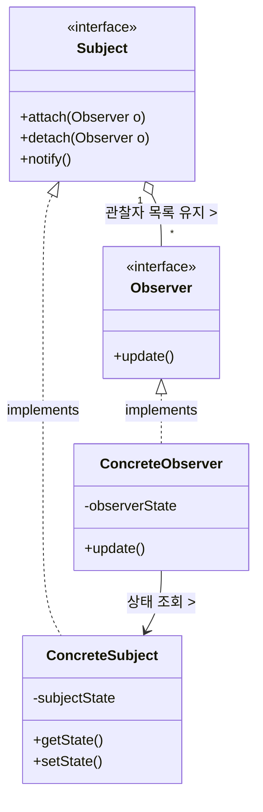

# Observer (상태 변화 통지)

---

## I. 상태 변화 자동 통지, Observer 패턴의 개요

특정 객체(Subject)의 상태가 변화했을 때, 그 객체에 의존하는 다수의 관찰자 객체(Observer)들에게 자동으로 알림을 통지하고 상태를 갱신하도록 지원하는 1:N 의존성 기반의 GoF 행동형 디자인 패턴이다.

| 구분 | 주요 내용 |
| --- | --- |
| **개념** | 발행 주체(Subject)와 관찰자(Observer) 간의 인터페이스 기반 느슨한 결합을 통해, 이벤트 발생 시 실시간으로 변경 사항을 일괄 전파하는 패턴 |
| **등장 배경** | 상태 변화를 감지하기 위해 주기적으로 조회(Polling)하는 CPU 자원 낭비 극복 및 주체와 관찰자 간의 강한 결합도 해소 필요 |
| **핵심 특징** | 느슨한 결합(Loose Coupling), 개방-폐쇄 원칙(OCP) 준수, 동적 구독 및 구독 취소 지원, MVC 패턴의 데이터-뷰 동기화 핵심 기반 |

---

## II. Observer 패턴의 아키텍처 및 핵심 구성 요소

### 가. Observer 패턴의 클래스 다이어그램 및 동작 원리

`ConcreteSubject`의 상태가 변경되면(`setState`), 등록된 모든 옵서버 리스트를 순회하며 `notify()` 메서드를 호출하고, 각 `ConcreteObserver`의 `update()`가 실행되어 주체의 최신 상태와 동기화된다.

### 나. Observer 패턴의 핵심 구성 요소

| 분류 | 구성 요소 (키워드) | 세부 설명 및 역할 |
| --- | --- | --- |
| **주체 인터페이스** | Subject | 관찰자(Observer) 객체들을 등록(`attach`), 해제(`detach`), 일괄 통지(`notify`)하는 추상 메서드 명세 |
| **관찰자 인터페이스** | Observer | Subject의 상태 변경 통지를 수신했을 때 실행될 갱신(`update()`) 메서드를 정의한 인터페이스 |
| **구체적 주체** | ConcreteSubject | 실제 비즈니스 상태 데이터를 저장 관리하며, 상태 변화가 발생할 때 등록된 관찰자들에게 알림을 발송 |
| **구체적 관찰자** | ConcreteObserver | ConcreteSubject의 참조를 유지하며, 통지를 수신했을 때 주체의 최신 데이터를 반영하여 자체 로직 수행 |
| **구독 관리** | attach() / detach() | 런타임에 동적으로 관찰자 객체를 구독 목록에 추가하거나 제거하여 메모리 누수 방지 |
| **이벤트 전파** | notify() / update() | 상태가 바뀌는 즉시 주체가 호출하는 브로드캐스팅 메서드와 이를 받아 처리하는 이벤트 핸들러 |
| **데이터 전달 방식** | Push vs Pull 모델 | 주체가 변경된 상세 데이터를 통지에 직접 실어 보내는 방식(Push)과, 통지만 받고 관찰자가 필요한 데이터만 조회하는 방식(Pull) |

---

## III. 유사 패턴 비교 및 최신 동향

### 가. Observer 패턴 vs Publish-Subscribe (Pub/Sub) 패턴 비교

| 비교 항목 | Observer 패턴 (옵서버) | Publish-Subscribe 패턴 (발행-구독) |
| --- | --- | --- |
| **결합도** | **낮음** (인터페이스를 통해 주체와 관찰자가 상호 인지) | **완전 분리** (Publisher와 Subscriber가 서로의 존재를 모름) |
| **통신 매개체** | 객체 간 **직접 메서드 호출** (Direct Call) | 중간에 **이벤트 브로커 / 메시지 큐** 존재 (Kafka, RabbitMQ) |
| **동기성** | 대부분 단일 프로세스 내 **동기식(Synchronous)** 처리 | 주로 분산 네트워크 환경의 **비동기식(Asynchronous)** 처리 |
| **적용 범위** | 단일 애플리케이션 내 GUI 이벤트, MVC 아키텍처 | 분산 시스템, [[MSA (Micro Service Architecture)|MSA]], 대규모 이벤트 스트리밍 |

### 나. 최신 기술 동향 및 발전 방향

* **반응형 프로그래밍(Reactive Programming)의 근간**: Observer 패턴은 데이터 스트림과 배압(Backpressure) 제어를 결합한 RxJava, Project Reactor(Spring WebFlux), Coroutines Flow 등 모던 리액티브 아키텍처의 핵심 뼈대로 확장됨.
* **메모리 누수(Lapsed Listener) 방지 기법**: 등록된 옵서버가 사용 종료 후 명시적으로 해제되지 않아 발생하는 메모리 누수를 방지하기 위해, 약한 참조(WeakReference) 기반 옵서버 관리와 생명주기 인식(Lifecycle-Aware) 컴포넌트 결합이 일반화됨.

---

### 🔗 연관 토픽

- **소속 도메인**: [[00_소프트웨어공학_MOC|🏗️ 소프트웨어공학]]
- **세부 분류**: `5. 디자인 패턴`
- **핵심 연관 토픽**:
  - [[디자인 패턴]]
  - [[MVC 패턴 (Model-View-Controller Pattern)]]
  - [[EDA]]
  - [[결합도]]
  - [[객체지향 설계 원리]]
