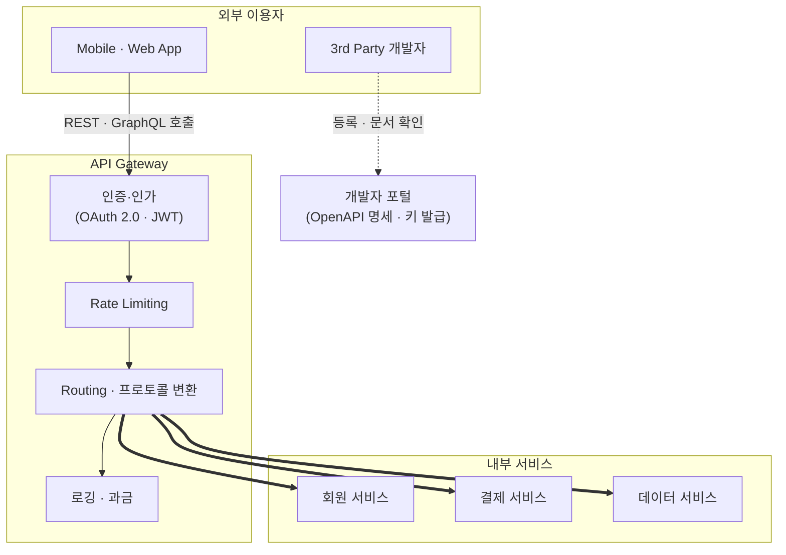

# API 및 Open API

---

## I. 기능과 데이터를 여는 창구, API·Open API의 개요

### 가. 정의

- **API (Application Programming Interface)**: 소프트웨어 간 기능·데이터를 주고받기 위해 **호출 방식과 데이터 형식을 정의한 인터페이스**
- **Open API**: 기업·기관이 보유한 데이터와 서비스를 **외부 개발자·파트너가 활용하도록 공개한 API** (공공데이터 API, 오픈뱅킹 등)

### 나. 특징

| 구분 | 내용 |
| --- | --- |
| 등장 배경 | [[MSA (Micro Service Architecture)\|MSA]] 확산, 플랫폼 비즈니스와 API 경제, [[마이데이터]]·오픈뱅킹 정책 |
| 상호운용성 | HTTP·REST·[[JSON]] 등 표준 기반으로 이기종 시스템 연동 |
| 생태계 확장 | 외부 개발자가 결합 서비스(매시업)를 만들어 플랫폼 가치 증대 |
| 개발 생산성 | 기능 재사용, 문서화된 계약(Contract) 기반 병렬 개발 |
| 위험 | 인증 미흡·과다 노출 시 데이터 유출, 버전 변경 시 호환성 문제 |

---

## II. 구조 및 기술요소

### 가. Open API 제공 구조

- 외부 호출은 [[API Gateway]]에서 인증·트래픽 제어를 거쳐 내부 서비스로 라우팅되고, 개발자는 포털에서 명세와 키를 받아 연동

### 나. 기술요소

| 구분 | 요소 | 설명 |
| --- | --- | --- |
| 스타일 | REST API | URI로 자원 식별, HTTP 메서드로 행위 표현 ([[REST RESTful API 설계 6원칙\|REST 원칙]]) |
| | GraphQL / gRPC | 클라이언트 지정 질의 / Protocol Buffers 기반 고성능 RPC |
| 데이터 형식 | JSON / [[XML]] | 플랫폼 독립 텍스트 데이터 교환 형식 |
| 보안 | OAuth 2.0 | 비밀번호 공유 없이 제3자 앱에 접근 권한 위임 |
| | JWT | 서명된 클레임 기반 자체 포함형 토큰 |
| | API Key · mTLS | 호출자 식별, 상호 인증서 인증 |
| 명세 | OpenAPI Specification (OAS) | REST API를 기계·사람이 읽을 수 있게 기술하는 표준 (구 Swagger) |
| 관리 | API Gateway · APIM | 단일 진입점, 버전·수명주기·모니터링·과금 관리 |

---

## III. 비교 및 동향

### 가. REST vs GraphQL vs gRPC

| 비교 항목 | REST | GraphQL | gRPC |
| --- | --- | --- | --- |
| 중심 개념 | 자원 | 클라이언트 질의 | 원격 프로시저(행위) |
| 전송 | HTTP/1.1·HTTP/2 | 주로 HTTP 단일 엔드포인트 | HTTP/2 |
| 형식 | JSON 등 텍스트 | JSON | Protocol Buffers (바이너리) |
| 장점 | 범용성, HTTP 캐싱 용이 | Over/Under-fetching 감소 | 고성능, 강한 타입, 양방향 스트리밍 |
| 단점 | 여러 번 호출 필요 가능 | 캐싱·쿼리 비용 제어 어려움 | 브라우저 직접 호출 제약 |
| 활용 | 외부 공개 Open API | 복잡한 화면용 BFF | MSA 내부 서비스 간 통신 |

### 나. 동향

- **API 보안**: API가 주요 공격 대상이 되면서 OWASP API Security Top 10 기반 점검, [[WAAP]]·API 탐지(Discovery) 도입 확대
- **AI 에이전트 연동**: LLM의 Function Calling, MCP(Model Context Protocol) 등 AI 에이전트가 외부 API·도구를 호출하는 표준 등장
- **개방 생태계**: 공공데이터포털, 오픈뱅킹, 금융·의료 마이데이터 등 법·제도 기반 API 개방 확대

---

### 🔗 연관 토픽

- **소속 도메인**: [[00_디지털서비스_MOC|🚀 디지털서비스]]
- **세부 분류**: `4. 데이터 플랫폼 & 개방형 API 생태계`
- **핵심 연관 토픽**:
  - [[REST RESTful API 설계 6원칙]]
  - [[API Gateway]]
  - [[마이데이터]]
  - [[WAAP|WAAP(Web Application and API Protection)]]
  - [[MSA (Micro Service Architecture)]]
