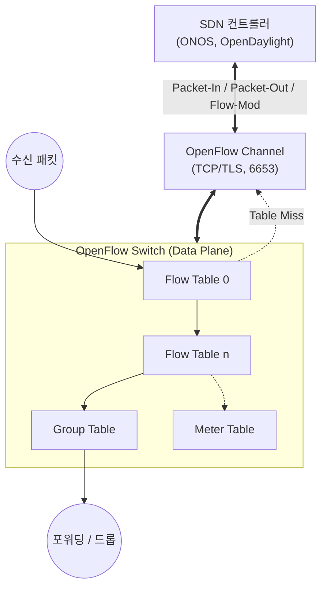

# OpenFlow (오픈플로우)

---

## I. SDN의 사우스바운드 표준, OpenFlow의 개요

### 가. 정의

- [[SDN(Software Defined Network)|SDN]]에서 **중앙 컨트롤러(Control Plane)가 스위치의 플로우 테이블(Data Plane)을 직접 프로그래밍**할 수 있게 하는 개방형 사우스바운드 [[프로토콜]] (ONF 표준)

### 나. 등장 배경 및 특징

| 구분 | 내용 |
| --- | --- |
| 등장 배경 | 장비 벤더 종속(Lock-in) 극복, 클라우드의 동적 트래픽에 맞춘 네트워크 유연성 요구 |
| 제어·전달 분리 | 경로 결정(제어)과 패킷 전달(데이터)을 분리 |
| 플로우 기반 제어 | 목적지 IP가 아닌 L2~L4 헤더 조합(Flow) 단위의 세밀한 정책 |
| 중앙 집중 관리 | 전체 네트워크 뷰 기반 트래픽 엔지니어링 |

---

## II. 동작 원리 및 핵심 구성요소

### 가. 아키텍처 및 동작

- 플로우 테이블과 일치(Match)하면 지정된 동작(Action)을 수행하고, 일치하는 항목이 없으면(Table Miss) **Packet-In**으로 컨트롤러에 질의 → 컨트롤러가 **Flow-Mod**로 규칙을 설치

### 나. 핵심 구성요소

| 구분 | 요소 | 설명 |
| --- | --- | --- |
| 제어 | SDN 컨트롤러 | 토폴로지 수집, 경로 계산, 플로우 규칙 배포 |
| 통신 | Secure Channel | 컨트롤러–스위치 간 TLS/TCP 제어 채널 |
| 데이터 구조 | Flow Table | Match Fields + Counters + Actions(Instructions) |
| 매칭 | Match Fields | 입력 포트, MAC, IPv4/IPv6, TCP/UDP 포트 등 다계층 헤더 |
| 실행 | Action / Instruction | Forward, Drop, 헤더 변경, 다음 테이블로 이동 |
| 처리 구조 | 파이프라인 | 여러 플로우 테이블을 순차 통과하며 복합 처리 |
| 확장 | Group Table | 멀티캐스트·로드밸런싱용 다중 포트 전송 (OF 1.1+) |
| | Meter Table | 플로우별 전송률 측정·제한으로 [[QoS]] 제어 (OF 1.3+) |
| 메시지 | Packet-In / Packet-Out / Flow-Mod | 미등록 패킷 질의, 패킷 방출 지시, 규칙 추가·수정·삭제 |

---

## III. 비교 및 동향

### 가. 전통적 라우팅 vs OpenFlow SDN

| 비교 항목 | 전통적 라우팅 | OpenFlow 기반 SDN |
| --- | --- | --- |
| 구조 | 장비마다 제어·전달 통합 (분산 제어) | 제어·전달 분리 (중앙 제어) |
| 포워딩 기준 | 목적지 IP | 플로우 (L2~L4 조합) |
| 설정 | 장비별 CLI | 컨트롤러 API |
| 활용 | 기업망, 인터넷 백본 | 데이터센터, 5G 코어, 트래픽 엔지니어링 |

### 나. OpenFlow vs P4

| 비교 항목 | OpenFlow | P4 |
| --- | --- | --- |
| 설계 사상 | 정해진 헤더만 처리 (프로토콜 종속) | 프로토콜 독립적 |
| 제어 대상 | 플로우 테이블 엔트리 | 파서·처리 로직 자체 |
| 신규 프로토콜 | 스펙·펌웨어 갱신 필요 | 프로그램 컴파일로 즉시 지원 |
| 파이프라인 | 고정 | 프로그래머블 |

### 다. 동향

- **화이트박스 생태계**: 범용 하드웨어에 오픈소스 NOS를 올리는 개방형 네트워킹의 마중물 역할
- **데이터 플레인 프로그래밍**: P4, DPU/SmartNIC 중심으로 진화
- **클라우드 네이티브 융합**: eBPF·Cilium 기반 [[쿠버네티스]] CNI로 고속 패킷 처리 확장

---

### 🔗 연관 토픽

- **소속 도메인**: [[00_네트워크_MOC|🌐 네트워크]]
- **세부 분류**: `1. OSI 7계층 & 데이터링크 계층 (L1/L2)`
- **핵심 연관 토픽**:
  - [[SDN(Software Defined Network)]]
  - [[스위치]]
  - [[IBN(Intent-Based Networking)]]
  - [[NFV]]
  - [[QoS|QoS (Quality of Service)]]
