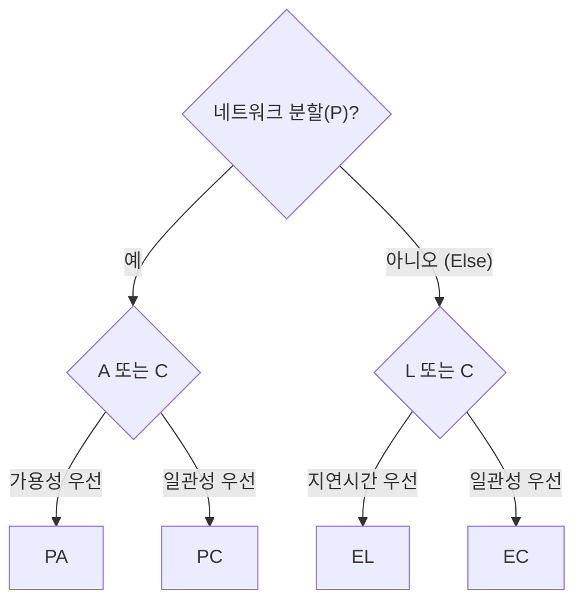

# PACELC

---

## I. 장애 시와 평상시의 선택, PACELC의 개요

### 가. 정의

- 분산 시스템에서 **네트워크 분할(P) 시에는 가용성(A)과 일관성(C) 중, 정상 상태(Else)에서는 지연시간(L)과 일관성(C) 중 무엇을 우선하는지로 시스템을 분류하는 모델** (Daniel Abadi, 2010 제안·2012 논문)

### 나. 특징

| 구분 | 내용 |
| --- | --- |
| CAP 보완 | CAP는 분할 상황만 설명, 평상시 복제 지연의 트레이드오프 누락 |
| 평상시 기준 | 동기 복제(일관성) vs 비동기 복제(저지연) |
| 분류 | PA/EL, PA/EC, PC/EL, PC/EC |
| 설계 지침 | 업무 중요도에 맞는 DB·일관성 수준 선택 근거 |

---

## II. 분류 구조 및 구성요소

### 가. 판단 흐름

- 분할 시 선택(PA·PC)과 평상시 선택(EL·EC)의 조합으로 시스템 유형을 표기

### 나. 구성요소

| 구분 | 요소 | 설명 |
| --- | --- | --- |
| 분할 시 | P (Partition) | 노드 간 통신 단절 |
| | A (Availability) | 불일치를 감수하고 응답 |
| | C (Consistency) | 일관성을 위해 일부 요청 거부·대기 |
| 평상시 | E (Else) | 장애 없는 정상 상태 |
| | L (Latency) | 비동기 복제로 빠른 응답 |
| | C (Consistency) | 동기 복제·합의로 일관된 응답 |
| 유형 | PA/EL | Cassandra, DynamoDB (기본 설정) |
| | PA/EC | MongoDB (Abadi 분류) |
| | PC/EL | Yahoo PNUTS |
| | PC/EC | HBase, BigTable, Spanner, [[CockroachDB]] 등 분산 SQL |

---

## III. 비교 및 동향

### 가. CAP vs PACELC

| 비교 항목 | CAP | PACELC |
| --- | --- | --- |
| 관점 | 분할 상황만 | 분할 + 정상 상황 |
| 선택 | A vs C | (A vs C) + (L vs C) |
| 성능 표현 | 없음 | 지연시간을 명시적 고려 |
| 분류 | CP, AP | PA/EL, PA/EC, PC/EL, PC/EC |

### 나. 동향

- **조정 가능한 일관성**: Cassandra 일관성 레벨, Azure Cosmos DB 5단계 일관성으로 요청별 L–C 선택
- **분산 SQL의 선택**: Spanner·[[New SQL|NewSQL]]은 PC/EC를 택하고 TrueTime·리더 배치로 지연을 줄임 (트레이드오프 자체는 존재)
- **업무별 설계**: 결제·원장은 PC/EC, 피드·로그·장바구니는 PA/EL 지향

---

### 🔗 연관 토픽

- **소속 도메인**: [[00_데이터베이스_MOC|🗄️ 데이터베이스]]
- **세부 분류**: `3. 장애 회복 기법 & 데이터 무결성`
- **핵심 연관 토픽**:
  - [[NoSQL (CAP 이론 BASE 속성)]]
  - [[분산 데이터베이스|분산 데이터베이스 (Distributed Database)]]
  - [[New SQL]]
  - [[CockroachDB|CockroachDB(코크로치DB)]]
  - [[합의 알고리즘]]
