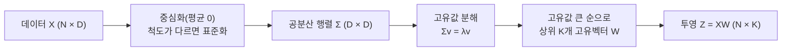

# PCA (Principal Component Analysis, 주성분 분석)

---

## I. 분산을 가장 많이 담는 축으로, PCA의 개요

### 가. 정의

- 변수들의 선형 결합으로 **분산을 최대한 보존하는 서로 직교하는 축(주성분)을 찾아 데이터를 저차원으로 투영**하는 [[비지도 학습]] 기반 [[차원 축소]] 기법

### 나. 필요성 및 특징

| 구분 | 내용 |
| --- | --- |
| 차원의 저주 완화 | 변수 수를 줄여 연산량·과적합 위험 감소 |
| [[다중공선성]] 제거 | 주성분끼리 서로 무상관 |
| 정보 보존 | 분산이 큰 PC1부터 순서대로 선택 |
| 선형성 | 선형 투영만 가능, 비선형 구조는 표현 한계 |
| 해석 | 주성분은 원 변수의 조합이라 의미 해석이 어려울 수 있음 |

---

## II. 계산 절차 및 구성요소

### 가. 계산 절차

- 공분산 행렬의 고유벡터가 주성분 방향, 고유값이 그 방향의 분산이며, 실제 구현은 중심화한 데이터의 [[SVD(Singular Value Decomposition)|SVD]]로 계산하는 경우가 많음

### 나. 구성요소

| 구분 | 요소 | 설명 |
| --- | --- | --- |
| 수학 | 공분산 행렬 | 변수 쌍의 공분산을 담은 대칭 행렬 |
| | 고유값 분해 | $\Sigma v = \lambda v$, 대칭 행렬이라 고유벡터가 직교 |
| 주성분 | 고유벡터 | 주성분 축의 방향 (로딩) |
| | 고유값 | 해당 축의 분산, 설명력 |
| 선택 | 누적 설명 분산 | 상위 K개 고유값 합 / 전체 합, 보통 80~90% 기준 |
| | 스크리 플롯 | 고유값 감소가 완만해지는 지점(엘보) 선택 |
| 전처리 | 중심화·표준화 | 평균 제거는 필수, 단위가 다르면 표준화(상관행렬 PCA) |
| 구현 | SVD | $X = U\Sigma V^T$에서 $V$의 열이 주성분, 수치적으로 안정적 |
| 복원 | 재구성 | $\hat{X} = ZW^T$, 재구성 오차는 버린 고유값의 합 |

---

## III. 비교 및 동향

### 가. PCA vs LDA

| 비교 항목 | PCA | [[LDA(Linear Discriminant Analysis)\|LDA]] |
| --- | --- | --- |
| 목적 | 전체 분산 최대화 | 클래스 분리 최대화 |
| 학습 | 비지도 (레이블 불필요) | 지도 (레이블 필요) |
| 기준 | 분산이 가장 큰 직교 축 | 클래스 간 분산 / 클래스 내 분산 최대 |
| 최대 차원 | 원 차원 D까지 | 클래스 수 − 1 |
| 활용 | 압축, 노이즈 제거, 시각화, 다중공선성 해소 | 분류 전처리, 얼굴 인식 |
| 한계 | 클래스 정보 미반영 | 클래스별 정규분포·공분산 동일 가정 |

### 나. 동향

- **비선형 확장**: Kernel PCA, 오토인코더, t-SNE·UMAP과 용도에 따라 병행
- **대규모 계산**: 확률적(Randomized) SVD, 증분(Incremental) PCA로 대용량·스트리밍 데이터 처리
- **임베딩 압축**: 고차원 임베딩을 PCA로 줄여 [[벡터 데이터베이스]] 저장·검색 비용 절감

---

### 🔗 연관 토픽

- **소속 도메인**: [[00_인공지능_MOC|🤖 인공지능]]
- **세부 분류**: `1. 수학 · 통계학 & 데이터 전처리`
- **핵심 연관 토픽**:
  - [[차원 축소|차원 축소(Dimensionality Reduction)]]
  - [[SVD(Singular Value Decomposition)]]
  - [[LDA(Linear Discriminant Analysis)]]
  - [[다중공선성|다중공선성 (Multicolinearity)]]
  - [[비지도 학습]]
