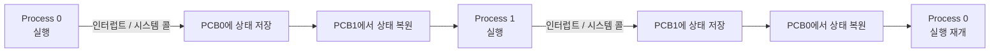

# PCB (Process Control Block, 프로세스 제어 블록)

---

## I. 프로세스 문맥 저장의 핵심 자료구조, PCB의 개요

### 가. 정의

- [[OS(운영체제)|운영체제]]가 각 [[프로세스]]를 식별·제어·관리하는 데 필요한 **상태 정보와 문맥(Context)을 저장하는 커널 메모리 내 자료구조**

### 나. 필요성 및 특징

| 구분 | 내용 |
| --- | --- |
| 문맥 교환 지원 | [[CPU]]를 빼앗긴 프로세스의 상태를 저장하고 재할당 시 정확히 복원 ([[문맥 교환]]) |
| 자원 추적 | 메모리 매핑, 파일 디스크립터, I/O 상태 등 프로세스별 자원 관리 |
| 생명주기 동기화 | 프로세스 생성 시 커널 공간에 생성, 종료 시 소멸 |
| 큐 연동 | 연결 리스트로 준비·대기 큐에 연결되어 [[스케줄링]]에 활용 |

---

## II. PCB 구조 및 문맥 교환

### 가. 문맥 교환 동작

- [[인터럽트]] 발생 시 현재 레지스터·PC를 PCB에 저장하고, 스케줄러가 고른 다음 프로세스의 PCB를 CPU에 적재

### 나. 구성요소

| 분류 | 요소 | 설명 |
| --- | --- | --- |
| 식별 | PID / PPID | 프로세스 ID, 부모 프로세스 ID |
| 상태 | Process State | New, Ready, Running, Waiting, Terminated ([[프로세스 상태 전이도]]) |
| 실행 문맥 | Program Counter | 다음에 실행할 명령어 주소 |
| | CPU Registers | 누산기, 인덱스 레지스터, 스택 포인터, 상태 레지스터 |
| 스케줄링 | Scheduling Info | 우선순위, 스케줄링 큐 포인터, 남은 타임 퀀텀 |
| [[메모리 관리]] | Memory Info | Base/Limit 레지스터, 페이지·세그먼트 테이블 포인터 |
| 회계 | Accounting Info | CPU 사용 시간, 시간 제한, 계정 번호 |
| 입출력 | I/O Status | 할당된 I/O 장치, 열린 파일 디스크립터 목록 |

---

## III. PCB vs TCB 및 동향

### 가. PCB vs TCB (Thread Control Block)

| 비교 항목 | PCB | TCB |
| --- | --- | --- |
| 관리 단위 | 프로세스 (자원 소유 단위) | [[쓰레드\|스레드]] (실행·스케줄링 단위) |
| 저장 정보 | 주소 공간, 파일·자원 메타데이터 | PC, 레지스터, 스레드 스택 포인터 |
| 메모리 공유 | 다른 프로세스와 격리 | 같은 프로세스 내 Code·Data·Heap 공유 |
| 문맥 교환 비용 | 큼 (주소 공간 전환, TLB 무효화) | 작음 (레지스터만 교체) |
| 관계 | 하나의 PCB가 여러 TCB를 참조 | 각 TCB는 소속 PCB를 참조 |

### 나. 동향

- **Linux `task_struct`**: 프로세스와 스레드를 태스크로 통합 관리하고, `clone()` 플래그(CLONE_VM, CLONE_FILES 등)로 공유 범위 결정
- **eBPF 관측**: 컨테이너 환경에서 `task_struct`를 추적해 문맥 교환·런큐 지연을 저부하로 분석

---

### 🔗 연관 토픽

- **소속 도메인**: [[00_운영체제_MOC|⚙️ 운영체제]]
- **세부 분류**: `1. 프로세스 & 스레드 관리`
- **핵심 연관 토픽**:
  - [[프로세스]]
  - [[문맥 교환|문맥 교환 (Context Switching)]]
  - [[프로세스 상태 전이도]]
  - [[쓰레드]]
  - [[커널|커널(Kernel)]]
