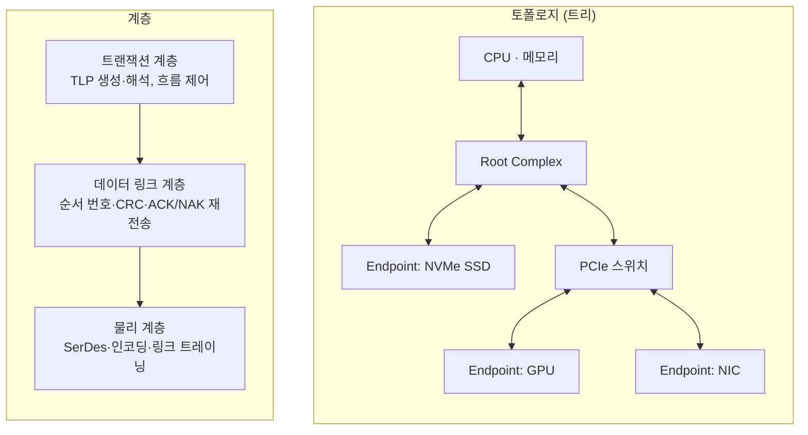

# PCI Express (PCIe)

---

## I. 레인 단위 직렬 점대점 연결, PCI Express의 개요

### 가. 정의

- 공유 병렬 버스(PCI·AGP)를 대체해 **장치마다 전용 직렬 레인으로 패킷을 주고받는 점대점([[Point-to-Point]]) 고속 입출력 인터페이스 표준** (PCI-SIG, 2003년 1.0)

### 나. 등장 배경 및 특징

| 구분 | 내용 |
| --- | --- |
| 배경 | 병렬 버스의 클록 스큐·누화로 속도 향상 한계, [[GPU]]·NVMe 대역폭 요구 증가 |
| 점대점 | 버스 공유 없이 장치별 전용 링크, 스위치로 확장 |
| 전이중 직렬 | 레인마다 송신·수신 차동 쌍을 따로 두어 동시 전송 |
| 확장성 | x1·x4·x8·x16 레인 수로 대역폭 조절 |
| 소프트웨어 호환 | PCI 구성 공간·드라이버 모델 유지 |

---

## II. 구조 및 구성요소

### 가. 토폴로지와 계층 구조

- Root Complex를 정점으로 스위치를 거쳐 Endpoint가 트리를 이루고, 데이터는 TLP로 만들어져 링크 계층의 신뢰성 처리를 거쳐 레인으로 전송

### 나. 구성요소

| 구분 | 요소 | 설명 |
| --- | --- | --- |
| 구성 장치 | Root Complex | [[CPU]]·메모리를 PCIe 계층에 연결하는 최상위 장치 |
| | 스위치 | 여러 Endpoint로 패킷을 라우팅 |
| | Endpoint | GPU·NVMe·NIC 등 실제 장치 |
| 물리 계층 | 레인 (Lane) | 송신 차동 쌍 + 수신 차동 쌍 (선 4가닥) |
| | 인코딩·신호 | 1.0·2.0 8b/10b, 3.0~5.0 128b/130b (NRZ), 6.0~ PAM4 신호 + FLIT 모드 |
| 링크 계층 | DLLP · LCRC | 링크 관리 패킷, 오류 검출과 재전송 |
| 트랜잭션 계층 | TLP | Memory·I/O·Configuration·Message 트랜잭션 |
| | 흐름 제어 | 크레딧 기반으로 수신 버퍼 넘침 방지 |
| 부가 기능 | Hot-Plug, [[QoS]] | 가동 중 장치 교체, 트래픽 클래스(TC)·가상 채널(VC) |
| | SR-IOV | 한 장치를 여러 가상 기능(VF)으로 나눠 VM에 직접 할당 |

---

## III. 비교 및 동향

### 가. 세대별 비교

| 비교 항목 | PCIe 4.0 | PCIe 5.0 | PCIe 6.0 | PCIe 7.0 |
| --- | --- | --- | --- | --- |
| 규격 발표 | 2017 | 2019 | 2022 | 2025 |
| 레인당 속도 | 16GT/s | 32GT/s | 64GT/s | 128GT/s |
| x16 대역폭 (한 방향) | 약 32GB/s | 약 64GB/s | 약 128GB/s | 약 256GB/s |
| 신호·인코딩 | NRZ, 128b/130b | NRZ, 128b/130b | PAM4, FLIT | PAM4, FLIT |
| 오류 처리 | CRC + 재전송 | CRC + 재전송 | FEC + CRC + 재전송 | FEC + CRC + 재전송 |

### 나. 동향

- **PAM4·FEC 정착**: 6.0부터 한 신호에 2비트를 싣는 PAM4로 같은 신호 주파수에서 속도 2배, 늘어난 오류는 경량 FEC로 보정
- **CXL의 물리 기반**: [[CXL]]이 PCIe 물리 계층 위에서 [[캐시 일관성]]·메모리 확장을 제공해 AI 서버의 핵심 인터커넥트로 확대
- **광 연결**: 고속화에 따른 전송 거리 한계로 PCIe over Optics(광 인터커넥트) 표준화 논의

---

### 🔗 연관 토픽

- **소속 도메인**: [[00_컴퓨터구조_MOC|💻 컴퓨터구조]]
- **세부 분류**: `3. 고성능 AI 가속기 & 입출력 시스템`
- **핵심 연관 토픽**:
  - [[CXL|CXL (Compute Express Link)]]
  - [[DMA(Direct Memory Access)]]
  - [[Point-to-Point]]
  - [[GPU]]
  - [[I2C(Inter Integrated Circuit)와 SPI(Serial Peripheral Interface)]]
