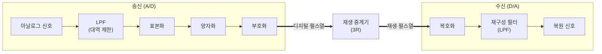

# PCM (Pulse-Code Modulation)

---

## I. 아날로그를 숫자로 바꾸는, PCM의 개요

### 가. 정의

- 아날로그 신호를 **일정 주기로 표본화하고, 진폭을 유한 단계로 양자화한 뒤, 이진 부호로 부호화**하는 디지털 변환 방식 (전화망 음성 G.711의 기반)

### 나. 특징

| 구분 | 내용 |
| --- | --- |
| 등장 배경 | 아날로그 전송의 잡음 누적 문제, 디지털 교환·[[다중화]](TDM) 필요 |
| 잡음 내성 | 재생 중계기로 펄스를 다시 만들어 잡음 누적 차단 |
| 처리 용이 | 저장·암호화·디지털 처리 가능 |
| 대역 소모 | 음성 64kbps(8kHz × 8비트)로 아날로그보다 넓은 대역 필요 |
| 양자화 잡음 | 진폭을 반올림하며 생기는 피할 수 없는 오차 |

---

## II. 구조 및 구성요소

### 가. 변환 과정

- 표본화로 PAM 신호를 만들고, 양자화·부호화로 비트열을 만든 뒤 수신측에서 복호화·필터링해 복원

### 나. 구성요소

| 구분 | 요소 | 설명 |
| --- | --- | --- |
| 전처리 | 앤티에일리어싱 LPF | 표본화 전 고주파 제거로 에일리어싱 방지 |
| 1단계 | 표본화 | 나이퀴스트 조건 fs ≥ 2fm (음성 4kHz → 8kHz 표본화) |
| 2단계 | 양자화 | 진폭을 가장 가까운 레벨로 근사, n비트면 SQNR 약 6.02n + 1.76dB |
| | 비선형 양자화 (압신) | 작은 신호는 조밀하게, 큰 신호는 성기게 (북미 μ-law, 유럽 A-law) |
| 3단계 | 부호화 | 양자화 레벨을 이진 부호로 변환 (음성 8비트) |
| 전송 | 3R 재생 중계 | Reshaping, Retiming, Regeneration |
| 다중화 | TDM | T1(24채널, 1.544Mbps), E1(32슬롯, 2.048Mbps) |
| 복원 | 재구성 필터 | 계단 신호를 평활화해 아날로그 복원 |

---

## III. 비교 및 동향

### 가. PCM vs DPCM vs ADPCM vs DM

| 비교 항목 | PCM | DPCM | ADPCM | DM (델타 변조) |
| --- | --- | --- | --- | --- |
| 부호화 대상 | 표본값 자체 | 예측값과의 차이 | 차이 + 적응형 양자화 스텝 | 차이의 부호 (1비트) |
| 전송률 (음성 예) | 64kbps (G.711) | PCM보다 낮음 | 32kbps (G.726) | 낮음 |
| 복잡도 | 낮음 | 중간 | 높음 | 매우 낮음 |
| 주요 잡음 | 양자화 잡음 | 예측 오차 | 적응으로 완화 | 경사 과부하, 입자 잡음 |

### 나. 동향

- **음성 코덱 고도화**: ADPCM을 거쳐 CELP 계열(AMR, EVS), Opus 등 저비트율 코덱이 VoIP·이동통신 표준
- **고해상도 오디오**: 96·192kHz, 24비트 LPCM이 스튜디오·하이레스 음원 포맷으로 사용
- **TDM 퇴조**: 전화망의 IP 전환(All-IP)으로 PCM은 패킷 음성(RTP)의 페이로드 형식으로 유지

---

### 🔗 연관 토픽

- **소속 도메인**: [[00_네트워크_MOC|🌐 네트워크]]
- **세부 분류**: `3. 전송 계층 & 트래픽 / 혼잡 제어 (L4)`
- **핵심 연관 토픽**:
  - [[다중화|다중화(Multiplexing)]]
  - [[전송부호화]]
  - [[소스코딩, 채널코딩, 라인코딩 샤논 정리]]
  - [[QAM(Quadrature Amplitude Modulation)--|QAM]]
  - [[VAN]]
