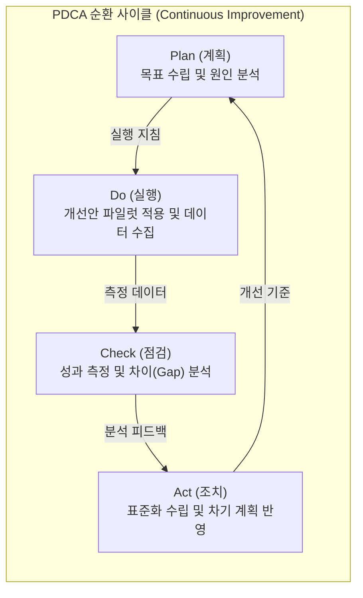

# PDCA (Plan-Do-Check-Act, Deming Cycle)

---

## I. 지속적 품질 개선의 기반, PDCA의 개요

### 가. 정의

- 업무 프로세스와 서비스 품질의 지속적 혁신을 위해 **계획(Plan), 실행(Do), 점검(Check), 조치(Act)의 4단계를 나선형으로 반복 수행하는 체계적 품질 관리 프레임워크**

### 나. 특징 및 필요성

| 구분 | 내용 |
| --- | --- |
| 나선형 진화 | 한 번의 사이클로 종료되지 않고 지속 반복을 통해 품질 수준을 점진적으로 상향(Spiral-up) |
| 표준화 기반 | 개선 결과를 새로운 표준(SDCA)으로 제정하여 품질 퇴보를 차단하고 전사 확산 |
| 사실 기반 관리 | Check 단계에서 직관이 아닌 정량적 데이터와 KPI에 기반한 성과 측정 및 Gap 분석 |
| 범용 적용성 | 제조 TQM을 넘어 ISO 9001/27001, ITIL, [[ISMS-P]] 등 IT 관리 체계의 핵심 관리 메커니즘으로 활용 |

---

## II. 개념도 및 핵심 구성요소

### 가. 개념도

- 사이클이 순환할 때마다 프로세스 품질이 향상되며, Act 단계의 표준화(Standardization)가 기저를 지지하여 본래 수준으로의 퇴보를 방지

### 나. 단계별 핵심 활동

| 구분 | 요소 | 설명 |
| --- | --- | --- |
| Plan (계획) | 목표 설정 | 비전 및 고객 요구사항([[SLA]]) 기반의 SMART 목표 수립 |
| | 원인 분석 | 5-Whys, 특성요인도(Fishbone) 등을 활용한 문제 근본 원인 도출 및 개선안 기획 |
| Do (실행) | 파일럿 테스트 | 전면 적용 전 통제된 소규모 환경에서 개선안 사전 검증 |
| | 훈련 및 실행 | 실무자 대상 변경 프로세스 교육 및 실행 단계 데이터 수집 |
| Check (점검) | 성과 측정 | KPI 기반 정량 데이터 수집 및 초기 계획 목표치 대비 달성도 측정 |
| | 차이 분석 | 목표치와 실제 결과 간의 격차(Variance) 및 부작용 식별 |
| Act (조치) | 시정 조치 | 미달 원인 피드백을 통해 보완책 수립 후 다음 Plan의 입력값 전달 |
| | 표준화 및 확산 | 검증된 개선안을 새로운 업무 표준(SOP)으로 등록하고 전사 확산 |

---

## III. 지속적 개선 프레임워크 비교 및 동향

### 가. PDCA vs DMAIC vs OODA

| 비교 항목 | PDCA | DMAIC (Six Sigma) | OODA Loop |
| --- | --- | --- | --- |
| 주 적용 분야 | ISO 인증, ITIL, 일반 품질·보안 관리 | 식스시그마, 대규모 프로세스 최적화 | 애자일 조직, 사이버 침해 대응, 군사 전략 |
| 핵심 목적 | 프로세스의 점진적이고 안정적인 품질 개선 | 통계적 데이터 분석을 통한 결함·낭비 제거 | 급변하는 불확실성 속 신속한 의사결정 |
| 수행 절차 | Plan $\rightarrow$ Do $\rightarrow$ Check $\rightarrow$ Act | Define $\rightarrow$ Measure $\rightarrow$ Analyze $\rightarrow$ Improve $\rightarrow$ Control | Observe $\rightarrow$ Orient $\rightarrow$ Decide $\rightarrow$ Act |
| 추진 방식 | 반복적 피드백 루프 (관리 체계 중심) | 통계적 가설 검정 및 검증 (데이터 중심) | 상황 인식 및 빠른 루프 회전 (속도·적응 중심) |

### 나. 동향

- **CI/CD 파이프라인 내재화**: 현대 [[DevOps]]의 지속적 통합/배포 환경에서 Plan(이슈 등록), Do(코드 작성), Check(자동화 테스트), Act(배포 및 모니터링)가 자동화된 초단주기 PDCA로 구현
- **보안 및 개인정보 관리 표준 준용**: [[ISMS-P]] 및 ISO 27001 등 주요 규제 프레임워크에서 관리체계 수립(P), 운영(D), 점검(C), 개선(A)을 법적 컴플라이언스 필수 요건으로 지정
- **SDCA 병행 모델 정착**: 프로세스 혁신(PDCA) 후 이를 표준화하여 유지(SDCA: Standardize-Do-Check-Act)하는 2단계 반복 모델 확산

---

### 🔗 연관 토픽

- **소속 도메인**: [[00_경영전략_MOC|📈 경영전략]]
- **세부 분류**: `5. IT 투자 성과 평가 & 비즈니스 연속성 계획 (BCP)`
- **핵심 연관 토픽**:
  - [[ISMS-P]]
  - [[SLA]]
  - [[ITSM(Information Technology Service Management)]]
  - [[SDLC]]
  - [[DevOps|데브옵스 (DevOps)]]
