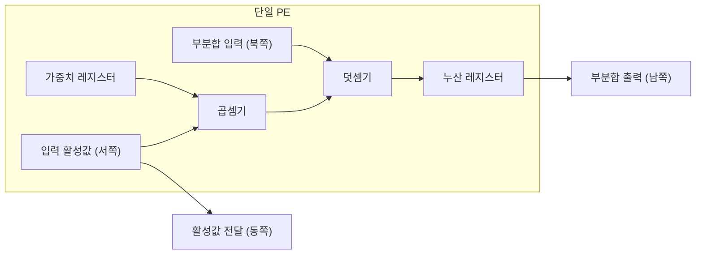

# PE (Processing Element)

---

## I. AI 가속기 병렬 연산의 최소 단위, PE의 개요

### 가. 정의

- [[NPU]] 등 AI 가속기 안에서 **[[MAC 배열|MAC]] 연산기·로컬 레지스터·이웃 PE와의 데이터 경로로 구성된 최소 연산 셀**

### 나. 특징

| 구분 | 내용 |
| --- | --- |
| 공간 구조 | 수백~수만 개 PE를 격자로 배치, 데이터가 PE 사이를 흐르며 연산 (Spatial Architecture) |
| 데이터 재사용 | 로컬 레지스터·이웃 전달로 외부 메모리 접근 최소화 |
| 단순 제어 | 같은 연산을 반복, 명령 해독·분기 로직이 거의 없음 |
| [[DSA]] | 신경망 연산에 특화된 도메인 특화 구조 |

---

## II. 구조 및 구성요소

### 가. PE 내부 구조와 배열

- 활성값은 동쪽 PE로, 부분합은 남쪽 PE로 전달되어 [[시스톨릭 어레이]]를 구성

### 나. 구성요소

| 구분 | 요소 | 설명 |
| --- | --- | --- |
| 연산 | MAC 유닛 | 곱셈 후 누산, PE의 핵심 연산 |
| | 가변 정밀도 ALU | INT8·FP16·FP8 등 여러 정밀도 지원 |
| 저장 | 로컬 레지스터 파일 | 가중치·부분합 보관, 상위 버퍼 접근 감소 |
| | 더블 버퍼링 | 연산과 다음 데이터 적재를 겹쳐 대기 제거 |
| 데이터 흐름 | WS (Weight Stationary) | 가중치를 PE에 고정, 가중치 재적재 에너지 절감 |
| | OS (Output Stationary) | 부분합을 PE에 고정, 부분합 이동 감소 |
| | RS (Row Stationary) | 행 단위 매핑으로 입력·가중치·부분합 재사용 균형 (Eyeriss) |
| 저전력 | Zero-skipping | 입력·가중치가 0이면 연산·메모리 접근 생략 |
| | 클록·파워 게이팅 | 쉬는 PE의 동적·정적 전력 차단 |

---

## III. 비교 및 동향

### 가. NPU PE vs GPU CUDA 코어

| 비교 항목 | NPU PE | [[GPU]] CUDA 코어 |
| --- | --- | --- |
| 제어 | 고정 데이터플로, 제어 로직 최소 | SIMT, Warp 스케줄러·분기 처리 포함 |
| 데이터 이동 | PE 간 직접 전달 | 레지스터 파일·공유 메모리 경유 |
| 최적 대상 | 행렬 곱(GEMM)·합성곱 | 그래픽·과학 계산·[[딥러닝]] 등 범용 |
| 전력 효율 | 높음 | 중간 |

### 나. 동향

- **메모리 근접 배치**: PE를 메모리 내부·옆에 두는 [[PIM]]·PNM 구조로 데이터 이동 감소
- **초저정밀 포맷**: OCP MX(Microscaling) 포맷(MXFP8·MXFP4 등)처럼 블록 단위 스케일을 공유하는 저비트 연산 지원

---

### 🔗 연관 토픽

- **소속 도메인**: [[00_컴퓨터구조_MOC|💻 컴퓨터구조]]
- **세부 분류**: `1. CPU 프로세서 & 마이크로아키텍처`
- **핵심 연관 토픽**:
  - [[시스톨릭 어레이]]
  - [[MAC 배열]]
  - [[NPU|NPU(Neural Processing Unit)]]
  - [[TPU (Tensor Processing Unit)]]
  - [[GPU]]
