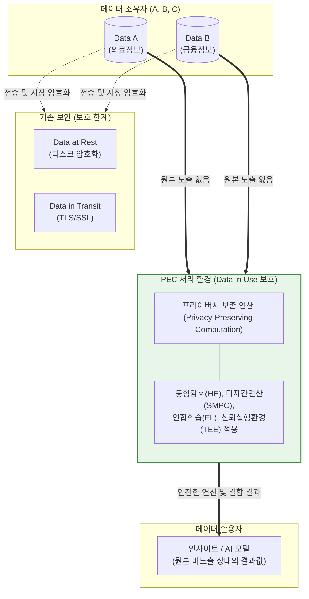

# PEC (Privacy-Enhancing Computation)

---

## I. 안전한 데이터 활용과 연산을 위한 보호 기술, PEC의 개요

### 가. PEC의 정의
- 데이터를 암호화하거나 원본을 노출하지 않은 상태에서도 분석, 연산, 모델 학습 등 정보 처리를 수행하여 프라이버시를 보장하면서 데이터 가치를 추출하는 차세대 보안 연산 기술의 총칭.

### 나. PEC의 등장 배경 및 주요 특징
| 구분 | 내용 |
| --- | --- |
| Data in Use 보호 | 저장(Rest) 및 전송(Transit) 구간 보호를 넘어 메모리 연산 중(In Use) 원본 노출 취약점 극복 |
| 데이터 사일로 타개 | GDPR, 데이터 3법 등 프라이버시 규제를 준수하며 기업 간 민감 데이터 결합 및 AI 협업 실현 |
| 다중 기법 융합 | 암호학적 기법(동형암호, SMPC), 분산 아키텍처(연합학습), HW 격리(TEE)를 상호보완적 결합 |
| 무신뢰(Trustless) 협업 | 영지식(Zero-Knowledge) 및 암호학적 증명을 통해 참여자 간 사전 신뢰 없이도 안전한 공동 연산 보장 |

---

## II. PEC의 아키텍처 및 핵심 구성요소

### 가. PEC 처리 개념도 및 Data in Use 보호 메커니즘

* 기존 보안 인프라는 연산을 위해 복호화가 필수적이나, PEC 환경에서는 데이터를 암호화된 상태 그대로 병합 및 연산하거나, 로컬에서 처리한 가중치만 전송하여 원본 유출 위험을 원천 차단함.

### 나. PEC의 핵심 기술 요소

| 분류 | 요소기술(키워드) | 세부 설명 |
| --- | --- | --- |
| **수학/암호학** | 동형암호 (Homomorphic Enc.) | 데이터를 복호화하지 않고 암호문 상태 그대로 덧셈/곱셈 등 수학적 연산을 수행하고 그 결과를 도출하는 기술 |
| **수학/암호학** | 안전한 다자간 연산 (SMPC) | 2명 이상의 참여자가 자신의 원본 데이터를 서로에게 공개하지 않고도, 데이터의 결합된 결과값을 공동으로 계산하는 [[알고리즘]] |
| **수학/암호학** | 영지식 증명 ([[영지식증명\|ZKP]]) | 자신이 특정 정보(비밀값 등)를 알고 있다는 사실을 그 정보 자체를 노출하지 않고도 타인에게 암호학적으로 증명하는 기술 |
| **분산 처리** | 연합학습 (Federated Learning) | 원본 데이터를 중앙 서버로 집중시키지 않고 각 기기(로컬)에서 AI 모델을 학습한 뒤, 그 '가중치 업데이트' 결과만 중앙에서 병합하는 기술 |
| **데이터 변형** | [[차분 프라이버시]] (DP) | 데이터셋에 정교하게 계산된 통계적 노이즈(Noise)를 의도적으로 주입하여, 개인을 식별할 수 없게 하면서도 전체 데이터의 통계적 유효성은 유지하는 기술 |
| **하드웨어 기반** | 신뢰 실행 환경 (TEE) | [[CPU]] 내부(예: Intel SGX, ARM TrustZone)에 하드웨어적으로 격리된 보안 영역(Enclave)을 생성하여 연산 중인 데이터와 코드를 OS 접근으로부터 방어 |

---

## III. PEC 주요 기술 간 비교 및 향후 동향

### 가. PEC 세부 기술의 접근 방식 및 특성 비교

| 비교 항목 | 동형암호 (FHE) | 다자간 연산 (SMPC) | 연합학습 (Federated Learning) | 신뢰 실행 환경 (TEE) |
| --- | --- | --- | --- | --- |
| **접근 방식** | 수학적 [[암호 알고리즘]] | 암호학적 [[프로토콜]] | 분산 머신러닝 아키텍처 | 하드웨어 기반 물리적 격리 |
| **핵심 목적** | 암호문 상태의 직접 연산 | 상호 데이터 비노출 결합 연산 | 데이터 이동 없는 AI 분산 학습 | 연산 영역의 외부 접근 원천 차단 |
| **프라이버시 수준** | **매우 높음** | 매우 높음 | 보통~높음 | 높음 (칩 제조사 신뢰 필요) |
| **연산 오버헤드** | **매우 높음** (엄청난 컴퓨팅 자원 필요) | 높음 (막대한 네트워크 통신량 발생) | 중간 (가중치 전송 주기 최적화 필요) | 낮음 (네이티브 성능에 근접) |
| **실무 적용 한계** | 복잡한 비선형 연산 및 속도 한계 | 통신 지연시간 및 참여자 수 제약 | 참여 노드 간 데이터 불균형(Non-IID) | 특정 하드웨어 벤더 종속성 존재 |

### 나. 한계 극복 및 최신 발전 동향
- **하이브리드 PEC 아키텍처 확산**: 단일 기술의 성능 및 보안 한계를 극복하기 위해 '연합학습 + 차분 프라이버시(DP-FL)' 또는 'SMPC + TEE' 등 복합 기술 융합 모델이 주류 솔루션으로 부상.
- **하드웨어 가속기(FHE Accelerator) 상용화**: 완전동형암호(FHE)의 막대한 연산 지연 문제를 해결하기 위해 전용 ASIC 칩셋 및 [[GPU]] 기반 고속 병렬 연산 가속기 개발 가속화.
- **기밀 컴퓨팅 기반 LLM 프라이버시 보존 추론**: 기업 기밀 프롬프트 및 문서 유출을 방지하기 위해 클라우드 [[기밀컴퓨팅|기밀 컴퓨팅(Confidential Computing)]] 하드웨어 영역 내에서 LLM 추론을 수행하는 Private Inference 인프라 확산.

---

### 🔗 연관 토픽

- **소속 도메인**: [[00_보안_MOC|🛡️ 보안]]
- **세부 분류**: `2. 현대 암호학 & 키 관리 · 전자서명`
- **핵심 연관 토픽**:
  - [[영지식증명|영지식증명(Zero Knowledge Proof)]]
  - [[암호화|암호화 (Encryption)]]
  - [[암호 알고리즘]]
  - [[GPU]]
  - [[데이터 3법|데이터 3법 (Data 3 Acts)]]
