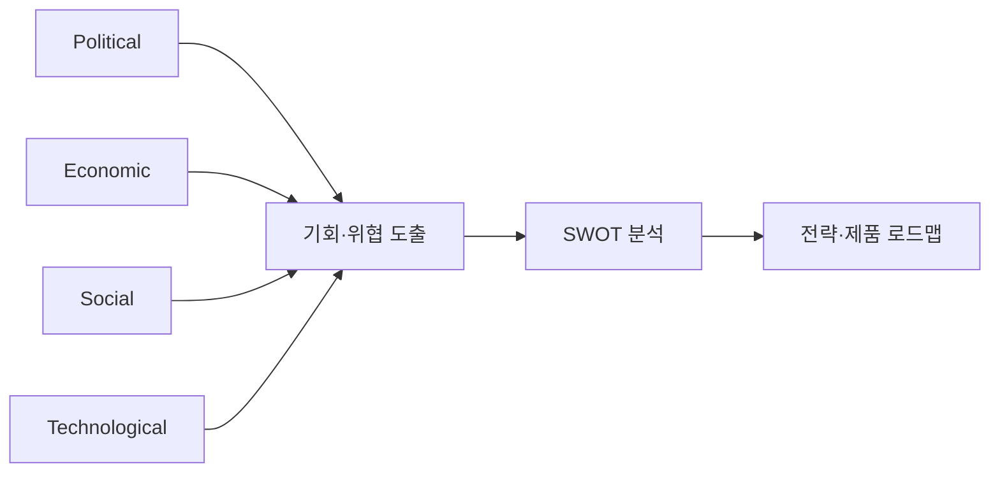

# PEST 분석 (PEST Analysis)

---

## I. 통제할 수 없는 거시 환경을 읽는, PEST 분석의 개요

### 가. 정의

- 조직에 영향을 주는 거시 외부 환경을 **정치(Political)·경제(Economic)·사회(Social)·기술(Technological)** 4개 관점으로 분석하는 [[환경분석]] 기법 (F. Aguilar, 1967 ETPS에서 유래)

### 나. 필요성 및 특징

| 구분 | 내용 |
| --- | --- |
| 필요성 | 기업이 통제할 수 없는 외부 변화에 선제 대응, 신시장 진입 위험 파악 |
| 외부 거시 초점 | 내부 역량이 아닌 산업 바깥의 환경 요인 분석 |
| SWOT 선행 | 분석 결과가 [[SWOT분석\|SWOT]]의 기회(O)·위협(T)으로 이어짐 |
| 확장성 | 환경·법률(PESTEL), 윤리(STEEPLE) 등으로 확장 |

---

## II. PEST 분석의 구조 및 구성요소

### 가. 개념도

- 4개 요인의 변화를 수집해 자사에 대한 기회·위협으로 해석하고, 내부 강·약점과 결합해 전략으로 구체화

### 나. 구성요소

| 구분 | 요소 | 설명 |
| --- | --- | --- |
| 기본 (PEST) | Political (정치) | 정책 방향, 규제·세제, 통상 마찰 (예: 반도체 수출 통제) |
| | Economic (경제) | 성장률, 금리·환율, 물가, 소비 여력 (예: 고금리로 IT 투자 위축) |
| | Social (사회) | 인구 구조(고령화, 1인 가구), 라이프스타일, 가치관 |
| | Technological (기술) | 신기술 등장, R&D 수준, 기술 성숙도·진부화 속도 |
| 확장 (PESTEL) | Environmental (환경) | 기후 변화, 탄소 규제, [[ESG 경영]] 요구 |
| | Legal (법률) | 공정거래·[[개인정보보호법]]·AI 관련 법제 (예: EU AI Act) |

---

## III. 유사 기법 비교 및 동향

### 가. PEST vs 3C vs SWOT

| 구분 | PEST | [[3C 4C 분석\|3C]] | SWOT |
| --- | --- | --- | --- |
| 분석 대상 | 거시 외부 환경 | 시장(고객·경쟁사·자사) | 내부(S·W) + 외부(O·T) |
| 목적 | 큰 흐름과 통제 불가 위험 파악 | 경쟁 우위·KSF 도출 | 종합 전략 방향 설정 |
| 수행 시점 | 분석 초기 | 분석 초기 | PEST·3C 결과를 종합하는 단계 |

### 나. 동향

- **PESTEL·STEEPLE 확산**: ESG·AI 규제 강화로 환경·법률·윤리 요인 분석 비중 증가
- **상시 모니터링**: 뉴스·SNS·규제 정보를 수집·분석해 거시 변화를 대시보드로 상시 추적하고 전략에 반영
- **시나리오 결합**: 불확실성이 큰 요인(지정학, 금리)은 복수 시나리오로 분석

---

### 🔗 연관 토픽

- **소속 도메인**: [[00_경영전략_MOC|📈 경영전략]]
- **세부 분류**: `1. 경영 환경 분석 & 전략 수립 프레임워크`
- **핵심 연관 토픽**:
  - [[환경분석]]
  - [[SWOT분석]]
  - [[3C 4C 분석|3C/4C 분석]]
  - [[ISP (Information Strategy Plan)]]
  - [[ESG 경영]]
