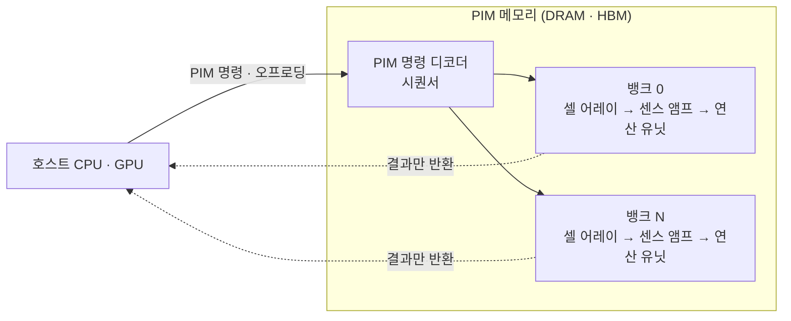

# PIM (Processing-In-Memory)

---

## I. 데이터가 있는 곳에서 계산하는, PIM의 개요

### 가. 정의

- **메모리 내부(DRAM 뱅크 옆 등)에 연산기([[MAC 배열|MAC]]·ALU)를 넣어** 데이터를 프로세서로 옮기지 않고 메모리 안에서 연산하는 반도체 기술

### 나. 필요성 및 특징

| 구분 | 내용 |
| --- | --- |
| 메모리 장벽 | 연산 성능 증가를 메모리 대역폭이 따라가지 못하는 Memory Wall |
| 데이터 이동 에너지 | 연산보다 DRAM↔프로세서 이동에 더 많은 에너지 소모 |
| 내부 대역폭 활용 | 여러 뱅크를 동시에 연산해 외부 버스보다 큰 내부 대역폭 사용 |
| 적합 연산 | 산술 강도가 낮은 메모리 바운드 연산 (GEMV, 원소별 연산, 임베딩 조회) |

---

## II. 구조 및 구성요소

### 가. 구조와 동작

- 호스트가 PIM 명령을 보내면 뱅크별 연산 유닛이 동시에 연산(뱅크 수준 병렬성)하고 결과만 돌려줌

### 나. 구성요소

| 구분 | 요소 | 설명 |
| --- | --- | --- |
| 연산 | 뱅크 내 연산 유닛 | 뱅크마다 붙은 FP16·BF16·INT8 SIMD·MAC 유닛 |
| 제어 | PIM 시퀀서 | 표준 DRAM 명령 사이에 PIM 연산 명령을 해석·실행 |
| | 명령 버퍼·레지스터 | PIM 연산 프로그램과 중간 결과 저장 |
| 방식 | 디지털 PIM | 센스 앰프 뒤 디지털 회로로 연산, DRAM 공정 호환 (HBM-PIM, AiM) |
| | 아날로그 CIM | ReRAM·SRAM 크로스바에서 전류 합으로 MAC, 저전력이나 정밀도·변동성 과제 ([[멤리스터]]) |
| 연결 | TSV / 내부 버스 | [[HBM]] 적층 구조의 수직 채널과 뱅크 내부 경로 |
| SW | 컴파일러·런타임 | 모델 그래프에서 메모리 바운드 연산을 골라 PIM으로 오프로드 |
| 표준 | JEDEC 표준화 | LPDDR·HBM 계열 PIM 규격화 논의, [[CXL]] 메모리와 연계 |

---

## III. 비교 및 동향

### 가. PIM vs PNM

| 비교 항목 | PIM (In-Memory) | PNM (Near-Memory) |
| --- | --- | --- |
| 연산 위치 | 메모리 다이 내부, 뱅크 옆 | 메모리 옆 로직 (HBM 베이스 다이, CXL 컨트롤러, 버퍼 칩) |
| 대역폭 | 내부 뱅크 대역폭 사용, 가장 큼 | 메모리 인터페이스 대역폭 수준 |
| 설계 난이도 | 높음 (DRAM 공정에 로직 구현, 면적·발열 제약) | 중간 (로직 공정 다이 분리) |
| 사례 | 삼성 HBM-PIM(Aquabolt-XL), SK hynix GDDR6-AiM, UPMEM | 삼성 CXL-PNM, AXDIMM |

### 나. 동향

- **LLM 추론 가속**: 디코딩 단계의 GEMV가 메모리 바운드여서 PIM·PNM 적용 효과가 큰 분야로 부각
- **LPDDR-PIM**: 모바일 [[온디바이스 AI]]용 저전력 PIM 연구·표준화 추진
- **프로그래밍 모델**: 범용 프레임워크에서 PIM을 쓰기 위한 컴파일러·라이브러리 정비가 확산의 관건

---

### 🔗 연관 토픽

- **소속 도메인**: [[00_컴퓨터구조_MOC|💻 컴퓨터구조]]
- **세부 분류**: `2. 캐시 & 메모리 계층 구조 · 스토리지`
- **핵심 연관 토픽**:
  - [[HBM|HBM (High Bandwidth Memory)]]
  - [[메모리 반도체|메모리 반도체 (Memory Semiconductor)]]
  - [[MAC 배열]]
  - [[지능형 반도체]]
  - [[멤리스터]]
