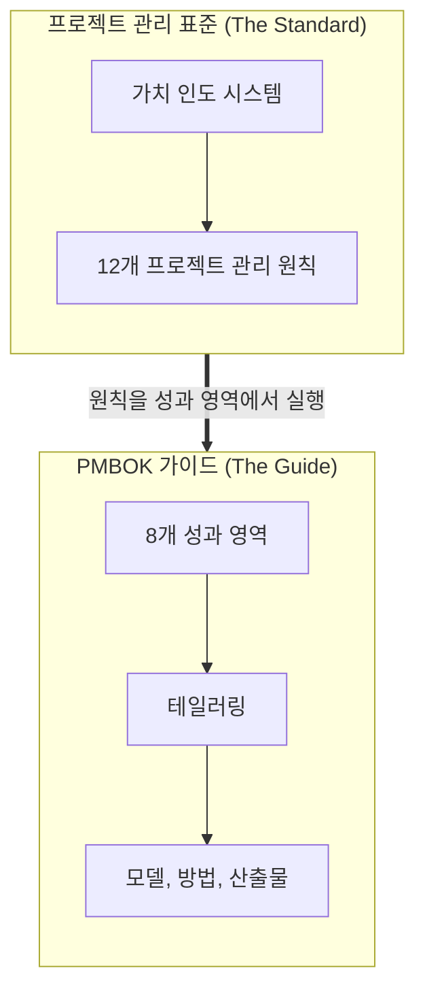

# PMBOK 7판 (Project Management Body of Knowledge 7th Ed.)

---

## I. 프로세스에서 원칙으로, PMBOK 7판의 개요

### 가. 정의

- PMI가 2021년 발간한 프로젝트 관리 지식 체계로, 6판의 49개 프로세스(ITTO) 중심 구조를 **12개 원칙과 8개 성과 영역** 중심으로 전면 개편한 가이드

### 나. 등장 배경 및 특징

| 구분 | 내용 |
| --- | --- |
| VUCA 환경 | [[변동성]]·불확실성·복잡성·모호성이 커져 고정 프로세스만으로 대응 한계 |
| 산출물 → 성과 | 산출물(Output) 인도보다 비즈니스 가치·성과(Outcome) 창출을 성공 기준으로 |
| 접근법 중립 | 예측형·적응형([[Agile]])·하이브리드 모두에 적용 |
| 테일러링 강조 | 프로젝트 맥락에 맞춰 방법·산출물을 조정 |
| 표준 개정 | ANSI 표준인 '프로젝트 관리 표준'도 원칙 기반으로 개정 |

---

## II. 구조와 구성요소

### 가. 구조

- 표준은 가치 인도 시스템과 행동 원칙을, 가이드는 성과 영역과 테일러링·도구 선택을 다룸. 상세는 [[PMBOK 8개 성과 영역 및 프로젝트 관리 12원칙(PMBOK 7판)|12원칙·8성과 영역]] 참조

### 나. 구성요소

| 구분 | 요소 | 설명 |
| --- | --- | --- |
| 표준 | 가치 인도 시스템 | 포트폴리오·프로그램·프로젝트·운영이 조직 전략과 연결되어 가치를 만드는 체계 |
| | 12개 원칙 | 스튜어드십, 팀, 이해관계자, 가치, 시스템 사고, 리더십, 테일러링, 품질, 복잡성, 리스크, 적응성·회복력, 변화 |
| 가이드 | 8개 성과 영역 | 이해관계자, 팀, 개발 접근법·생애주기, 계획, 프로젝트 작업, 인도, 측정, 불확실성 |
| | [[테일러링]] | 규모·조직 문화·규제 등을 고려해 접근법·거버넌스·프로세스 조정 |
| | 모델·방법·산출물 | 상황적 리더십 등 모델, 회의·추정 등 방법, 헌장·로그 등 산출물(Artifacts) 모음 |
| 디지털 | PMIstandards+ | 사례·기법을 온라인으로 보완 제공 |

---

## III. 비교 및 동향

### 가. PMBOK 6판 vs 7판

| 비교 항목 | 6판 (2017) | 7판 (2021) |
| --- | --- | --- |
| 구조 | 5 프로세스 그룹, 10 지식 영역, 49 프로세스 | 12 원칙, 8 성과 영역 |
| 지향 | 산출물, 프로세스 준수 | 성과, 가치 인도 |
| 접근법 | 예측형 중심 (애자일은 부록 수준) | 예측형·적응형·하이브리드 포괄 |
| 도구 | ITTO로 규정 | 모델·방법·산출물 중 선택, 테일러링 |
| 리더 상 | 관리·통제 | 서번트 리더십, 팀 공동 책임 |

### 나. 동향

- **프로세스 지침 분리**: 6판식 프로세스 그룹은 『Process Groups: A Practice Guide』(2022)로 별도 유지 ([[PMBOK 프로세스 그룹 (5단계)]])
- **8판 발간 (2025)**: 원칙을 6개, 성과 영역을 7개로 재편하고 프로세스와 착수~종료의 집중 영역(Focus Areas)을 다시 포함해 7판의 원칙 중심과 6판의 실무성을 결합
- **역할 융합**: 프로젝트 관리자와 제품 책임자(PO)·프로덕트 매니저 역할의 경계가 흐려지며 가치 중심 리더십 강조

---

### 🔗 연관 토픽

- **소속 도메인**: [[00_프로젝트관리_MOC|📋 프로젝트관리]]
- **세부 분류**: `1. PMBOK 표준 & 프로젝트 거버넌스`
- **핵심 연관 토픽**:
  - [[PMBOK 8개 성과 영역 및 프로젝트 관리 12원칙(PMBOK 7판)]]
  - [[PMBOK 프로세스 그룹 (5단계)]]
  - [[프로젝트 관리 지식 영역|프로젝트 관리 지식 영역 (Knowledge Area)]]
  - [[테일러링|테일러링 (Tailoring)]]
  - [[ISO 21500]]
