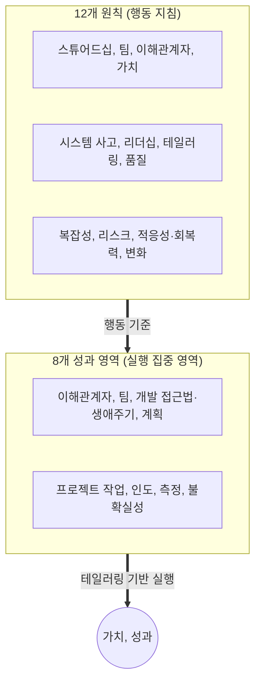

# PMBOK 7판: 12대 원칙과 8대 성과 영역

---

## I. 행동의 기준과 실행의 영역, 12원칙과 8성과 영역의 개요

### 가. 정의

- **12원칙**: 프로젝트 참여자의 사고와 행동을 이끄는 기본 지침 (프로젝트 관리 표준)
- **8성과 영역**: 성과를 효과적으로 인도하기 위해 함께 다뤄야 하는 **상호 연관된 활동 묶음** (PMBOK 가이드)

### 나. 특징

| 구분 | 내용 |
| --- | --- |
| 역할 분담 | 원칙은 '어떻게 행동할지(Why·How)', 성과 영역은 '어디에 집중할지(What)' |
| 성과 중심 | 각 성과 영역마다 기대 성과(Outcome)와 확인 방법 제시 |
| 상호작용 | 성과 영역은 순서 없이 동시에 상호작용, 지식 영역처럼 분절되지 않음 |
| 테일러링 | 원칙과 성과 영역을 바탕으로 방법·산출물을 상황에 맞게 선택 |

---

## II. 12원칙과 8성과 영역

### 가. 개념도

### 나. 12원칙

| 구분 | 요소 | 설명 |
| --- | --- | --- |
| 태도 | 1. 스튜어드십 | 성실하고 존중하며 배려하는 관리자, 윤리·법규 준수 |
| | 2. 팀 | 협력적인 프로젝트 팀 환경 조성 |
| | 3. 이해관계자 | 이해관계자의 효과적 참여 유도 |
| | 4. 가치 | 산출물이 아닌 가치 실현에 집중 |
| 사고 | 5. 시스템 사고 | 시스템 상호작용을 인식·평가·대응 |
| | 6. 리더십 | 직위와 무관하게 리더십 행동 발휘 |
| | 7. [[테일러링]] | 맥락에 따라 접근법 조정 |
| | 8. 품질 | 프로세스와 인도물에 품질을 내재화 |
| 대응 | 9. 복잡성 | 인간 행동·시스템·모호성에서 오는 복잡성 탐색 |
| | 10. 리스크 | 위협 최소화, 기회 극대화로 리스크 대응 최적화 |
| | 11. 적응성·회복력 | 변화에 적응하고 차질에서 회복 |
| | 12. 변화 | 구상한 미래 상태로의 전환을 지원 |

### 다. 8성과 영역

| 구분 | 요소 | 설명 |
| --- | --- | --- |
| 사람 | 이해관계자 | 식별·분석·참여 유도, 생산적 관계 유지 |
| | 팀 | 공동 책임 문화, 리더십, 고성과 팀 구축 |
| 방식 | 개발 접근법·생애주기 | 예측형·적응형·하이브리드와 단계·인도 주기 선택 |
| | 계획 | 범위·일정·예산·자원 계획, 점진적 구체화 |
| 실행 | 프로젝트 작업 | 프로세스·자원·조달·의사소통 관리, 학습 |
| | 인도 | 요구사항·범위·품질 충족, 의도한 성과 실현 |
| 통제 | 측정 | 지표·대시보드로 성과 평가, 시정 조치 |
| | 불확실성 | 리스크·모호성·복잡성·[[변동성]] 탐색과 대응 |

---

## III. 비교 및 동향

### 가. 6판 지식 영역 vs 7판 성과 영역

| 비교 항목 | 6판 10개 지식 영역 | 7판 8개 성과 영역 |
| --- | --- | --- |
| 구성 | 통합, 범위, 일정, 원가, 품질, 자원, 의사소통, 리스크, 조달, 이해관계자 | 이해관계자, 팀, 개발 접근법·생애주기, 계획, 프로젝트 작업, 인도, 측정, 불확실성 |
| 관점 | 무엇을 관리하는가 (기능 분할) | 어떤 성과를 내는가 (성과 중심) |
| 연결 | 프로세스 ITTO로 연결 | 영역 간 동시·유기적 상호작용 |
| 대응 예 | 리스크 관리 | 불확실성 (리스크 + 모호성·복잡성) |

### 나. 동향

- **제품 관리와 접목**: 가치·인도·불확실성 영역이 가설 검증, 반복 출시 등 프로덕트 관리 실무와 맞물림
- **8판 재편 (2025)**: 원칙 6개, 성과 영역 7개로 축소·재구성하고 프로세스를 다시 포함

---

### 🔗 연관 토픽

- **소속 도메인**: [[00_프로젝트관리_MOC|📋 프로젝트관리]]
- **세부 분류**: `1. PMBOK 표준 & 프로젝트 거버넌스`
- **핵심 연관 토픽**:
  - [[PMBOK 7판 (Project Management Body of Knowledge 7th Ed.)]]
  - [[프로젝트 관리 지식 영역|프로젝트 관리 지식 영역 (Knowledge Area)]]
  - [[PMBOK 프로세스 그룹 (5단계)]]
  - [[테일러링|테일러링 (Tailoring)]]
  - [[ISO 21500]]
