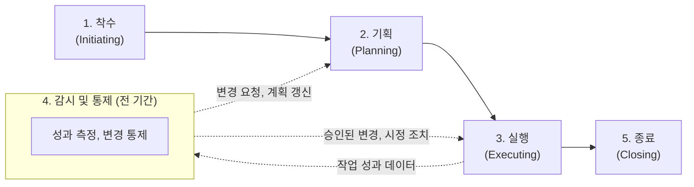

# PMBOK 5대 프로세스 그룹 (Process Groups)

---

## I. 착수에서 종료까지, PMBOK 프로세스 그룹의 개요

### 가. 정의

- 프로젝트 관리 프로세스를 목적에 따라 **착수·기획·실행·감시 및 통제·종료**의 5개로 묶은 논리적 그룹 (PMBOK 6판 49개 프로세스의 분류 축)

### 나. 특징

| 구분 | 내용 |
| --- | --- |
| 단계와 구분 | 프로젝트 생애주기 단계(Phase)가 아니라 관리 활동의 묶음, 한 단계 안에서도 5개 그룹 반복 |
| 중첩·반복 | 기획과 실행이 반복되고 감시·통제는 전 기간에 걸쳐 수행 |
| ITTO | 각 프로세스는 입력·도구 및 기법·출력으로 정의 |
| 프로세스 수 (6판) | 착수 2, 기획 24, 실행 10, 감시·통제 12, 종료 1 |

---

## II. 그룹 간 흐름과 핵심 활동

### 가. 개념도

- 착수로 승인된 프로젝트는 기획·실행을 반복하며 구체화되고, 감시·통제는 기준선과 실적을 비교해 변경을 처리

### 나. 그룹별 핵심 활동

| 구분 | 요소 | 설명 |
| --- | --- | --- |
| 1. 착수 | 헌장 개발, 이해관계자 식별 | 프로젝트·단계를 공식 승인, 산출물: 프로젝트 헌장, 이해관계자 관리대장 |
| 2. 기획 | 범위·일정·원가·품질·위험 등 계획 | 산출물: [[프로젝트 관리 계획서]], 범위 기준선([[WBS]]), 일정·원가 기준선 |
| 3. 실행 | 작업 지시·관리, 팀 확보·개발, 조달 | 산출물: 인도물, 작업 성과 데이터, 이슈 로그, 변경 요청 |
| 4. 감시 및 통제 | 성과 감시, 통합 변경 통제, 범위 확인, 품질 통제 | 산출물: 작업 성과 정보·보고서, 승인된 변경 요청, 검증된 인도물 |
| 5. 종료 | 프로젝트·단계 종료 | 산출물: 최종 제품·서비스 이관, 교훈 등록부 갱신 |

---

## III. 비교 및 동향

### 가. 프로세스 그룹 vs 스크럼 대응

| 비교 항목 | 프로세스 그룹 (예측형) | [[SCRUM\|스크럼]] 대응 요소 |
| --- | --- | --- |
| 착수 | 헌장, 이해관계자 식별 | 제품 비전, 초기 제품 백로그 |
| 기획 | 통합 프로젝트 관리 계획서 | 스프린트 계획, 스프린트 백로그 |
| 실행 | WBS 작업 패키지 수행 | 1~4주 스프린트, 증분(Increment) 개발 |
| 감시·통제 | [[EVM(Earned Value Management, 획득 가치 관리)\|EVM]], 변경통제위원회 | 일일 스크럼, 스프린트 리뷰, 번다운 차트 |
| 종료 | 공식 인수, 교훈 정리 | 스프린트 회고, 릴리스 |

### 나. 동향

- **실무 지침으로 존속**: 7판이 원칙 중심으로 바뀐 뒤에도 PMI는 『Process Groups: A Practice Guide』(2022)로 프로세스 그룹 체계를 유지
- **8판 재도입 (2025)**: 착수~종료를 집중 영역(Focus Areas)으로 다시 포함하고 프로세스를 재정리
- **하이브리드**: 계약·인프라 구축은 프로세스 그룹 기반 예측형, 화면·서비스 개발은 애자일로 운영

---

### 🔗 연관 토픽

- **소속 도메인**: [[00_프로젝트관리_MOC|📋 프로젝트관리]]
- **세부 분류**: `1. PMBOK 표준 & 프로젝트 거버넌스`
- **핵심 연관 토픽**:
  - [[프로젝트 관리 지식 영역|프로젝트 관리 지식 영역 (Knowledge Area)]]
  - [[프로젝트 관리 계획서]]
  - [[PMBOK 7판 (Project Management Body of Knowledge 7th Ed.)]]
  - [[ISO 21500]]
  - [[PMO|(E)PMO]]
