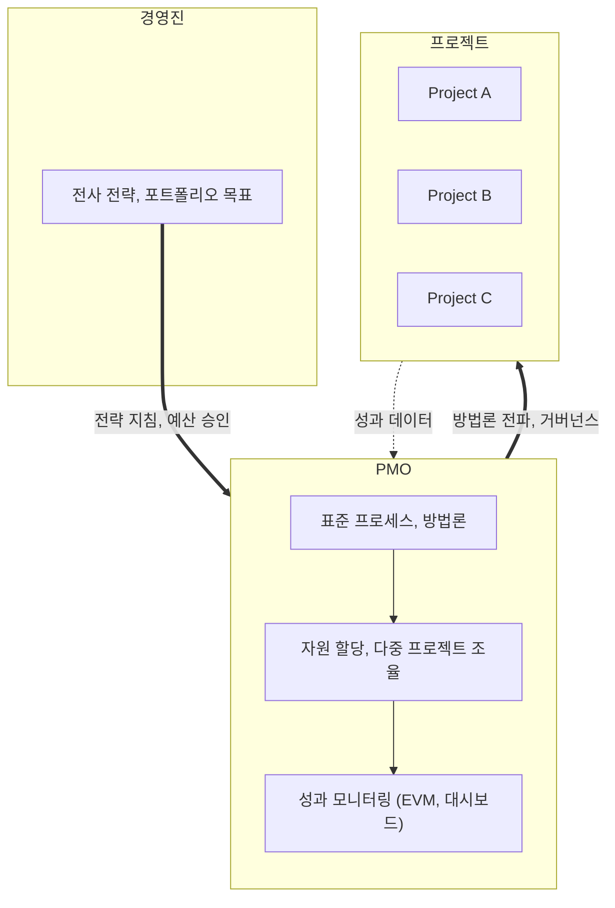

# PMO (Project Management Office, 프로젝트 관리 사무국)

---

## I. 다중 프로젝트 거버넌스 조직, PMO의 개요

### 가. 정의

- 조직 내 프로젝트 관리 **표준·방법론을 수립**하고 다수 프로젝트의 **자원·성과를 통합 관리·조율**하는 조직 단위 (전사 차원이면 EPMO, Enterprise PMO)

### 나. 필요성 및 특징

| 구분 | 내용 |
| --- | --- |
| 다중 프로젝트 조율 | 동시 진행 프로젝트 간 자원 충돌, 중복 투자 방지 |
| 전략 정렬 | 경영 전략과 프로젝트 포트폴리오 연계, 전사 성공률 제고 |
| 표준화 | 공통 방법론·템플릿·도구로 관리 품질 평준화 |
| 성숙도 견인 | OPM3, [[CMMI]] 등 조직 프로젝트 관리 성숙도 향상 |
| 유연한 형태 | 조직 성숙도에 따라 지원형 → 통제형 → 지시형으로 권한 차등 |

---

## II. PMO의 위치와 유형

### 가. 거버넌스 구조

- 경영진의 전략을 받아 표준·자원을 통제하고, 프로젝트 성과를 집계해 경영진에 보고

### 나. PMO 유형 (PMBOK 6판)

| 구분 | 요소 | 설명 |
| --- | --- | --- |
| 지원형 (Supportive) | 통제 수준 낮음 | 템플릿, 모범 사례, 교육, 교훈 정보 제공 (컨설팅·자원 센터 역할) |
| 통제형 (Controlling) | 통제 수준 중간 | 방법론·양식·도구 준수 요구, 거버넌스 준수 점검 |
| 지시형 (Directive) | 통제 수준 높음 | PMO가 프로젝트를 직접 관리, PM을 소속·파견 |

---

## III. 비교 및 동향

### 가. PM vs PMO

| 비교 항목 | PM (Project Manager) | PMO |
| --- | --- | --- |
| 관리 대상 | 단일 프로젝트 | 다중 프로젝트, 프로그램, 포트폴리오 |
| 목표 | 범위·일정·원가 내 목표 달성 | 전사 자원 최적 배분, 표준화, 성공률 향상 |
| 책임 | 프로젝트 인도물·품질 | 포트폴리오 성과, 전략 정렬 |
| 권한 | 프로젝트 팀 지휘 | 프로세스 수립, 자원 조율, 코칭·점검 |

- 공공 정보화 사업의 PMO(사업관리 위탁)와 감리의 차이는 [[감리 PMO 비교표]] 참조

### 나. 동향

- **Agile PMO / Value PMO**: 문서 통제 중심에서 가치 흐름·장애 제거 중심의 [[린 방법론|린]] 거버넌스 지원으로 전환
- **데이터 기반 PMO**: PPM 도구의 실시간 대시보드, AI 기반 지연·예산 초과 징후 예측
- **공공 PMO 제도화**: 전자정부법에 따른 전자정부사업관리 위탁(PMO) 제도로 대형 공공 사업에 적용

---

### 🔗 연관 토픽

- **소속 도메인**: [[00_프로젝트관리_MOC|📋 프로젝트관리]]
- **세부 분류**: `1. PMBOK 표준 & 프로젝트 거버넌스`
- **핵심 연관 토픽**:
  - [[PMBOK 프로세스 그룹 (5단계)]]
  - [[감리 PMO 비교표]]
  - [[린 방법론|린 (Lean) 방법론]]
  - [[CMMI]]
  - [[Agile]]
