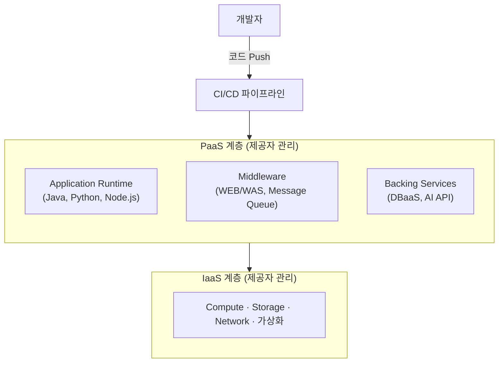

# PaaS (Platform as a Service)

---

## I. 코드에만 집중하는 플랫폼, PaaS의 개요

### 가. 정의

- 애플리케이션 개발·실행·관리에 필요한 **[[OS(운영체제)|OS]]·미들웨어·런타임을 서비스로 제공**하여, 이용자가 인프라 구축 없이 애플리케이션과 데이터만 관리하는 클라우드 서비스 모델

### 나. 특징

| 구분 | 내용 |
| --- | --- |
| 개발 편의 | 언어 런타임·라이브러리·개발 도구·CI/CD 연동 제공 |
| 비용 효율 | 플랫폼 구축 비용 절감, 종량제 과금 |
| 운영 자동화 | 오토스케일링, 로드밸런싱, [[HA(High Availability)\|고가용성]], 패치 관리 |
| 제약 | 플랫폼이 지원하는 언어·서비스에 종속(Lock-in) 가능 |

---

## II. 구조 및 기술요소

### 가. 구조

- 개발자가 코드를 배포하면 PaaS가 빌드·실행·확장을 처리하고, 하부 IaaS는 이용자에게 보이지 않음. 이용자는 애플리케이션과 데이터만 관리

### 나. 기술요소 (런컨시데: 런타임·컨테이너·시큐리티·데이터베이스)

| 구분 | 요소 | 설명 |
| --- | --- | --- |
| 실행 환경 | Runtime | Java·Python 등 언어 실행 환경, 동적 자원 할당 |
| | [[컨테이너]] | [[도커\|Docker]]·[[쿠버네티스\|Kubernetes]] 기반 격리·배포, 이식성 확보 |
| | Middleware | WEB/WAS, Message [[Queue]] 등 실행 필수 SW |
| 보안 | 인증 · 접근통제 | 플랫폼 계정·권한 관리, 앱 간 격리 |
| 개발 지원 | [[DevOps]] · CI/CD | Git 연동 빌드·배포 자동화 |
| 서비스 | [[데이터베이스]] · API | DBaaS, 빅데이터·AI API, 서비스 카탈로그 |

---

## III. 비교 및 동향

### 가. IaaS vs PaaS vs SaaS (책임 공유 모델)

| 비교 항목 | IaaS | PaaS | SaaS |
| --- | --- | --- | --- |
| 제공 범위 | 서버, 스토리지, 네트워크, [[가상화]] | IaaS + OS, 미들웨어, 런타임 | PaaS + 애플리케이션 |
| 이용자 관리 | OS, 미들웨어, 앱, 데이터 | 애플리케이션, 데이터 | 데이터, 계정·접근 설정 |
| 사례 | AWS EC2, Google Compute Engine | Google App Engine, Heroku, K-PaaS | Microsoft 365, Salesforce |

### 나. 동향

- **K-PaaS**: NIA 주도로 개발된 국내 개방형 클라우드 플랫폼 PaaS-TA가 2023년 K-PaaS로 명칭 변경, 전자정부 표준프레임워크 연계
- **CaaS · 서버리스**: [[쿠버네티스]] 관리형 서비스(EKS, GKE)와 FaaS가 전통적 PaaS 역할을 흡수
- **플랫폼 엔지니어링**: 기업이 내부 개발자 플랫폼(IDP)을 직접 구성해 PaaS 수준의 셀프서비스 제공

---

### 🔗 연관 토픽

- **소속 도메인**: [[00_디지털서비스_MOC|🚀 디지털서비스]]
- **세부 분류**: `1. 클라우드 컴퓨팅 & 가상화 인프라`
- **핵심 연관 토픽**:
  - [[XaaS|XaaS(Everything as a Service)]]
  - [[클라우드 컴퓨팅|클라우드 컴퓨팅 (Cloud Computing)]]
  - [[CSP|CSP (Cloud Service Provider)]]
  - [[컨테이너|컨테이너 (Container)]]
  - [[쿠버네티스|쿠버네티스(Kubernetes)]]
