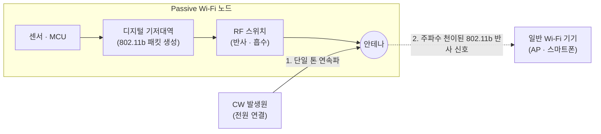

# Passive Wi-Fi

---

## I. 전파를 만들지 않고 반사로 보내는, Passive Wi-Fi의 개요

### 가. 정의

- 센서 노드가 스스로 전파를 만들지 않고 **외부 연속파(CW)를 반사·흡수(후방산란, Backscatter)해 일반 Wi-Fi 기기가 받을 수 있는 802.11b 패킷을 만드는** 초저전력 무선 통신 기술 (워싱턴대, 2016)

### 나. 등장 배경 및 특징

| 구분 | 내용 |
| --- | --- |
| 등장 배경 | 일반 Wi-Fi 송신은 수백 mW로 배터리 IoT 센서에 부적합 |
| 후방산란 | 안테나 임피던스를 바꿔 입사 전파를 반사·흡수하며 데이터 변조 |
| 초저전력 | 수십 µW 수준 (연구 기준 일반 Wi-Fi 대비 약 1만 분의 1) |
| 기존 기기 호환 | 일반 스마트폰·AP가 그대로 수신 |
| 제약 | 전원이 연결된 별도 CW 발생원 필요, 짧은 거리·낮은 속도 (1~11Mbps) |

---

## II. 구조 및 구성요소

### 가. 동작 구조

- 아날로그 RF 생성은 전원 연결 장치가 맡고, 노드는 디지털 스위칭만으로 반사 신호를 Wi-Fi 채널로 천이해 패킷을 만듦

### 나. 구성요소

| 구분 | 요소 | 설명 |
| --- | --- | --- |
| 구조 | RF·디지털 분리 | 고전력 아날로그 부분(CW 발생)을 노드 밖으로 분리 |
| 통신 | 후방산란 | 반사·흡수 상태 전환으로 변조 |
| 주파수 | 주파수 천이 | CW와 다른 Wi-Fi 채널로 반사 신호를 옮겨 자기 간섭 회피 |
| 표준 호환 | 802.11b DSSS·CCK | 1·2·5.5·11Mbps 패킷 합성 |
| 신호원 | CW 발생원 | 단일 톤 전파를 계속 방사하는 플러그형 장치 |
| 수신 | 상용 Wi-Fi 기기 | 별도 [[게이트웨이]] 없이 수신 |
| 전원 | 에너지 하베스팅 | RF·태양광 수확과 결합해 배터리 없는 동작 |

---

## III. 비교 및 동향

### 가. Passive Wi-Fi vs Wi-Fi vs BLE

| 비교 항목 | Passive Wi-Fi | 일반 Wi-Fi | BLE |
| --- | --- | --- | --- |
| 전송 방식 | 후방산란 | 능동 송신 | 능동 송신 |
| 소비 전력 | 수십 µW | 수백 mW | 수 mW ~ 수십 mW |
| 신호원 | 외부 CW 필요 | 자체 | 자체 |
| 수신 인프라 | 일반 Wi-Fi 기기 | 일반 Wi-Fi 기기 | 스마트폰·게이트웨이 |
| 활용 | 저전력 센서, 태그 | 대용량 전송 | 웨어러블, 비콘 |

### 나. 동향

- **Ambient IoT 표준화**: 3GPP Rel-19 Ambient IoT, IEEE 802.11bp(Ambient Power)에서 배터리 없는 기기 통신 표준화 진행
- **CW 공급원 일체화**: 기존 AP·스마트폰이 반송파 공급을 겸하는 방식 연구
- **응용**: 물류 추적, 스마트홈 센서, 이식형 의료 기기 ([[RFID]]와 유사한 후방산란 원리)

---

### 🔗 연관 토픽

- **소속 도메인**: [[00_네트워크_MOC|🌐 네트워크]]
- **세부 분류**: `3. 전송 계층 & 트래픽 / 혼잡 제어 (L4)`
- **핵심 연관 토픽**:
  - [[RFID]]
  - [[NFC]]
  - [[무선 충전 기술]]
  - [[Wi-Fi 7|WI-FI 7 (IEEE 802.11be)]]
  - [[게이트웨이]]
