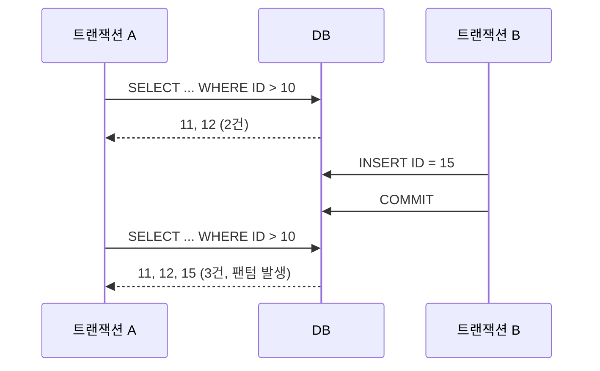

# 팬텀 리드 (Phantom Read)

---

## I. 범위 재조회 시 나타나는 유령 행, Phantom Read의 개요

### 가. 정의

- 한 [[트랜잭션]]이 같은 조건으로 범위를 다시 조회할 때, **다른 트랜잭션이 커밋한 INSERT·DELETE 때문에 처음에 없던 행이 나타나거나 있던 행이 사라지는 이상 현상**

### 나. 특징

| 구분 | 내용 |
| --- | --- |
| 핵심 | 값이 아닌 행 집합(건수)이 바뀜 |
| 원인 | 읽은 행만 잠그고 조건 범위·빈 공간(Gap)은 잠그지 않음 |
| 표준 정의 | ANSI SQL-92에서 REPEATABLE READ 이하 수준에서 허용 |
| 방지 | SERIALIZABLE, 범위·Gap 잠금, 스냅샷 격리 |

---

## II. 발생 원리 및 제어 기법

### 가. 발생 시나리오

- A가 읽은 행(11, 12)은 잠겨 있어도 그 사이·뒤 공간에 B의 삽입을 막지 못해 결과 집합이 달라짐

### 나. 제어 기법

| 구분 | 요소 | 설명 |
| --- | --- | --- |
| 발생 조건 | 범위 질의 | BETWEEN, >, <, LIKE 등 여러 행을 스캔하는 조건 |
| 격리 수준 | SERIALIZABLE | 표준상 팬텀까지 방지하는 최고 수준 ([[Isolation Level (격리 레벨고립성 수준)\|격리 수준]]) |
| 잠금 | Gap Lock | 인덱스 레코드 사이 공간을 잠가 삽입 차단 |
| | Next-Key Lock | 레코드 잠금 + 앞쪽 Gap 잠금 (MySQL InnoDB) |
| | Predicate Lock | 검색 조건 자체를 잠금 (이론적 방법, PostgreSQL SSI가 변형 사용) |
| 버전 | 스냅샷 읽기 | 트랜잭션 시작 시점 스냅샷만 읽어 재조회 결과 고정 ([[MVCC(다중 버전 동시성 제어) 2가지 유형\|MVCC]]) |

---

## III. 비교 및 동향

### 가. 읽기 이상 현상 비교

| 비교 항목 | [[Dirty Read]] | Non-Repeatable Read | Phantom Read |
| --- | --- | --- | --- |
| 원인 | 미커밋 변경 읽기 | 커밋된 UPDATE·DELETE | 커밋된 INSERT·DELETE |
| 증상 | 롤백될 값 사용 | 같은 행의 값 변경 | 결과 행 수 변경 |
| 방지 최소 수준 | READ COMMITTED | REPEATABLE READ | SERIALIZABLE |
| 단위 | 행 | 행 | 범위 |

### 나. DBMS 구현 동향

- **MySQL InnoDB**: 기본 REPEATABLE READ에서 일반 SELECT는 스냅샷, 잠금 읽기(FOR UPDATE)는 Next-Key Lock으로 팬텀 방지 (두 방식을 섞으면 예외 발생 가능)
- **PostgreSQL**: REPEATABLE READ를 스냅샷 격리로 구현해 팬텀이 보이지 않음, SERIALIZABLE은 SSI로 쓰기 스큐까지 방지
- **분산 DB**: [[CockroachDB]] 등은 기본 SERIALIZABLE로 팬텀·쓰기 스큐를 함께 차단

---

### 🔗 연관 토픽

- **소속 도메인**: [[00_데이터베이스_MOC|🗄️ 데이터베이스]]
- **세부 분류**: `2. 트랜잭션 & 동시성 제어 (Concurrency)`
- **핵심 연관 토픽**:
  - [[Isolation Level (격리 레벨고립성 수준)]]
  - [[Dirty Read]]
  - [[Locking]]
  - [[MVCC(다중 버전 동시성 제어) 2가지 유형]]
  - [[병행 제어]]
