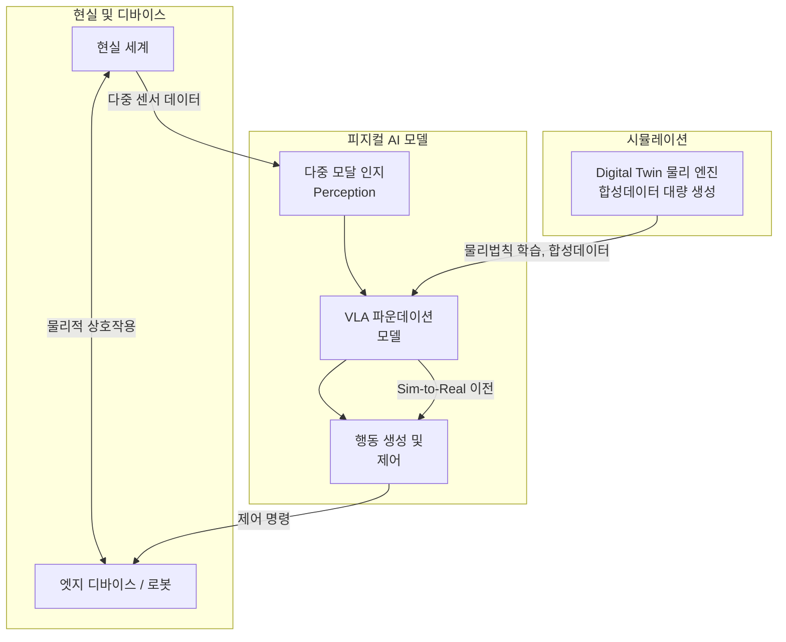

# Physical AI (피지컬 AI)

---

## I. 현실 세계와 상호작용하는 지능형 시스템, 피지컬 AI 개요

### 가. 피지컬 AI의 정의
로봇·[[드론]]·자율주행차 등 물리적 실체(Body)를 가진 기기에 AI를 결합하여, 현실의 물리법칙을 이해하고 스스로 **인지·추론·행동**하며 물리적 작업을 수행하는 [[인공지능]] 시스템이다.

### 나. 피지컬 AI의 특징 및 배경
| 구분 | 세부 특징 |
| :--- | :--- |
| 체화된 지능(Embodied AI) | 화면 속 텍스트·이미지 생성을 넘어 물리적 신체와 액추에이터를 통해 환경과 직접 상호작용하며 학습 |
| VLA 및 Sim-to-Real | 시각-언어-행동(Vision-Language-Action) 모델을 기반으로 디지털 트윈 시뮬레이터에서 훈련 후 현실로 전이 |
| 산업 현장 자동화 확장 | 제조·물류 노동력 부족 대응 및 Gartner 2026 전략 기술 선정 등 물리적 작업 자동화의 핵심 동력 부상 |

---

## II. 피지컬 AI의 아키텍처 및 핵심 기술요소

### 가. 피지컬 AI의 동작원리 및 아키텍처

- 다중 센서로 환경을 인지하고(인지), VLA 모델로 상황을 추론·계획하며(판단), 액추에이터로 행동을 수행(제어)

### 나. 피지컬 AI의 핵심 기술요소

| 구분 | 기술 | 특징 |
| :--- | :--- | :--- |
| **환경 인지** | 멀티모달 센서 퓨전 | 카메라·LiDAR·레이더 데이터를 결합해 3D 환경 정밀 인식 |
| **환경 인지** | 공간 지능 / SLAM | 3D 공간 이해, 위치 추정과 지도 작성 |
| **의사결정** | VLA [[파운데이션 모델]] | 시각·언어·행동을 통합해 자연어 명령을 행동으로 변환 |
| **의사결정** | 엣지 AI | [[NPU]] 기반 [[온디바이스 AI\|온디바이스]] 추론으로 실시간 판단 |
| **가상 학습** | 물리 기반 시뮬레이터 | [[디지털 트윈]]에서 물리법칙을 반영한 가상 훈련 |
| **가상 학습** | 심층 [[강화학습]] | 시뮬레이션의 대량 시행착오로 최적 행동 정책 학습 |
| **가상 학습** | [[합성 데이터]] / Sim-to-Real | 시뮬레이터 데이터로 학습 후 현실 격차(Reality Gap) 보정 |
| **물리 제어** | 전신 제어 [[알고리즘]] | 역동역학 연산으로 관절·모터를 동시 제어 |
| **물리 제어** | 햅틱 피드백 | 접촉 힘·질감을 반영해 악력 등을 미세 조절 |

---

## III. 피지컬 AI와 기존 생성형 AI 비교

### 가. 기존 생성형 AI와의 비교

| 항목 | 기존 생성형 AI | 피지컬 AI |
| :--- | :--- | :--- |
| **목적** | 정보 생성, 답변 제공 | 현실 세계와 상호작용, 물리 작업 수행 |
| **입출력** | 텍스트, 이미지 | 센서 데이터·프롬프트 → 행동 제어 |
| **주도 모델** | [[초거대 언어 모델\|LLM]] | VLA, RFM(Robot Foundation Model) |
| **학습 데이터** | 인터넷 크롤링 데이터 | 시뮬레이션·합성 데이터, 로봇 시연 데이터 |
| **오류 영향** | 잘못된 정보 | 물리적 사고·인명 피해 |

### 나. 향후 전망 및 고려사항

* **범용 휴머노이드 상용화 가속**: 제조 공장 및 물류 센터 현장에 2족/4족 보행 로봇이 투입되어 자연어 작업 지시를 자율 수행
* **기능 안전과 고신뢰 AI 인증 결합**: 오작동 시 물리적 상해 및 인명 피해로 직결되므로 ISO 26262, ISO/IEC TS 42119-2 기반 안전 검증 필수화
* **사이버 물리 시스템(CPS) 인프라 연계**: 스마트 팩토리, 자율주행 관제망, 스마트 시티와의 실시간 데이터 동기화를 통해 지능형 물리 자동화 생태계 완성

---

### 🔗 연관 토픽

- **소속 도메인**: [[00_인공지능_MOC|🤖 인공지능]]
- **세부 분류**: `6. 설명가능한 AI (XAI) & AI 윤리 · 거버넌스`
- **핵심 연관 토픽**:
  - [[인공지능]]
  - [[디지털 트윈|디지털 트윈 (Digital Twin)]]
  - [[CPS]]
  - [[강화학습]]
  - [[파운데이션 모델]]
